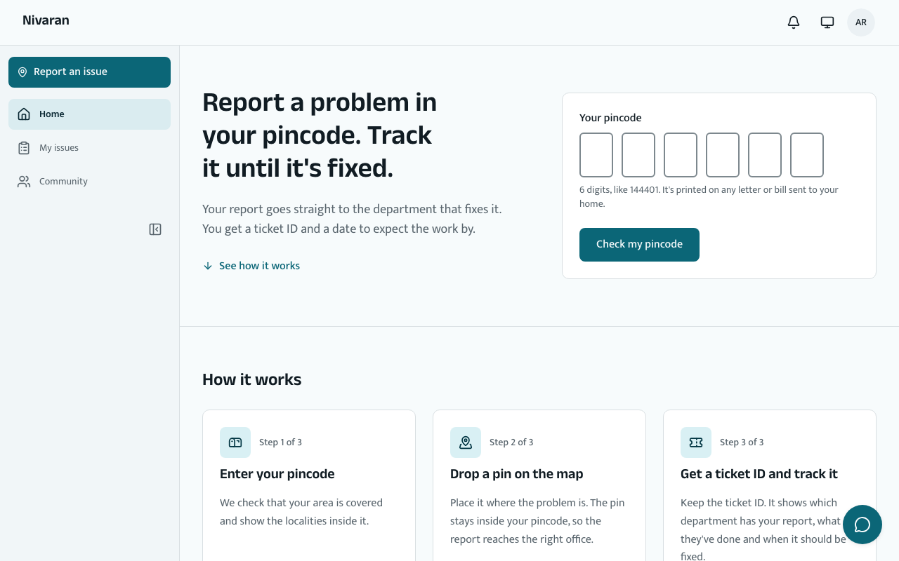
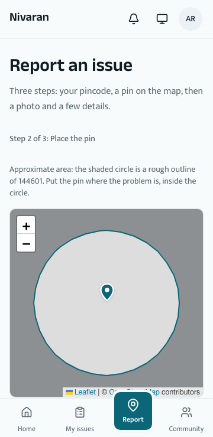
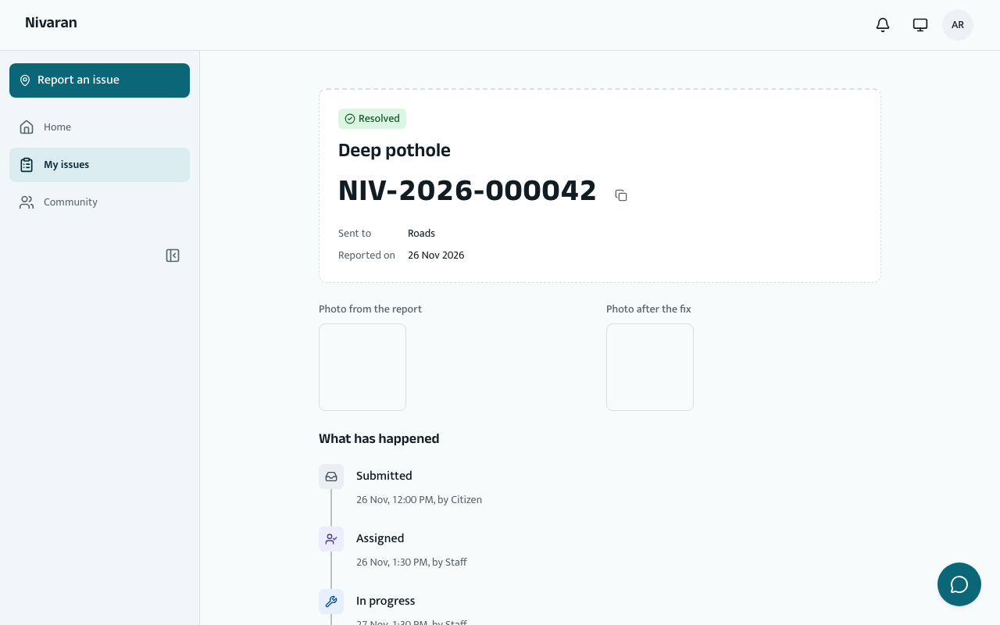
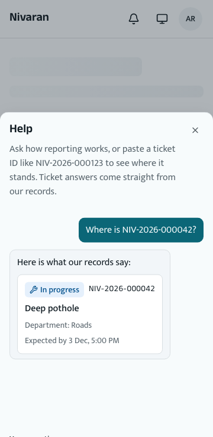
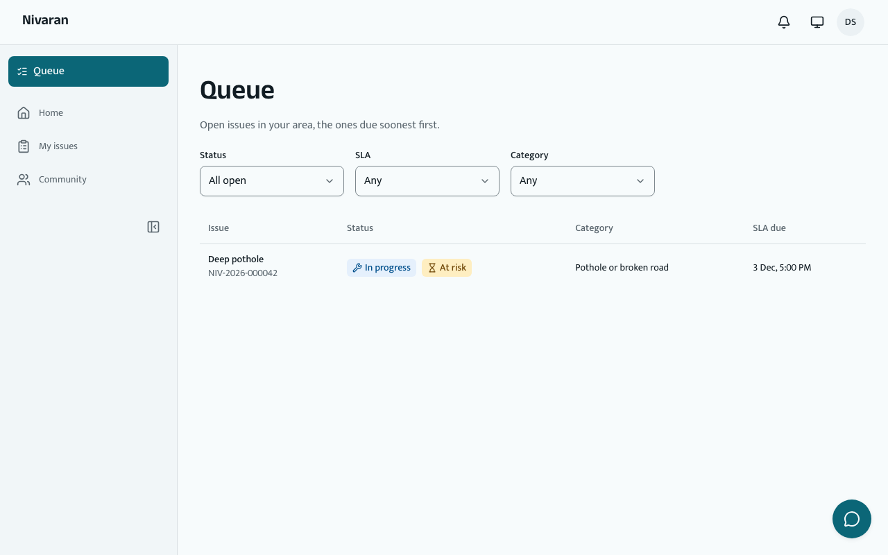
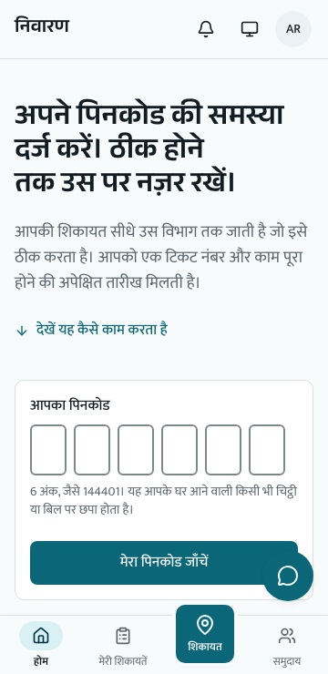
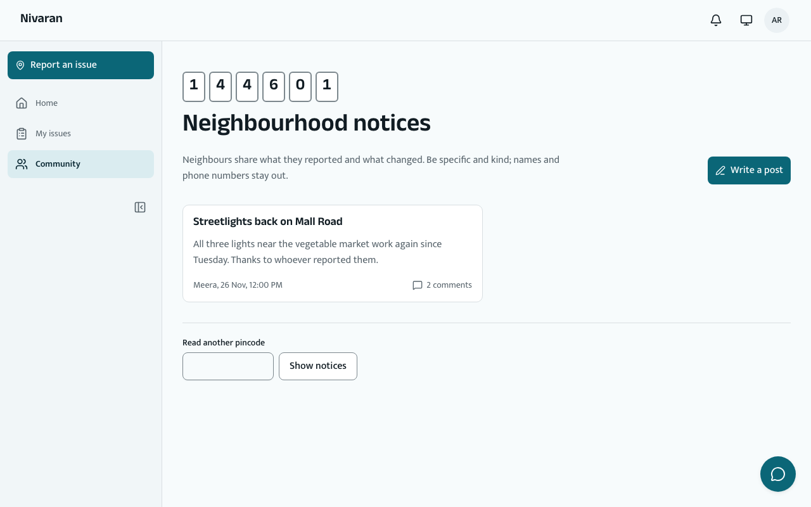
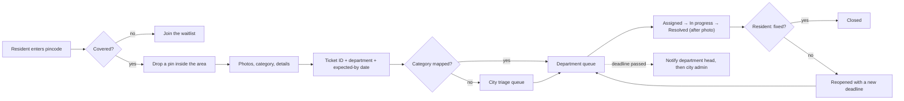
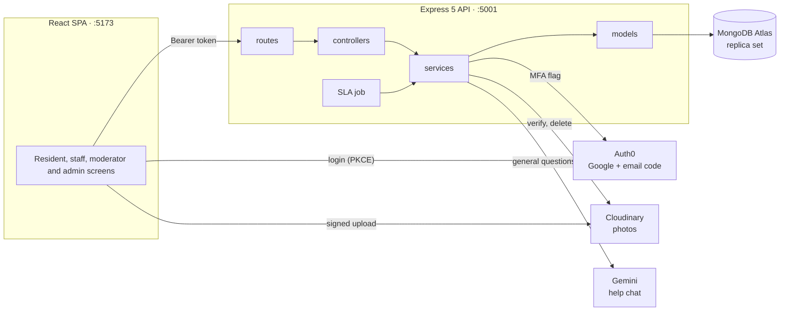

<div align="center">

# निवारण · Nivaran

**Report a civic problem in your pincode. Track it until it's fixed.**

A full-stack civic issue platform for Indian cities: residents drop a pin, get a ticket ID and an
expected-by date, and watch the right department work through it.

[](https://github.com/sachinsharmaa07/NVN/actions/workflows/ci.yml)




</div>

---

## Contents

- [What it does](#what-it-does)
- [Screenshots](#screenshots)
- [How a report flows](#how-a-report-flows)
- [Architecture](#architecture)
- [Tech stack](#tech-stack)
- [Quick start](#quick-start)
- [Configuration](#configuration)
- [Scripts](#scripts)
- [Testing](#testing)
- [Run with Docker](#run-with-docker)
- [API reference](#api-reference)
- [Security and privacy](#security-and-privacy)
- [Project structure](#project-structure)
- [Status and roadmap](#status-and-roadmap)
- [Troubleshooting](#troubleshooting)
- [Credits](#credits)

## What it does

| For | They can |
| --- | --- |
| **Residents** | Enter a 6-digit pincode, drop a pin inside its area, add up to 3 photos and get a ticket `NIV-YYYY-NNNNNN` with the department and an expected-by date. Follow every step on a timeline, confirm the fix or reopen it, and get notified in the app and by email (English or Hindi). |
| **Neighbours** | Read and post notices in their pincode's community feed, comment in threads, report abusive posts. |
| **Everyone signed in** | Ask the help chat. Ticket questions are answered straight from the database; general questions go to Gemini. |
| **Staff and department heads** | Work an SLA-sorted queue: assign, start, resolve with an "after" photo, put on hold (pauses the clock), assign triage issues. |
| **Moderators** | Review posts and comments hidden by three reports; restore them or delete with a reason. |
| **City admins** | Choose which department handles each category and how many hours it may take; manage users and roles in their city. |
| **The public** | Live totals on the home page: reports, fixed, open, typical time to fix. |

Works in **English and Hindi** (the choice follows the user's profile), in light and dark themes, from a
360 px phone up.

## Screenshots

<table>
  <tr>
    <td width="34%"></td>
    <td></td>
  </tr>
  <tr>
    <td align="center"><sub>Report: pin inside the pincode</sub></td>
    <td align="center"><sub>Ticket and its timeline</sub></td>
  </tr>
  <tr>
    <td></td>
    <td></td>
  </tr>
  <tr>
    <td align="center"><sub>Help chat</sub></td>
    <td align="center"><sub>Staff queue, soonest due first</sub></td>
  </tr>
  <tr>
    <td></td>
    <td></td>
  </tr>
  <tr>
    <td align="center"><sub>हिन्दी</sub></td>
    <td align="center"><sub>Pincode community</sub></td>
  </tr>
</table>

<sub>Screenshots come from the end-to-end test suite, which runs against a fake backend: the names and tickets are made up.</sub>

## How a report flows



Each kind of problem has a respond-by and a fix-by time (national default, overridable per city). A background
job tells the department head when a new ticket isn't assigned by its respond-by time, marks tickets **at risk**
at 75% of the fix-by time and **overdue** after it, escalates to the city admin 24 hours later, and auto-closes
resolved tickets after 7 days.

| Category | Respond within | Fix within (default) |
| --- | --- | --- |
| Pothole or broken road | 24 h | 168 h |
| Garbage | 12 h | 48 h |
| Streetlight | 24 h | 72 h |
| Water leak | 12 h | 48 h |
| Drain or sewer | 24 h | 72 h |
| Something else (always triage) | 48 h | 168 h |

## Architecture



- **Layered server.** route → controller → service → model. Controllers never touch Mongoose; ESLint
  enforces it. Every route validates `body`, `params` and `query` with strict Zod schemas.
- **Access on every request.** `authenticate` (RS256 JWT) → `loadUser` (MongoDB) → `requireActive` →
  `requireVerifiedEmail` → `requirePermission(...)`, then the city or department scope is applied inside the
  service's query. Role, scope and status come from the database, never from the token.
- **Out of scope looks like missing.** Someone else's ticket or another city's record is a `404` with the same
  body as a real miss, so IDs can't be probed.
- **Audited changes.** Role and status changes, issue moves, moderation and city settings each write an
  AuditLog row in the same transaction as the change.
- **One error shape.** `{ "error": { "code": "UPPER_SNAKE", "message": "..." } }`; stack traces never leave the server.
- **Lists are cursor-paginated** (max 50) on compound indexes.

## Tech stack

| Layer | Choices |
| --- | --- |
| Client | React, Vite, React Router, TanStack Query, Tailwind CSS v4, shadcn/ui (Radix), Leaflet, motion, react-hook-form + Zod |
| Server | Node 22, Express 5 (ES modules), Mongoose, Zod 4, pino, helmet, express-rate-limit |
| Data | MongoDB Atlas (replica set for transactions), 2dsphere geo queries |
| Identity | Auth0: Google and passwordless email code, PKCE, refresh-token rotation, MFA for admins |
| Services | Cloudinary (signed uploads, EXIF stripped), Gemini via `@google/genai`, email over SMTP (Gmail) via `nodemailer` |
| Quality | ESLint 9, Prettier, Vitest + Supertest, Testing Library, Playwright, GitHub Actions |
| Ops | Docker images (API + nginx web), Compose with optional local MongoDB |

## Quick start

**You need:** Node 22 (`nvm use`), a MongoDB Atlas database, an Auth0 tenant, and the GeoNames pincode file.

```bash
git clone https://github.com/sachinsharmaa07/NVN.git && cd NVN
npm ci                                   # installs both workspaces
cp server/.env.example server/.env       # then fill in (see Configuration)
cp client/.env.example client/.env
```

Load the pincode data once. Download `IN.zip` from [GeoNames](https://download.geonames.org/export/zip/),
unzip it and save `IN.txt` as `data/pincodes.tsv` (about 12 MB, git-ignored). Then:

```bash
npm run setup:data -w server   # indexes, ~19k pincodes, default departments, SLA defaults; safe to rerun
npm run dev                    # API on :5001, app on :5173
```

- App: <http://localhost:5173> · API health: <http://localhost:5001/api/health> (expect `"db": "up"`)
- Sign in once, then make yourself the first admin: set `SUPER_ADMIN_EMAIL` in `server/.env` and run
  `npm run bootstrap:super-admin -w server`.

> [!NOTE]
> Without Auth0 settings the app still runs: the public pages work and protected pages say sign-in isn't set up.
> Photos need the `CLOUDINARY_*` keys; real chat answers need `GEMINI_API_KEY` (ticket answers work without it).

## Configuration

Both apps read a `.env` file (git-ignored; only the `.env.example` templates are committed). The server checks
every value with Zod at start-up and exits with a list of what's wrong.

<details>
<summary><b>Server: <code>server/.env</code></b></summary>

| Variable | Example | Secret | Purpose |
| --- | --- | --- | --- |
| `NODE_ENV` | `development` | | `development`, `test` or `production` |
| `PORT` | `5001` | | API port (macOS AirPlay holds 5000) |
| `MONGODB_URI` | `mongodb+srv://…/nivaran_dev` | **yes** | Database (must be a replica set; Atlas is) |
| `MONGODB_URI_TEST` | `…/nivaran_test` | **yes** | Optional test database; its name must end in `_test` |
| `CLIENT_URL` | `http://localhost:5173` | | The only origin CORS allows |
| `LOG_LEVEL` | `info` | | pino level |
| `TRUST_PROXY` | `0` | | Proxies in front of the API; 1 or more in production |
| `AUTH0_DOMAIN` | `nivaran-dev.us.auth0.com` | | Tenant host, no `https://` |
| `AUTH0_AUDIENCE` | `https://api.nivaran.in` | | API identifier |
| `AUTH0_M2M_CLIENT_ID` / `_SECRET` | from the M2M app | **yes** | Management API, for the admin MFA flag. Server only |
| `HMAC_SECRET` | `openssl rand -hex 32` | **yes** | Hashes waitlist emails. Set once |
| `CLOUDINARY_CLOUD_NAME` / `_API_KEY` / `_API_SECRET` | | **yes** (key + secret) | Photo uploads |
| `GEMINI_API_KEY` | from Google AI Studio | **yes** | Help chat general answers (optional) |
| `GEMINI_MODEL` | `gemini-2.5-flash` | | Model name |
| `SMTP_HOST` · `SMTP_PORT` | `smtp.gmail.com` · `465` | | Mail server (defaults are Gmail) |
| `SMTP_USER` · `SMTP_PASS` | your Gmail · an App password | **yes** (password) | Without both, emails are only logged, never sent |
| `EMAIL_FROM` | `Nivaran <you@gmail.com>` | | Sender shown to recipients (default: `Nivaran <SMTP_USER>`) |
| `SUPER_ADMIN_EMAIL` | `you@example.com` | | Read only by the bootstrap script |
| `SLA_JOB_INTERVAL_MS` | `300000` | | SLA job tick; `0` turns it off |
| `AUTH_CLOCK_TOLERANCE_SECONDS` | `5` | | Token expiry tolerance |
| `DNS_SERVERS` | `1.1.1.1,8.8.8.8` | | Dev only, for SRV lookups on odd networks |

</details>

<details>
<summary><b>Client: <code>client/.env</code></b> (all public: never put a secret here)</summary>

| Variable | Example | Purpose |
| --- | --- | --- |
| `VITE_API_URL` | `http://localhost:5001` | API base URL |
| `VITE_AUTH0_DOMAIN` | `nivaran-dev.us.auth0.com` | Same tenant as the server |
| `VITE_AUTH0_CLIENT_ID` | from the SPA app | Auth0 application |
| `VITE_AUTH0_AUDIENCE` | `https://api.nivaran.in` | Must equal the server's |
| `VITE_SUPPORT_CONTACT` | `your city admin` | Who suspended users should contact |

</details>

<details>
<summary><b>Auth0 setup</b> (about 20 minutes)</summary>

1. **Tenant.** Create a tenant (e.g. `nivaran-dev`).
2. **Web app.** Applications → Create → *Single Page Application*. Allowed Callback, Logout and Web Origins:
   `http://localhost:5173` (add `http://localhost:8080` for Docker). Turn on **Refresh Token Rotation**.
3. **API.** APIs → Create, identifier `https://api.nivaran.in`, RS256. Under *Application Access*, give the web
   app user-delegated access.
4. **Sign-in methods.** Turn on Google (`google-oauth2`) and Passwordless *Email* (6-digit code) for the web
   app. Do **not** add automatic account linking; the server links only verified emails. Turn on Attack
   Protection.
5. **Claims Action.** Actions → Library → *Build from scratch*, trigger *Login / Post Login*, name
   `Add Nivaran claims`, deploy, and add it to the post-login flow:

   ```js
   exports.onExecutePostLogin = async (event, api) => {
     const ns = "https://nivaran.in/"; // must match CLAIM_NAMESPACE in server/src/services/userService.js
     const mfaDone = (event.authentication?.methods ?? []).some((m) => m.name === "mfa");
     const isRefresh = event.transaction?.protocol === "oauth2-refresh-token";
     if (event.user.app_metadata?.mfa_required === true && !mfaDone && !isRefresh) {
       api.multifactor.enable("any", { allowRememberBrowser: false });
     }
     api.accessToken.setCustomClaim(`${ns}email`, event.user.email);
     api.accessToken.setCustomClaim(`${ns}name`, event.user.name);
     api.accessToken.setCustomClaim(`${ns}picture`, event.user.picture);
     api.accessToken.setCustomClaim(`${ns}email_verified`, event.user.email_verified === true);
     api.accessToken.setCustomClaim(`${ns}mfa`, mfaDone);
   };
   ```

6. **Machine-to-Machine app** for the Management API with only `update:users_app_metadata` (and
   `update:users`). Its ID and secret go in `server/.env`.
7. Fill in both `.env` files, restart, sign in, then run the bootstrap script.

</details>

## Scripts

Run from the repository root. Add `-w server` or `-w client` to target one workspace.

| Command | What it does |
| --- | --- |
| `npm run dev` | API and app together with live reload |
| `npm run check` | Lint, format check, all tests, production build: exactly what CI runs |
| `npm test` · `npm run test:e2e` | Unit and API tests · Playwright end-to-end tests |
| `npm run lint` · `npm run format` | ESLint · Prettier |
| `npm run build` | Production build of the client |
| `npm run docker:up` · `docker:smoke` | Run both images · start, health-check and stop them |

<details>
<summary><b>Server data and admin scripts</b> (dry run unless noted; add <code>-- --apply</code> to write)</summary>

| Command | What it does |
| --- | --- |
| `setup:data` | Everything a fresh database needs, applied: M1 + M2 + M3 indexes, pincode import, departments, SLA defaults |
| `import:pincodes` | Loads `data/pincodes.tsv`; one city per (state, district), e.g. `PB-KAPURTHALA` |
| `import:boundaries` | Optional exact pincode polygons from GeoJSON (`data/boundaries/*.geojson`) |
| `seed:departments` | Roads, Sanitation, Electrical, Water, Drainage per city, plus the category map |
| `seed:sla` | National respond and fix hours per category |
| `migrate:m1-indexes` · `migrate:m2-indexes` · `migrate:m3-indexes` | Build indexes (production never builds them at start-up). M3 refuses `--apply` while duplicate flags exist |
| `bootstrap:super-admin` | Makes `SUPER_ADMIN_EMAIL` the first super admin (applies directly, safe to rerun) |
| `sync:mfa-flags` | Re-syncs Auth0 MFA flags from the database (applies directly, safe to rerun) |
| `migrate:users-v1` · `migrate:users-v2` · `migrate:users-v3` | Historical user migrations (v1 applies directly; v2 and v3 need `--apply`). v3 removes the old `auth0Id` field once it is copied. Idempotent |

</details>

## Testing

```bash
npm test                                         # server (Vitest + Supertest) and client (Testing Library)
(cd client && npx playwright install chromium)   # once
npm run test:e2e                                 # phone (360 px) and laptop (1280 px)
```

- **About 1,600 unit and API tests.** Server tests use a real MongoDB replica set: a throwaway one from
  `mongodb-memory-server` by default, or yours via `MONGODB_URI_TEST`. Auth0 is replaced by a local fake key server.
- **43 end-to-end flows** run against the production bundle with a fake backend (`client/e2e/fixtures.js`), so
  they need no accounts or internet. The `VITE_E2E` sign-in shortcut refuses to build outside e2e mode.
- **A route-inventory test** walks every route and fails if one lacks the guard chain.
- **CI** (`.github/workflows/ci.yml`) runs `check`, the e2e suite and a Docker build-and-smoke job on every
  push and pull request.

## Run with Docker

```bash
npm run docker:up     # build and start: app on http://localhost:8080 (nginx proxies /api/)
npm run docker:smoke  # start, check / and /api/health, stop
npm run docker:down
```

The API runs with `NODE_ENV=production`, so `server/.env` needs the production settings (Auth0, M2M,
`HMAC_SECRET`, Cloudinary). For an offline database, set
`MONGODB_URI=mongodb://mongo:27017/nivaran?replicaSet=rs0` and start with `COMPOSE_PROFILES=local-db`.

## API reference

All routes are under `/api`. Signed-in routes need `Authorization: Bearer <token>`.

| Method and path | Who | Purpose |
| --- | --- | --- |
| `GET /health` · `GET /stats` | public | Status and DB state · public totals, verified fixes, SLA-met rate (cached 5 min) |
| `GET /pincodes/:pin` · `POST /pincodes/:pin/check-point` | public | Is a pincode covered (its city must be active) · is a point inside it |
| `POST /waitlist` | public | Join the waitlist for an uncovered pincode |
| `GET /me` · `PATCH /me` | signed in | Profile (created on first sign-in) · name, language, home pincode |
| `POST /uploads/sign` · `POST /uploads/discard` | verified | Signed Cloudinary upload · delete an abandoned draft's photos |
| `POST /issues` | verified | Submit a report (`Idempotency-Key` header) |
| `GET /issues/mine` · `GET /issues/:ticketId` | reporter | My tickets · one ticket with its timeline |
| `POST /issues/:ticketId/confirm` · `/reopen` | reporter | Confirm the fix · reopen with a note |
| `GET /staff/issues` | staff and above | SLA-sorted queue in scope |
| `PATCH /issues/:ticketId/status` · `/assign` | staff, dept head, city admin | Move through the state machine · assign triage |
| `POST /issues/:ticketId/hold` · `/resume` | dept head | Pause or resume the SLA clock |
| `GET /notifications` · `POST /notifications/read` | signed in | In-app notifications |
| `GET /community/posts?pincode` · `POST /community/posts` | signed in · verified | Pincode feed · new post |
| `GET`/`DELETE /community/posts/:id` · `…/comments` | signed in · author | Post, comments, delete your own |
| `POST /community/flags` | verified | Report a post or comment (3 reports hide it) |
| `GET /moderation/queue` · `POST /moderation/:type/:id` | moderator, city admin | Review queue · hide, restore, delete |
| `POST /chat` | signed in | Help chat |
| `GET /admin/users` · `PATCH /admin/users/:id/role` · `/status` | city admin and above | Users, roles, suspension |
| `GET /admin/city-settings` · `PUT /admin/city-settings/:category` | city admin | Department and SLA hours per category |
| `GET /admin/audit` | city admin (own city), super admin | Audit log: who changed what, cursor pages |
| `GET /admin/cities` · `POST /admin/cities` · `PATCH /admin/cities/:id` | super admin | List with status · add a city (with its departments) · rename, open or pause it |
| `POST /admin/departments` · `PATCH /admin/departments/:id` | city admin (own city), super admin | Add a custom department · rename it |
| `GET /admin/waitlist` | super admin | Most-requested uncovered pincodes |
| `GET /cities` · `GET /departments` | admins | Pickers |

## Security and privacy

- Sign-in is Auth0 only (Google or email code). No passwords, no home-grown tokens or OTPs.
- The browser keeps tokens **in memory only**, never in `localStorage`.
- Admins (level 4 and up) must use two-step verification; the server fails closed without it.
- Photos are stripped of EXIF location data and checked on the server (type, size, folder).
- Waitlist emails are stored only as an HMAC hash.
- The help chat never stores messages, removes emails and phone numbers before calling Gemini, and never
  lets the model answer ticket questions.
- Strict Zod validation, `sanitizeFilter`, rate limits per user and IP, helmet headers and no stack traces in responses.

## Project structure

```text
.
├── client/                 React app
│   ├── e2e/                Playwright flows and the fake backend
│   └── src/
│       ├── app/            router, providers, Auth0 wiring
│       ├── components/     ui/ (shadcn), system/, report/, issues/, staff/, community/, chat/, admin/, nav/
│       ├── pages/          Landing, Report, Issues, IssueDetail, Community, Moderation, staff/, admin/
│       ├── hooks/          TanStack Query hooks per feature
│       ├── i18n/           en/ and hi/ dictionaries and t()
│       └── styles/         design tokens
├── server/                 Express API
│   ├── src/
│   │   ├── routes/ → controllers/ → services/ → models/
│   │   ├── middleware/     auth, access, validate, rate limits, errors
│   │   ├── validators/     Zod schemas
│   │   ├── utils/          pure rules: permissions, state machines, geo, cursors
│   │   └── jobs/           SLA timer
│   ├── scripts/            data and admin scripts
│   └── tests/              unit/, api/, helpers/
├── .github/                CI workflow and README screenshots
├── docker-compose.yml      API, web and optional local MongoDB
└── package.json            npm workspaces and root scripts
```

## Status and roadmap

| Milestone | Status |
| --- | --- |
| Sign-in, roles, admin users | ✅ Done |
| Report flow: pincode, map pin, photos, ticket, routing | ✅ Done |
| Tracking, staff queue, SLA job, notifications, public stats | ✅ Done |
| Community and moderation, help chat, city settings, Hindi | ✅ Done |
| Docker images and CI | ✅ Done |
| Email notifications (Gmail SMTP), respond-by tracking, audit log and city onboarding APIs | ✅ Done |
| State officer escalation, closure and SLA-met stats, custom departments, waitlist demand, photo discard | ✅ Done |
| Cloud deployment, monitoring, load and accessibility audits | ⏳ Next |

## Troubleshooting

| Symptom | Fix |
| --- | --- |
| `querySrv ECONNREFUSED` on start | Set `DNS_SERVERS=1.1.1.1,8.8.8.8` in `server/.env` (dev only) |
| "Sign-in isn't set up yet" | The `VITE_AUTH0_*` values belong in `client/.env`; restart Vite |
| "Client … is not authorized to access resource server" | Auth0 → APIs → your API → Application Access → allow the web app |
| Vite starts on 5174 | An old Vite holds 5173: `lsof -nP -iTCP:5173 -sTCP:LISTEN`, then `kill <PID>` |
| Signed out after a page refresh | The browser blocks Auth0's third-party cookie. Sign in again, or use an Auth0 custom domain |
| No users in the database after login | `curl -i http://localhost:5001/api/me` should answer 401; then check the browser's Network tab |

## Credits

Pincode data © [GeoNames](https://www.geonames.org/), CC BY 4.0. Map tiles © [OpenStreetMap](https://www.openstreetmap.org/copyright)
contributors. Fonts: Anek Devanagari and Mukta by Ek Type.
