# Nivaran v2: Architecture

> **Snapshot:** written 25 Nov 2026 against commit `000ff34` (`main`). It describes what the repository contains,
> read from the code, `CLAUDE.md`, `docs/UI.md`, `docs/DESIGN.md`, `docs/phase-1-auth.md`, `docs/AUTH0_SETUP.md`
> and `docs/adr/*`. No secret values appear here; only the *names* of settings.
>
> **How to read the status tags**
>
> | Tag | Meaning |
> | --- | --- |
> | **BUILT** | Exists in the repo and is covered by code (Phase 0 scaffold, visual foundation, Phase 1 auth and admin users). |
> | **PARTIAL** | A shell, placeholder or stub exists, the real feature does not. |
> | **DESIGNED** | Specified in `docs/DESIGN.md` or a phase prompt only. No code yet. Treat as a plan, not a fact. |
>
> Where documents disagree, `CLAUDE.md` says `docs/DESIGN.md` wins, but for auth the *code* is newer than parts of
> DESIGN.md. Section 22 lists every disagreement I found.

---

## Contents

1. [What Nivaran is](#1-what-nivaran-is)
2. [Build status at a glance](#2-build-status-at-a-glance)
3. [Functionality by role](#3-functionality-by-role)
4. [System context and high-level design (HLD)](#4-system-context-and-high-level-design-hld)
5. [Technology stack and why](#5-technology-stack-and-why)
6. [Authentication: Auth0, Google OAuth 2.0, PKCE, MFA](#6-authentication-auth0-google-oauth-20-pkce-mfa)
7. [Authorization: RBAC, scope, audit](#7-authorization-rbac-scope-audit)
8. [Server low-level design (LLD)](#8-server-low-level-design-lld)
9. [Database architecture](#9-database-architecture)
10. [Data flow diagrams (level 0, 1, 2)](#10-data-flow-diagrams-level-0-1-2)
11. [Sequence diagrams](#11-sequence-diagrams)
12. [State machines](#12-state-machines)
13. [External APIs and services](#13-external-apis-and-services)
14. [Design language](#14-design-language)
15. [Frontend architecture](#15-frontend-architecture)
16. [Motion and animation](#16-motion-and-animation)
17. [Card and component design](#17-card-and-component-design)
18. [User flows](#18-user-flows)
19. [Security, errors, logging, testing](#19-security-errors-logging-testing)
20. [Deployment and operations](#20-deployment-and-operations)
21. [MCP servers, agents and skills for future work](#21-mcp-servers-agents-and-skills-for-future-work)
22. [Known inconsistencies and open questions](#22-known-inconsistencies-and-open-questions)
23. [Roadmap](#23-roadmap)
24. [Glossary](#24-glossary)

---

## 1. What Nivaran is

Nivaran v2 is a civic issue reporting platform for Indian cities. A citizen enters a 6-digit pincode, drops a pin
inside that pincode's boundary, adds a photo and details, and receives a ticket ID (`NIV-YYYY-NNNNNN`). City staff
work an SLA-driven queue. An AI help chatbot answers questions, and a moderated community feed lets residents discuss
local issues.

It is built by one student with Claude Code, on free tiers, for users on mid-range phones and slow 4G. Those two
facts drive most decisions: few dependencies (ADR 0001), small files, mobile-first UI, lazy-loaded pages, and a
single API instance.

Design principle for the whole product (from `docs/UI.md`): **"a public counter that works"**: calm, plainly
official, like the best version of an India Post counter. Boldness is spent in exactly two places, the pincode boxes
and the ticket "counterfoil".

---

## 2. Build status at a glance

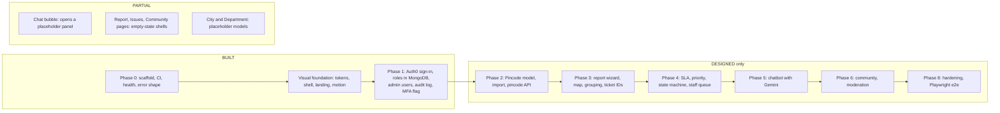

| Area | Status | Evidence in the repo |
| --- | --- | --- |
| npm workspaces, ESLint, Prettier, Vitest, CI | **BUILT** | root `package.json`, `.github/workflows/ci.yml` |
| `GET /api/health` | **BUILT** | `routes/healthRoutes.js`, `services/healthService.js` |
| Auth0 token check (RS256), user loading, 7 roles, scope rules | **BUILT** | `middleware/auth.js`, `middleware/access.js`, `utils/permissions.js` |
| `GET/PATCH /api/me` | **BUILT** | `routes/meRoutes.js`, `services/userService.js` |
| Admin users: list, role change, suspend and reactivate | **BUILT** | `routes/adminUserRoutes.js`, `services/adminUser*.js` |
| `AuditLog` (append-only) | **BUILT** | `models/AuditLog.js`, `services/auditService.js` |
| Auth0 Management API client and MFA flag sync | **BUILT** | `services/auth0ManagementClient.js`, `mfaFlagService.js` |
| Identity linking (Google and email code to one account) | **BUILT** | `services/identityLinkService.js` |
| One-off scripts: bootstrap super admin, sync MFA flags, migrate users v1 and v2 | **BUILT** | `server/scripts/` |
| Design tokens (light and dark), shell, landing page, profile, admin users, suspended, forbidden pages | **BUILT** | `client/src/styles/globals.css`, `layouts/`, `pages/` |
| `City`, `Department` models | **PARTIAL** | Marked "Placeholder: Phase 2 owns the full model" in their files. Used for scope checks and the admin pickers. |
| Chat bubble | **PARTIAL** | `components/chat/ChatBubble.jsx` opens a "coming soon" sheet. No API. |
| `/report`, `/issues`, `/community` | **PARTIAL** | Empty-state shells with the final navigation wiring. |
| Resend or email notifications | **DESIGNED** | Mentioned for escalations; no code. |
| Pincode, Issue, Report, SlaPolicy, Post, Comment, ChatMessage, Counter models | **DESIGNED** | `docs/DESIGN.md` section 3 only. |
| Leaflet map, Turf or in-house point-in-polygon | **DESIGNED** | ADR 0001 (in-house `utils/geo.js` replaces Turf). |
| Cloudinary signed uploads | **DESIGNED** | ADR 0001. |
| Gemini chatbot and blog assist | **DESIGNED** | DESIGN.md sections 5 and 6. |
| SLA job, escalation, priority score | **DESIGNED** | DESIGN.md section 7B. |

---

## 3. Functionality by role

Roles are ordered. A higher level inherits nothing automatically: each permission lists exactly which roles hold it
(`server/src/utils/permissions.js`). Level 0 means "not signed in".

| Level | Role | Scope | Built today | Designed for later |
| --- | --- | --- | --- | --- |
| 0 | Public | none | Landing page, health check | Public stats, published posts |
| 1 | `citizen` | own data | Sign in, view and edit own profile (name, language, default pincode) | Report issues, track tickets, confirm or reopen, post and comment, chat |
| 2 | `moderator` | one city | Role exists in the matrix and models | Hide, restore, delete posts with a reason |
| 3 | `staff` | one department | Role exists | Work the queue, update status, resolve with an after-photo |
| 4 | `dept_head` | one department, **MFA** | Role exists | Assign and reassign, approve pauses, level-1 escalations |
| 5 | `city_admin` | one city, **MFA** | Admin > Users for own city: list, change role below own level, suspend, reactivate | Departments, SLA policies, city reports, level-2 escalations |
| 6 | `state_officer` | one state, read-only, **MFA** | Read-only user list for the state | Oversight dashboards, level-3 escalations |
| 7 | `super_admin` | platform, **MFA** | Everything in Admin > Users, all cities | Onboard cities and pincodes, invite city admins |

### 3.1 Permission matrix (BUILT, as data)

`PERMISSIONS` in `utils/permissions.js`. "Verified" = a verified email is required. "MFA" = the permission is
MFA-flagged, which is enforced only for roles at level 4 and above.

| Permission | Roles | Reach | Verified | MFA |
| --- | --- | --- | --- | --- |
| `public:read` | all | none | no | no |
| `profile:read_own`, `profile:update_own` | all | own | no | no |
| `issue:create` | citizen, moderator, staff, dept_head, city_admin | own | yes | no |
| `issue:read_own` | same as above | own | no | no |
| `issue:read_scope` | staff, dept_head, city_admin, state_officer, super_admin | scope | yes | yes |
| `issue:assign` | dept_head, city_admin | scope | yes | yes |
| `issue:update_status` | staff, dept_head, city_admin | scope | yes | yes |
| `post:create` | citizen, moderator, staff, dept_head, city_admin | own | yes | no |
| `post:moderate` | moderator, city_admin, super_admin | scope | yes | yes |
| `user:read_scope` | city_admin, state_officer, super_admin | scope | yes | yes |
| `user:promote` | city_admin, super_admin | scope | yes | yes |
| `user:suspend` | city_admin, super_admin | scope | yes | yes |
| `city:onboard` | super_admin | platform | yes | yes |
| `audit:read` | city_admin, super_admin | scope | yes | yes |

Only the `profile:*`, `user:*` permissions have routes today. The `issue:*`, `post:*`, `city:onboard` and
`audit:read` entries are **DESIGNED**: the rule exists, the endpoint does not.

### 3.2 Scope rules (BUILT)

Which scope fields a user row must (`R`) or must not (`F`) carry. One table drives Zod, the services and the Mongoose
hook, so the three cannot drift.

| Role | `cityId` | `departmentId` | `stateCode` |
| --- | --- | --- | --- |
| citizen | F | F | F |
| moderator | R | F | F |
| staff | R | R | F |
| dept_head | R | R | F |
| city_admin | R | F | F |
| state_officer | F | F | R |
| super_admin | F | F | F |

---

## 4. System context and high-level design (HLD)

### 4.1 System context (who talks to what)

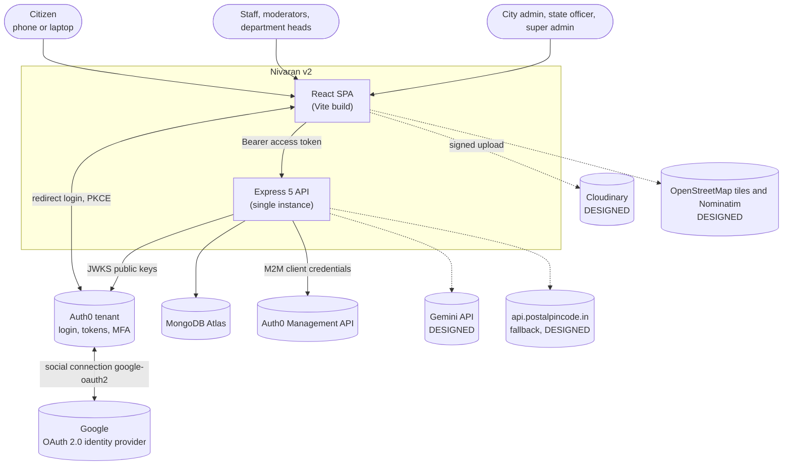

Dotted lines are **DESIGNED**, solid lines are **BUILT**.

### 4.2 Container view

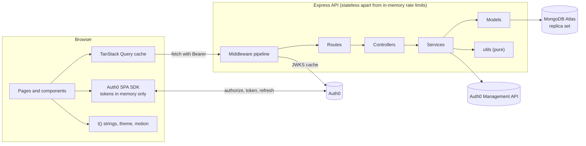

### 4.3 Key architectural decisions

| Decision | Choice | Why | Source |
| --- | --- | --- | --- |
| Language | JavaScript (ESM) everywhere, no TypeScript | Smaller learning load. Zod schemas plus JSDoc carry contracts. | ADR 0001 |
| Repo shape | Two apps in npm workspaces, one lockfile | One install, one `npm run dev`. | ADR 0001 (Phase 0 brief) |
| Server layering | route, controller, service, model. Controllers never touch Mongoose. | Rules testable without HTTP. Scope checks live in services so jobs and the chatbot reuse them. | ADR 0002 |
| Identity provider | Auth0 only. No passwords, no JWT signing, no OTP of our own. | "JWT verification is the wrong place to be clever." | CLAUDE.md |
| Source of truth for role, scope, status | **MongoDB**, loaded on **every request** | Suspension and demotion work on the very next call. A stolen token cannot carry a role. | Phase 1 doc |
| Tokens in the browser | Memory only, refresh-token rotation | Nothing for XSS to read from storage. | CLAUDE.md |
| Database | MongoDB Atlas, replica set, Mongoose 9 | Transactions (role change plus audit row) with no setup. | ADR 0001 |
| Scaling stance | One API instance for now | In-memory rate limit and (later) in-process SLA timer are only correct with one instance. Upgrade path is written down. | ADR 0001 |
| Real time | Not used. TanStack Query refetching instead. | Socket.IO deferred, needs a multi-instance adapter. | ADR 0001 |
| Out of scope sign-ins | Out-of-scope or missing id returns **404**, never 403 | Existence of other cities' users must not leak. | CLAUDE.md |

---

## 5. Technology stack and why

### 5.1 Server (`server/package.json`)

| Package | Role |
| --- | --- |
| `express` 5 | HTTP. v5 forwards rejected async handlers to the error handler, so there is no `asyncHandler` wrapper. |
| `mongoose` 9 | Schemas, indexes, transactions. `strictQuery` and `sanitizeFilter` are switched on globally. |
| `zod` 4 | Request validation (`.strict()` on body, params, query) and `.env` validation. |
| `express-oauth2-jwt-bearer` | Verifies Auth0 access tokens (RS256, issuer, audience, clock tolerance). |
| `helmet`, `cors`, `express-rate-limit` | Headers, origin allow-list, rate limiting. |
| `pino`, `pino-http` | JSON logs with a request id on every line. |
| `dotenv` | Loads `server/.env`; every value is validated in `config/env.js`. |
| dev: `vitest`, `supertest`, `mongodb-memory-server` | Unit tests, HTTP tests, throwaway replica set. |

### 5.2 Client (`client/package.json`)

| Package | Role |
| --- | --- |
| `react` 19, `react-dom` | UI. |
| `react-router` 8 (data mode, `createBrowserRouter`) | Routing. |
| `@tanstack/react-query` 5 | Server state: cache, retry policy, invalidation. |
| `@auth0/auth0-react` | Authorization Code flow with PKCE, silent refresh. |
| `tailwindcss` 4, `tw-animate-css`, `class-variance-authority`, `clsx`, `tailwind-merge` | Styling with tokens. |
| `radix-ui`, `lucide-react`, `sonner` | Primitives (via shadcn/ui), icons, toasts. |
| `react-hook-form`, `@hookform/resolvers`, `zod` | Forms validated with the same Zod style as the server. |
| `motion` | Page transitions, scroll reveals, timeline. Variants in `lib/motion.js`. |
| `@number-flow/react` | Animated KPI numbers (landing stats row; dashboard tiles later). |
| `@fontsource-variable/anek-devanagari`, `@fontsource/mukta` | Self-hosted fonts, Latin plus Devanagari. |
| dev: `vite` 8, `@vitejs/plugin-react`, `@tailwindcss/vite`, `vitest`, `jsdom`, Testing Library | Build and test. |

### 5.3 Planned, not installed yet (ADR 0001)

`leaflet` (map), `@google/genai` (Gemini), `@playwright/test` (e2e), `marked` + `sanitize-html` (only if posts need
formatting), `@base-ui-components/react` (only where Radix lacks a primitive). **In-house instead of packages:**
request id, Cloudinary signature (`node:crypto`), SLA timer (`setInterval().unref()`), point-in-polygon
(`utils/geo.js`), i18n `t()`.

---

## 6. Authentication: Auth0, Google OAuth 2.0, PKCE, MFA

### 6.1 The three parties and their roles

Nivaran never talks to Google directly. Two OAuth 2.0 relationships stack on top of each other:

| Relationship | Client | Authorization server | Grant | Result |
| --- | --- | --- | --- | --- |
| A | Auth0 (as a social-login broker) | Google | Authorization Code | Google tells Auth0 who the person is (`google-oauth2|<id>`, verified email, name, picture). |
| B | **Nivaran Web** (SPA) | Auth0 | **Authorization Code with PKCE** + refresh tokens with rotation | An Auth0-signed RS256 **access token** for audience `AUTH0_AUDIENCE`. |
| C | **Nivaran Server** (M2M app) | Auth0 | Client Credentials | A short-lived Management API token, used only to set `app_metadata.mfa_required`. |

PKCE means no client secret lives in the browser. The server holds only public values (domain, audience) for
verifying tokens, plus the M2M secret for relationship C. In development Auth0's built-in Google keys are fine;
`docs/AUTH0_SETUP.md` says production must use your own Google OAuth client.

### 6.2 Auth0 tenant configuration (from `docs/AUTH0_SETUP.md`)

| Item | Setting |
| --- | --- |
| Application `Nivaran Web` | Single Page Web App. Callback, logout and web-origin URLs set to the site origin (`http://localhost:5173` in dev). Refresh Token Rotation on, 7-day inactivity lifetime. Grant types: Authorization Code, Refresh Token. |
| API `Nivaran API` | Identifier = `AUTH0_AUDIENCE`, RS256, token lifetime 3600 s, Allow Offline Access on. RBAC **off** in Auth0: roles live in MongoDB. |
| Connection `google-oauth2` | Social, enabled for the SPA. |
| Connection `email` | Passwordless, 6-digit **code** (not magic link). The app asks for it by name. The password database connection is disabled. |
| Attack protection | Brute-force and suspicious-IP throttling on. |
| Action `Add Nivaran claims` | Post-login. Adds claims (below), and forces MFA enrolment for flagged users. |
| M2M app `Nivaran Server` | Management API with **only** `update:users` and `update:users_app_metadata`. |

### 6.3 Custom claims in the access token

Namespace `https://nivaran.in/` (`CLAIM_NAMESPACE` in `services/userService.js` must equal the Action's).

| Claim | Meaning | Server rule |
| --- | --- | --- |
| `…/email` | Address | Cleaned, lower-cased, max 254 chars |
| `…/name`, `…/picture` | Display name, avatar | Name never overwrites a user edit. Avatar only if `https://`. |
| `…/email_verified` | Boolean | Only `=== true` counts. The string `"true"`, `1` or a missing claim all fail. |
| `…/mfa` | Boolean: this sign-in used MFA | Only `=== true` counts. |

**Role, scope and status are deliberately NOT in the token.** A promotion or suspension therefore needs no tenant
edit and no new token.

### 6.4 Sign-in sequence (Google, PKCE)

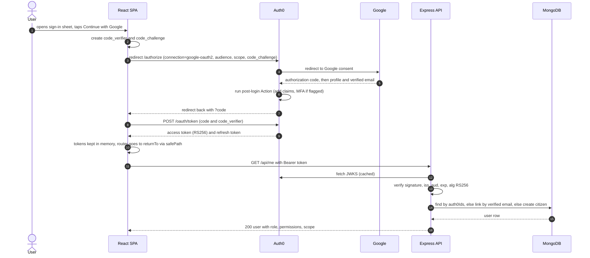

The **email code** path is identical from step 3, except `connection=email` and Auth0 emails a 6-digit code instead
of redirecting to Google. Typing the code proves the address, so those users arrive verified.

### 6.5 Server verification chain (every protected route)

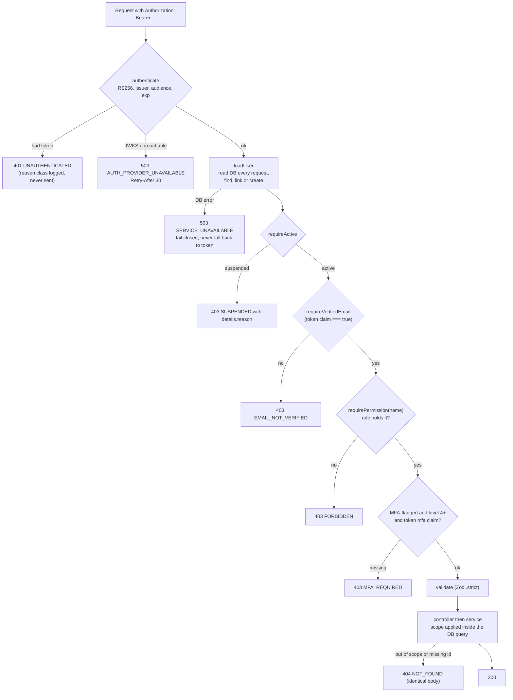

Note `/api/me` skips `requireVerifiedEmail`: an unverified person must still be able to read and fix their own profile.

### 6.6 First sight of a user: find, link or create

`userService.resolveRequestUser` runs on every request. Two unique indexes make racing first requests collide with
E11000, and the loser retries once.

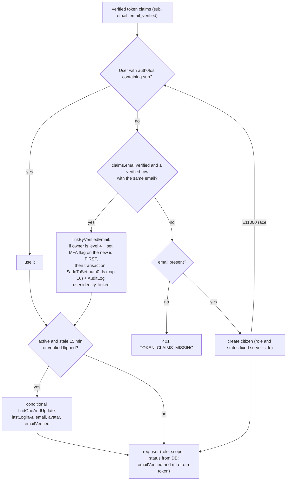

Linking only ever happens for a **verified** email. Linking an unverified address would let anyone who types a
victim's email take over the account.

### 6.7 MFA for administrators

Levels 4 and above (`MFA_MIN_LEVEL`) must sign in with MFA to use an MFA-flagged permission.

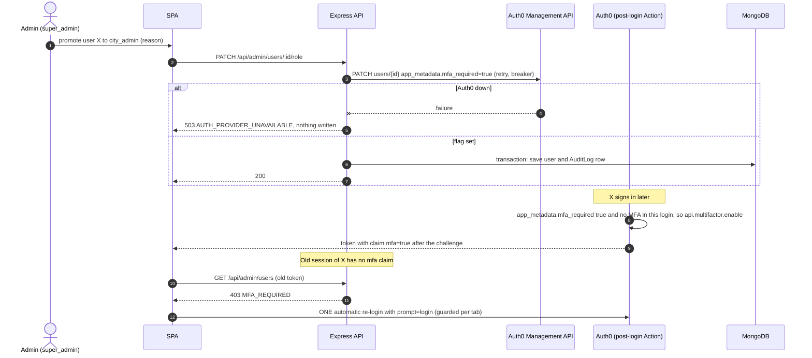

Ordering rule (never reordered): **raise the flag first** on promotion (an admin without MFA is the only dangerous
state; extra MFA is harmless), **clear it after the transaction** on demotion (best effort, one retry, an audit note
`user.mfa_flag_sync_failed` and `npm run sync:mfa-flags` as the repair).

The client avoids an infinite loop here: `lib/mfaGuard.js` stores a timestamp in `sessionStorage` (this tab only,
never a token) and allows one automatic MFA re-login per two minutes. After that the UI shows an error with Sign out.

### 6.8 Token handling in the browser

| Concern | Behaviour | Where |
| --- | --- | --- |
| Storage | `cacheLocation="memory"`. Never `localStorage` for tokens. | `app/AuthProvider.jsx` |
| Refresh | `useRefreshTokens`, plus `useRefreshTokensFallback` (hidden iframe using Auth0's own cookie if no refresh token). Scope `openid profile email offline_access`. | `AuthProvider.jsx` |
| 401 handling | One retry with `cacheMode: "off"` for a brand-new token, then the sign-in sheet opens ("session ended"). | `lib/authedRequest.js`, `hooks/useApi.js` |
| Open-redirect safety | `returnTo` is cleaned by `safePath` so it can only be a path on this site. | `lib/safePath.js` |
| No Auth0 config | If any of the three `VITE_AUTH0_*` values is empty the app runs signed-out, status `unconfigured`, no crash. | `lib/authConfig.js` |

### 6.9 What the client does with each server answer (`useApi`)

| Server answer | Client reaction |
| --- | --- |
| `EMAIL_NOT_VERIFIED` | Toast, mark cached user unverified, open the sign-in sheet ("gated" wording). |
| `SUSPENDED` | Cache the reason, navigate to `/suspended`. |
| `MFA_REQUIRED` | One fresh sign-in with `prompt=login` per tab. |
| `FORBIDDEN` | Invalidate `/api/me` so the guards show the 403 in place (a role changed). |
| 401 (after retry) | Mark session expired, open the sign-in sheet ("expired" wording). |
| `TOKEN_CLAIMS_MISSING` | Not an expired token. Offer Sign out, because a new token would not help. |

---

## 7. Authorization: RBAC, scope, audit

### 7.1 Three layers, one source of truth

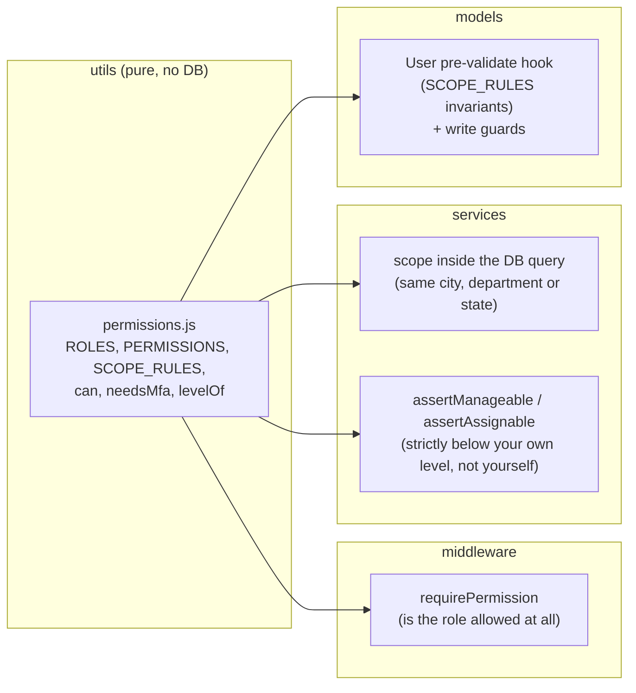

Rules, all enforced server-side:

- **Deny by default.** An unknown permission name throws when the route is *defined*, not when a user hits it.
- Nobody grants, changes or suspends a level **>=** their own, and nobody changes themselves.
- A `city_admin` can change roles of users in their city, plus citizens (who have no city yet, so a new
  city staff member can be promoted). Citizens are findable by a `city_admin` only by typing the **exact full email**.
- The `cityId` for a `city_admin` actor comes from the actor, never trusted from the request body.
- A role change to one that forbids a scope field **clears** that field. One that requires a field must receive it.
- Out of scope and missing are indistinguishable: both return `404 NOT_FOUND`.
- **Optimistic concurrency:** `User` has `optimisticConcurrency: true`. Two admins editing one user: the loser gets
  `409 CONFLICT` (the service also compares `__v` it read with the one inside the transaction).

### 7.2 Model-level write guards

Mongoose update operators, replacements and bulk writes skip whole-document validation, so a stray call could set a
role unchecked. `models/User.js` blocks every such form for the guarded fields (`role`, `status`, scope fields,
suspension fields) unless the caller passes `{ scopeWrite: true }` on purpose. The first-login upsert path may only
`$setOnInsert` a citizen. `insertMany` and `bulkWrite` are checked the same way.

### 7.3 AuditLog

Append-only record of who changed what. Written **only** through `services/auditService.js`, **inside the same
transaction** as the change it records.

| Action | When | Reason required |
| --- | --- | --- |
| `user.role_change` | Admin changes a role | yes |
| `user.suspend`, `user.reactivate` | Admin changes status | yes |
| `user.bootstrap_super_admin` | `npm run bootstrap:super-admin` | script reason |
| `user.identity_linked` | A new sign-in id is linked by verified email (system actor `auth:link`, stores the provider only, never the full `sub`) | no |
| `user.mfa_flag_sync_failed` | Clearing the Auth0 flag failed after a demotion | no |

Safeguards: every field is `immutable`; `updateOne`, `updateMany`, `findOneAndUpdate`, `replaceOne`,
`deleteOne`, `deleteMany`, `bulkWrite` and saving an existing row all throw. Snapshots (`before`, `after`) are
allow-listed per action (no tokens, no email) and capped at 4096 bytes. This stops mistakes in our own code. It
cannot stop a raw driver call or a stolen database credential (the model comment says so).

---

## 8. Server low-level design (LLD)

### 8.1 Middleware order (`app.js`)

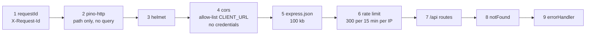

`trust proxy` is set from `TRUST_PROXY` so the limiter sees real client IPs. In production it must be 1 or more.

### 8.2 Layering and file map

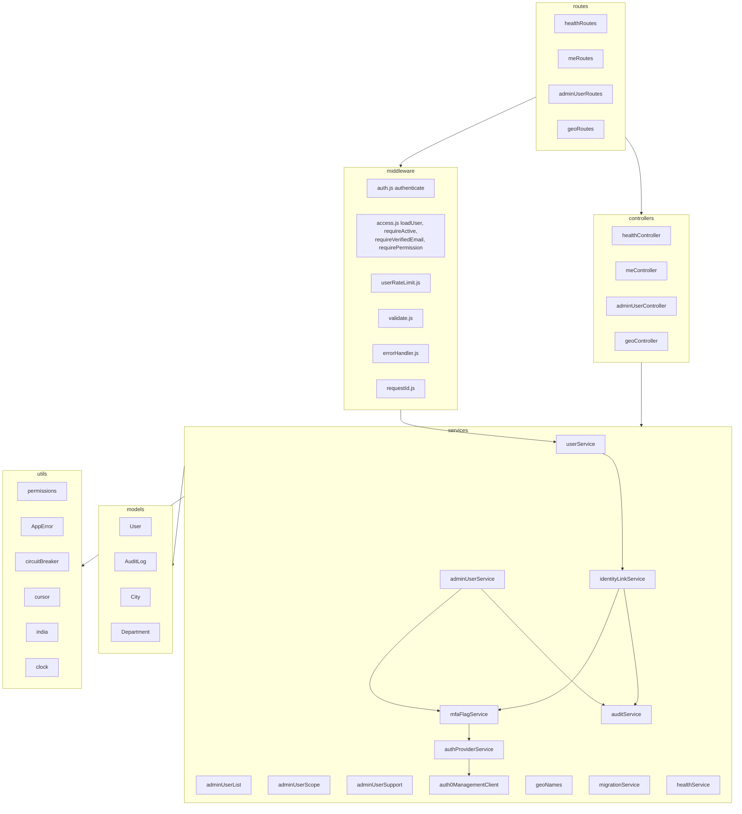

Rules (ADR 0002): `utils/` is pure; controllers import services and utils only; services receive plain values
(`actor`, `input`, `ctx`), never `req` or `res`.

### 8.3 HTTP API (BUILT)

All errors share the shape `{ "error": { "code": "UPPER_SNAKE", "message": "...", "details"?, "requestId"? } }`.

| Method and path | Auth chain | Rate limit | Body, query | Returns |
| --- | --- | --- | --- | --- |
| `GET /api/health` | none | global | `{}` strict | status and DB state |
| `GET /api/me` | authenticate, loadUser, requireActive, `profile:read_own` | global | none | `{ user }` incl. `permissions`, `cityName`, `departmentName` |
| `PATCH /api/me` | same, `profile:update_own` | global | `{ name?, preferredLanguage?, defaultPincode? }` strict, at least one. `null` pincode clears it. | `{ user }` |
| `GET /api/admin/users` | authenticate, loadUser, requireActive, requireVerifiedEmail, `user:read_scope` | 60/min/user | `limit` (1-50, default 20), `cursor`, `q` (3-64), `role`, `status` | `{ items, nextCursor }` |
| `PATCH /api/admin/users/:id/role` | same, `user:promote` | 10/min/user | `{ role, reason (5-500), cityId?, departmentId?, stateCode? }` strict | `{ user }` |
| `PATCH /api/admin/users/:id/status` | same, `user:suspend` | 10/min/user | `{ status, reason }` strict | `{ user }` |
| `GET /api/cities` | same, `user:promote` | 60/min/user | none | `{ items }` (max 500). A city admin sees only their own. |
| `GET /api/departments?cityId=` | same, `user:promote` | 60/min/user | `cityId` | `{ items }`. A city admin may only ask for their own city. |

Admin and personal-data routes send `Cache-Control: no-store`.

### 8.4 Role change algorithm (`adminUserService.changeRole`)

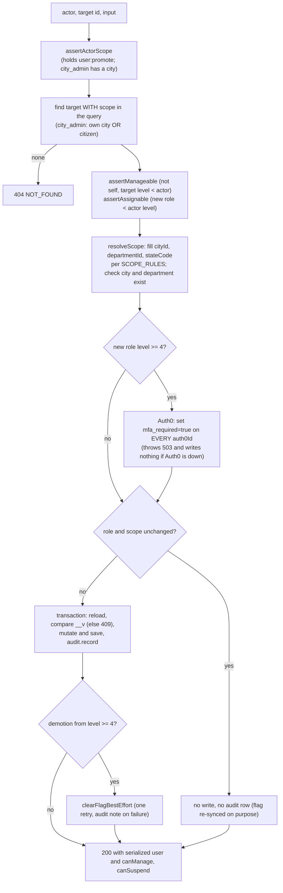

The serialized user includes `canManage` and `canSuspend`, computed on the server so the client copies no rules.

### 8.5 Auth0 Management client (`services/auth0ManagementClient.js`)

Node `fetch`, no SDK. Everything that can go wrong becomes an `AuthProviderError` (503); secrets, tokens and bodies
are never logged.

| Concern | Behaviour |
| --- | --- |
| Timeouts | token 3 s, one call 5 s, whole operation 8 s |
| Token cache | Cached at 90 % of lifetime (never within 60 s of expiry). One shared in-flight token request. |
| Retries | `idempotent` calls retry 5xx, network and timeouts (max 2, jittered backoff). `limited` calls retry only 429, 502, 503. A 401 gets one token refresh. 429 honours `Retry-After` up to 2 s. |
| Circuit breaker | 5 consecutive failures open it for 15 s. Then one probe call decides. A 4xx proves Auth0 is reachable and does not open it. |
| Error kinds | `timeout`, `network`, `upstream`, `rate_limited`, `breaker_open`, `misconfigured` (our credentials or scopes are wrong) |

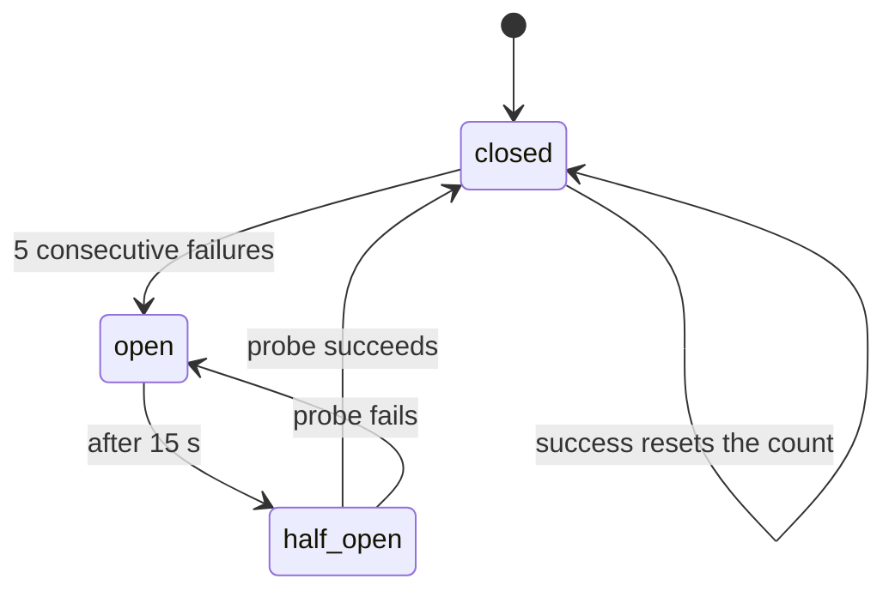

### 8.6 Pagination

Keyset (cursor) pagination on `(createdAt desc, _id desc)`. The cursor is an opaque base64url `{t, i}` that is
decoded and validated (bad input is 400). The service fetches `limit + 1` rows; the extra row only proves a next page
exists. Search is an **anchored, escaped prefix** on email and name (no regex from raw input, so no ReDoS).

### 8.7 Configuration (`config/env.js`)

Settings are read once, validated with Zod, frozen, and exported as `config`. Invalid settings exit the process
before it serves a request. Names only (see `server/.env.example`):

| Name | Required | Notes |
| --- | --- | --- |
| `NODE_ENV` | no | `development` (default), `test`, `production` |
| `PORT` | no | default 5000 in code (the repo's latest commit moved docs to 5001, see section 22) |
| `MONGODB_URI` | yes, except in test | `mongodb://` or `mongodb+srv://` |
| `MONGODB_URI_TEST` | for DB tests | database name must end in `_test` and differ from `MONGODB_URI` |
| `CLIENT_URL` | prod | reduced to its origin; the only CORS origin |
| `LOG_LEVEL` | no | default `info` |
| `TRUST_PROXY` | prod, 1 or more | proxies in front of the API |
| `AUTH0_DOMAIN`, `AUTH0_AUDIENCE` | prod | without them protected routes answer 503 `AUTH_NOT_CONFIGURED` |
| `AUTH_CLOCK_TOLERANCE_SECONDS` | no | default 5, max 30 |
| `AUTH0_M2M_CLIENT_ID`, `AUTH0_M2M_CLIENT_SECRET` | prod | set both or neither elsewhere. **Server only. Secret.** |
| `SUPER_ADMIN_EMAIL` | for bootstrap | read only by the bootstrap script |

Client (`client/.env.example`): `VITE_API_URL`, `VITE_AUTH0_DOMAIN`, `VITE_AUTH0_CLIENT_ID`, `VITE_AUTH0_AUDIENCE`
(public values), optional `VITE_SUPPORT_CONTACT`. Planned later: `GEMINI_API_KEY`, `GEMINI_MODEL`, Cloudinary keys,
`HMAC_SECRET` (all server-only).

### 8.8 One-off scripts (`server/scripts/`)

| Script | What it does | Safety |
| --- | --- | --- |
| `bootstrap:super-admin` | Promotes the single verified, active user with `SUPER_ADMIN_EMAIL`. Never creates a user. | Sets the Auth0 MFA flag first. One transaction with an audit row. Idempotent. Refuses a second super admin without `--force`. Distinct exit codes (2 not found, 4 unverified, 5 Auth0 failure). |
| `sync:mfa-flags` | Sets `mfa_required` in Auth0 for every sign-in id from the DB (on for level 4+, off below). | Streams with a cursor, one Auth0 call at a time. Safe to rerun. |
| `migrate:users-v1` | `verified` to `emailVerified`, default status, drops old indexes, builds new ones, **reports** scope violations (never fixes them). | Idempotent. Production runs with `autoIndex` off, so this is where its indexes are built. |
| `migrate:users-v2` | `auth0Id` to `auth0Ids` (copy, old field kept for rollback), builds the unique indexes. | Dry run unless `--apply`. Stops, writing nothing, if two verified rows share an email. |

---

## 9. Database architecture

MongoDB Atlas, database `nivaran_dev` (dev) and `nivaran_test` (wiped by tests). Transactions require a replica set;
Atlas provides one, and tests start a throwaway single-node replica set with `mongodb-memory-server` (or use
`MONGODB_URI_TEST`).

Global Mongoose settings (`config/db.js`): `strictQuery: true` (only schema fields in filters),
`sanitizeFilter: true` (an `{ $ne: null }` coming from outside becomes a literal match, blocking NoSQL injection;
our own operators are wrapped in `mongoose.trusted()`), and `autoIndex` **off in production** (a build can lock a
collection mid-traffic).

### 9.1 Entity-relationship diagram: BUILT today

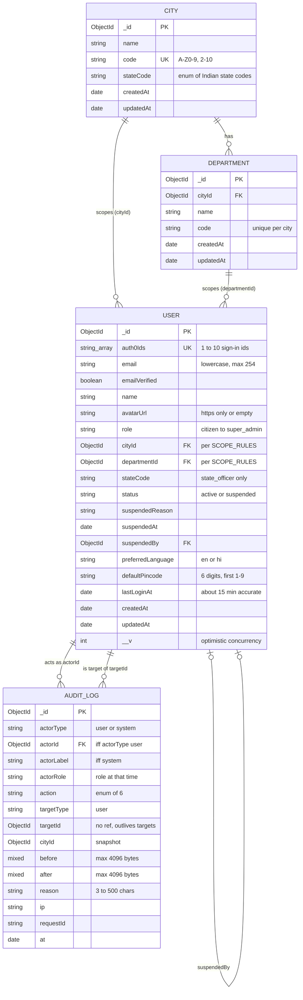

### 9.2 Indexes (BUILT)

| Collection | Index | Purpose |
| --- | --- | --- |
| `users` | `{ auth0Ids: 1 }` **unique** | Every request; guards the same-sub first-login race |
| `users` | `{ email: 1 }` **unique, partial** (`emailVerified: true`), name `email_verified_unique` | One verified row per address, so identity linking has exactly one target and two concurrent first logins make one user |
| `users` | `{ email: 1 }` | Exact lookup and anchored email-prefix search |
| `users` | `{ cityId: 1, createdAt: -1, _id: -1 }` | City list, no role filter |
| `users` | `{ cityId: 1, role: 1, createdAt: -1, _id: -1 }` | City list with a role filter |
| `users` | `{ stateCode: 1, createdAt: -1, _id: -1 }` partial (`stateCode` exists) | State officers' rows |
| `users` | `{ role: 1, createdAt: -1, _id: -1 }` | Super admin role filter |
| `users` | `{ createdAt: -1, _id: -1 }` | Super admin unfiltered list |
| `auditlogs` | `{ targetType: 1, targetId: 1, at: -1 }` | History of one user |
| `auditlogs` | `{ at: -1, _id: -1 }` | Global feed |
| `auditlogs` | `{ actorId: 1, at: -1 }` | What an admin did |
| `cities` | `code` unique; `{ stateCode: 1, name: 1 }` | Lookup; a state officer's city list |
| `departments` | `{ cityId: 1, code: 1 }` unique | One code per city |

### 9.3 Integrity rules the database cannot enforce alone

| Rule | Where it lives |
| --- | --- |
| Scope fields required or forbidden per role | `User` pre-validate hook, fed by `SCOPE_RULES` |
| Suspension fields present **iff** status is `suspended` | `User` pre-validate hook |
| No foreign keys, so deleting a City or Department that is still referenced throws | `City` and `Department` `pre('delete*')` hooks |
| `role`, `status`, scope can change only through load, mutate, `save()` | `User` write-guard hooks (`scopeWrite: true` is the explicit escape) |
| AuditLog never changes | `AuditLog` hooks that throw on every update and delete form |
| `""` is not a valid avatar or pincode | explicit `validate` functions (Mongoose `match` silently accepts the empty string) |

### 9.4 Full target data model: DESIGNED (`docs/DESIGN.md` section 3)

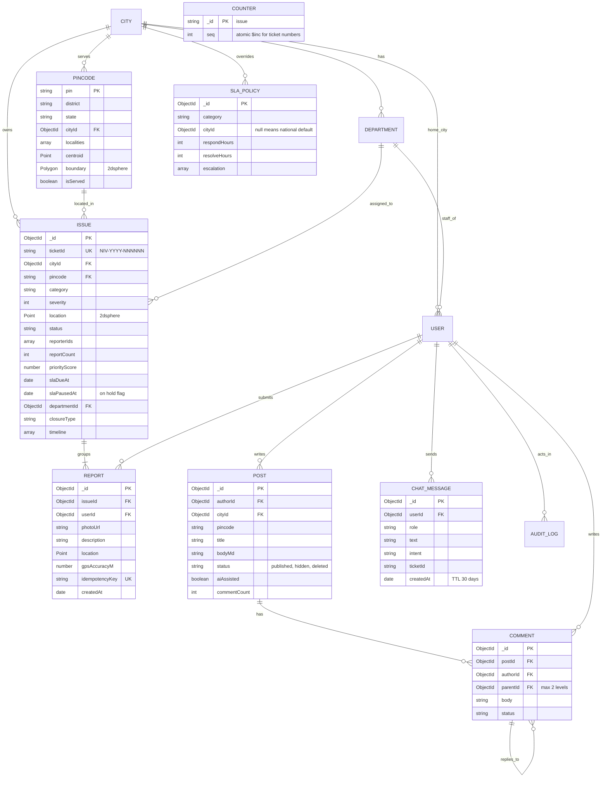

Designed indexes (DESIGN.md section 3): `pincodes.pin` unique and `boundary` 2dsphere; `issues.ticketId` unique,
`issues.location` 2dsphere, `{cityId, status, priorityScore: -1}`, `{reporterIds: 1}`; `reports {issueId, createdAt: -1}`;
`posts {status, createdAt: -1}`, `{cityId, status, createdAt: -1}` and a text index; `comments {postId, status, createdAt: 1}`;
`chatmessages {userId, createdAt: -1}` plus TTL; `auditlogs {targetType, targetId}`, `{at: -1}`.

Why reports and issues are separate: a report is one person's submission, an issue is the real problem. Geospatial
grouping attaches new reports to an existing issue so the crew fixes it once, and every reporter still sees their
ticket. Duplicate scoring from the Phase 3 prompt: `0.75 * distance + 0.25 * category`, threshold `0.55`, attach-or-create
inside a transaction. Ticket IDs come from an atomic counter document, never from `count + 1`.

Enums: issue status `submitted | assigned | in_progress | resolved | closed | reopened | rejected`; SLA state
`on_track | at_risk (>= 75 % used) | breached`, with "on hold" as the flag `slaPausedAt`; `closureType`
`citizen_confirmed | auto_closed | reopened`.

---

## 10. Data flow diagrams (level 0, 1, 2)

Notation: rounded boxes are external entities, rectangles are processes, cylinders are data stores. Numbers follow
the usual DFD levelling (process 2 becomes 2.1, 2.2 ...).

### 10.1 Level 0: context

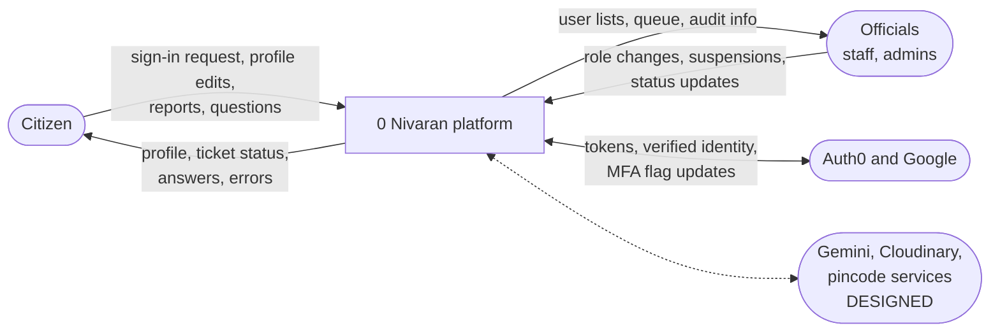

### 10.2 Level 1: main processes

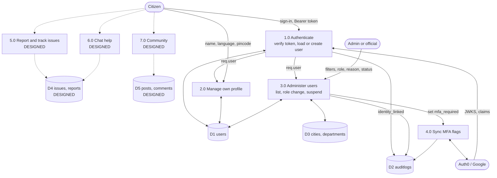

### 10.3 Level 2: process 1.0 Authenticate

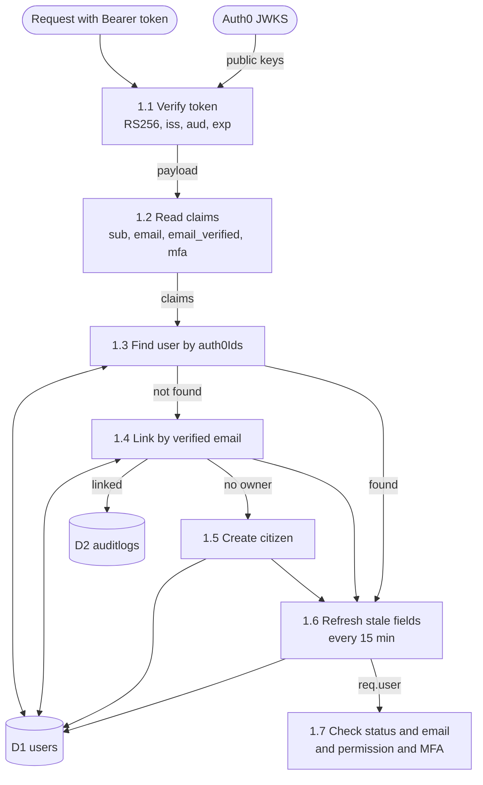

### 10.4 Level 2: process 3.0 Administer users (role change)

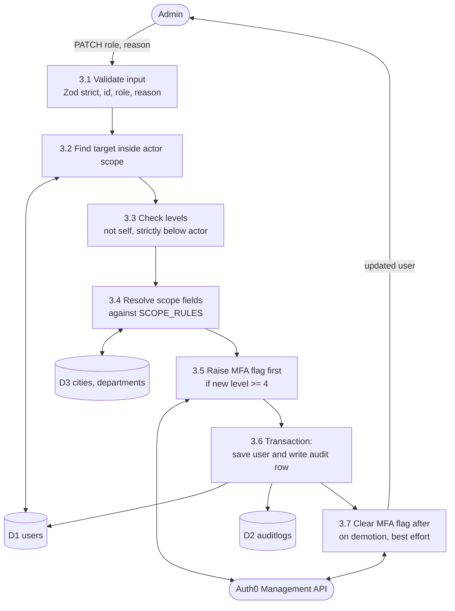

### 10.5 Level 2: process 5.0 Report an issue (DESIGNED)

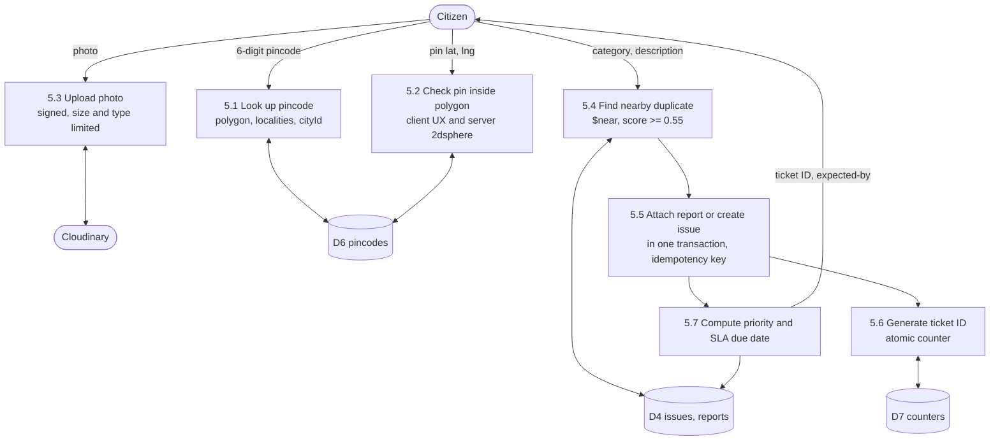

---

## 11. Sequence diagrams

### 11.1 Protected request end to end (BUILT)

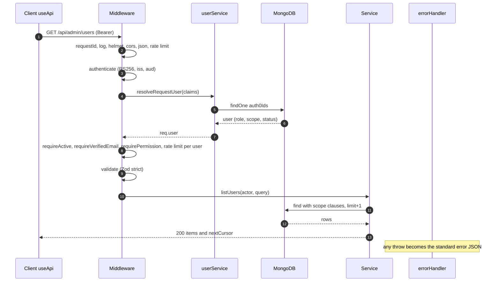

### 11.2 Suspension takes effect immediately (BUILT)

```mermaid
sequenceDiagram
  autonumber
  actor Adm as City admin
  actor Usr as Suspended citizen
  participant API
  participant DB
  participant SPA as Citizen's open tab

  Adm->>API: PATCH /admin/users/:id/status {suspended, reason}
  API->>DB: transaction: set status, suspendedReason/At/By, audit row
  API-->>Adm: 200
  Usr->>SPA: clicks anything that calls the API
  SPA->>API: request with a still-valid token
  API->>DB: loadUser reads status
  API-->>SPA: 403 SUSPENDED details.reason
  SPA->>SPA: markSuspended, navigate to /suspended
  Note over SPA: AppLayout redirects every route to /suspended
```

### 11.3 Report an issue (DESIGNED)

```mermaid
sequenceDiagram
  autonumber
  actor U as Citizen
  participant C as React app
  participant API
  participant DB as MongoDB
  participant CL as Cloudinary

  U->>C: types pincode 144401
  C->>C: regex ^[1-9][0-9]{5}$
  C->>API: GET /api/pincodes/144401
  API->>DB: find pincode
  alt missing
    API->>API: fallback api.postalpincode.in, cache, rate-limited
  end
  API-->>C: localities, boundary, cityId, isServed
  U->>C: drops the pin
  C->>C: in-house point-in-polygon, else show outside message
  C->>API: POST signed-upload params
  C->>CL: upload photo directly
  C->>API: POST /api/issues with Idempotency-Key
  API->>DB: $geoIntersects re-check (422 OUTSIDE_PINCODE if not inside)
  API->>DB: transaction: $near duplicate search, attach or create, counter $inc
  API-->>C: 201 ticketId NIV-2026-000123, expected by
```

### 11.4 Chatbot (DESIGNED)

```mermaid
flowchart TB
  M["User message"] --> RX{"Regex finds NIV-YYYY-NNNNNN?"}
  RX -- yes --> AU{"Is the user the reporter,<br/>or staff or admin of that city?"}
  AU -- no --> D["Reply: you can only check your own tickets"]
  AU -- yes --> DB[("Load issue: status, timeline, SLA, department")]
  DB --> T["Template reply, no AI involved"]
  RX -- no --> KW{"Asks about my complaints or status?"}
  KW -- yes --> L["List the user's last 5 tickets from the DB"]
  KW -- no --> G["Gemini with a strict civic-help system prompt,<br/>10 s timeout, never sees personal data"]
  G --> F["Reply plus: this is general guidance"]
```

Ticket answers come from the database, so status is always correct. Authorization runs before lookup so guessed
IDs cannot be read.

---

## 12. State machines

### 12.1 User account status (BUILT)

```mermaid
stateDiagram-v2
  [*] --> active: first sign-in creates a citizen
  active --> suspended: admin with reason (user:suspend)
  suspended --> active: admin reactivates with reason
  note right of suspended
    suspendedReason, suspendedAt, suspendedBy
    exist only while suspended (model invariant).
    Blocked on the very next request.
  end note
```

### 12.2 Client auth status (BUILT, `AuthProvider.jsx`)

```mermaid
stateDiagram-v2
  [*] --> unconfigured: any VITE_AUTH0_* value missing
  [*] --> loading: Auth0 starting or /api/me pending
  loading --> signedOut: no session
  loading --> signedIn: /api/me ok
  loading --> suspended: SUSPENDED or status suspended
  loading --> error: 5xx, network, claims missing, MFA blocked
  signedIn --> signedOut: 401 after one retry (reason sessionExpired)
  signedIn --> suspended: any API call answers SUSPENDED
  error --> loading: retry
  signedOut --> loading: login()
```

### 12.3 Issue lifecycle (DESIGNED, enums fixed in CLAUDE.md)

```mermaid
stateDiagram-v2
  [*] --> submitted
  submitted --> assigned: dept head assigns
  assigned --> in_progress: staff starts
  in_progress --> resolved: staff resolves with after-photo
  resolved --> closed: citizen confirms or auto-closed after 7 days
  resolved --> reopened: citizen reopens
  reopened --> assigned
  submitted --> rejected: rejected with reason
  closed --> [*]
  rejected --> [*]
```

Allowed transitions will live in one pure `stateMachine` util with a test for every transition (Phase 4).

### 12.4 SLA state (DESIGNED, pure maths already built in the client)

```mermaid
stateDiagram-v2
  [*] --> on_track
  on_track --> at_risk: 75 percent of allowed time used
  at_risk --> breached: past the due date
  on_track --> paused: dept head approves hold (slaPausedAt)
  at_risk --> paused
  paused --> on_track: clock resumes
  breached --> [*]
```

`client/src/components/system/slaState.js` already implements `getSlaState({startAt, dueAt, now})` and
`formatDuration`. "Paused" is a flag, not a server SLA state.

### 12.5 Community moderation (DESIGNED)

```mermaid
stateDiagram-v2
  [*] --> published
  published --> hidden: 3+ flags or moderator hides
  hidden --> published: moderator restores
  hidden --> deleted: moderator deletes with reason
  published --> deleted: author deletes own, or moderator with reason
  deleted --> [*]
```

---

## 13. External APIs and services

| Service | Role | Status | Auth and limits | Failure behaviour |
| --- | --- | --- | --- | --- |
| **Auth0** (tenant) | Login, tokens, MFA, passwordless email | **BUILT** | SPA app (PKCE), API audience, JWKS | JWKS outage: 503 `AUTH_PROVIDER_UNAVAILABLE` with `Retry-After`. Client keeps its session and retries. |
| **Google OAuth 2.0** | Social identity, via Auth0 connection `google-oauth2` | **BUILT** | Auth0 dev keys in development, own Google OAuth client required before launch | A failed Google login stays inside Auth0's flow. |
| **Auth0 Management API** | Set `app_metadata.mfa_required` | **BUILT** | M2M client credentials, scopes `update:users`, `update:users_app_metadata` only | Timeouts, retries, circuit breaker, then 503. A promotion writes nothing if the flag cannot be set. |
| **MongoDB Atlas** | Data | **BUILT** | `MONGODB_URI` | `/api/health` reports DB state. Startup exits if it cannot connect in about 5 s. |
| **Gemini API** (`@google/genai`) | Chatbot general answers, blog-assist buttons | **DESIGNED** | Server-side key, model name in env, 1000-char input, 300 output tokens, 20 messages per user per 10 min | 10 s timeout, one retry, "AI help is unavailable right now". Rest of the app unaffected. |
| **Cloudinary** | Photo storage | **DESIGNED** | Signed uploads built with `node:crypto`, size and format limits. Files never pass through our API. | Upload error shows a field-level message. |
| **All India Pincode Directory** (data.gov.in) | Post office, district, state per pincode | **DESIGNED** | Open licence, imported by a script | Import is idempotent. |
| **All India Pincode Boundary GeoJSON** (AIKosh) | Polygons for "only this area" | **DESIGNED** | Imported, 2dsphere index | No polygon: circle around the centroid, issue marked `areaPrecision: "approx"`. |
| **api.postalpincode.in** | Fallback for a pincode missing from the import | **DESIGNED** | Unofficial and free: 3 s timeout, cache every result, rate-limit | Phase 2 prompt error codes `INVALID_PINCODE`, `PINCODE_NOT_FOUND`, `UPSTREAM_UNAVAILABLE`. |
| **OpenStreetMap tiles and Nominatim** | Map tiles, optional address search (`countrycodes=in`) | **DESIGNED** | Usage policy: set a User-Agent, keep requests low | Locality select is the non-map alternative. |
| **Email provider for escalations** | Notifications | **DESIGNED, unchosen** | Resend was considered for the old verify-email stub, which was removed | None yet. |

---

## 14. Design language

Source of truth: `docs/UI.md`; implementation: `client/src/styles/globals.css`. Rule: **never hardcode a colour,
font or duration in a component.** Add or reuse a token.

### 14.1 Idea and identity

| Choice | Value |
| --- | --- |
| Metaphor | A public counter that works: forms, a stamped receipt, a clerk who says when to come back |
| Accent (one only) | **Peacock** (mor-pankhi): `oklch(0.47 0.08 215)` light, `oklch(0.76 0.10 205)` dark |
| Display font | **Anek Devanagari** variable (weight axis): h1 to h3, ticket IDs, pincode boxes, big counts. Weight 600, or 700 for ticket IDs. |
| Body font | **Mukta** 400, 500, 600. Both fonts are by Ek Type, designed for Latin and Devanagari together. |
| Neutrals | Cool "chalk and ink" greys, hue 220 to 235. No cream, no pure black. |
| Where boldness is spent | The six-box pincode input and the ticket counterfoil. Everything between is quiet. |
| Avoid | Gradients, glass, hero illustrations, confetti, all-caps labels, eyebrow text, `->` on buttons, monospace for data, identical shadows everywhere |

### 14.2 Typography

Scale 1.25: 12, 14, **16 body**, 20, 25, 31, 39 px. Mobile h1 is 31 px, desktop 39 px. Body never below 16 px on
mobile. Line height 1.6 body, 1.2 headings (1.75 and 1.35 for `lang="hi"` so Devanagari matras have room). Paragraphs
max 65ch, left-aligned (centre only the empty state and the counterfoil). Changing numbers use `tabular-nums`; Indian
grouping `1,50,000` via `Intl.NumberFormat('en-IN')`. Fonts are self-hosted through Fontsource, split by
`unicode-range`, so Devanagari files only load when Hindi appears. There is no Google Fonts `<link>`.

### 14.3 Colour tokens (names; values are in `globals.css`)

| Group | Tokens |
| --- | --- |
| Surface | `--background`, `--foreground`, `--card`, `--popover`, `--secondary`, `--muted`, `--accent`, `--border`, `--input`, `--ring` (each with `-foreground` where relevant) |
| Brand and danger | `--primary`, `--destructive` |
| Sidebar | `--sidebar`, `--sidebar-foreground`, `--sidebar-primary`, `--sidebar-accent`, `--sidebar-border`, `--sidebar-ring` |
| Charts | `--chart-1` to `--chart-5` |
| Issue status | `--status-submitted`, `-assigned`, `-in-progress`, `-resolved`, `-closed`, `-reopened`, `-rejected` (+ `-foreground`) |
| SLA | `--sla-on-track`, `-at-risk`, `-breached`, `-paused` (+ `-foreground`) |

All colours are OKLCH. Dark mode is a `.dark` class on `<html>` set before first paint by `index.html` and kept in
sync by `ThemeProvider` (`light | dark | system`). A `.light` class forces light tokens on a subtree (used by the
style guide). Status colours are information, never decoration, and **the accent never means a status.** Every
status badge carries an icon **and** a label, so colour is never the only signal.

| Status | Icon | SLA | Icon |
| --- | --- | --- | --- |
| submitted | Inbox | on_track | Clock |
| assigned | UserCheck | at_risk | Hourglass |
| in_progress | Wrench | breached | TriangleAlert |
| resolved | CircleCheck | paused | CirclePause |
| closed | Lock | | |
| reopened | RotateCcw | | |
| rejected | CircleX | | |

`statusMeta.js` is the single map from enum to icon, label key and token classes; `StatusBadge`, `SlaBadge` and
`StatusTimeline` all read from it.

### 14.4 Shape, space, depth, layers

| Aspect | Rule |
| --- | --- |
| Radius | `--radius: 0.625rem` (10 px). `sm` 6 px badges, pincode boxes. `md` 8 px buttons, inputs. `lg` 10 px cards, dialogs. `xl` 14 px sheet top corners, chat panel. `full` avatars and the chat bubble only. |
| Spacing | 4 px base, Tailwind scale steps 1, 2, 3, 4, 6, 8, 12, 16. No arbitrary values like `p-[13px]`. Card padding `p-4` mobile, `p-6` desktop. Field gap `gap-4`, section gap `gap-8` mobile and `gap-12` desktop. |
| Shadows | Three ink-tinted levels: `sm` (inputs), `md` (bottom bar, popover, chat bubble), `lg` (dialog, sheet). **Cards have a 1 px border and no shadow.** A shadow means "floats above the page". |
| Z layers | `--z-sticky` 20, `--z-bottombar` 30, `--z-chat` 40, `--z-sheet` 50, `--z-dialog` 60, `--z-toast` 70. Never a raw `z-[999]`. The map container gets `isolation: isolate`. |

### 14.5 Layout

- **Mobile-first.** Base styles for 360 px, then `sm` 640, `md` 768, `lg` 1024 (the navigation switch), `xl` 1280.
- Below 1024 px: top bar, page, **bottom bar** (64 px plus the iOS safe area, max 4 items: Home, My issues,
  **Report** raised in the centre, Community).
- At 1024 px and up: left **sidebar** (16 rem, collapsible to icons), bottom bar hidden.
- Content width: 72 rem for lists and dashboards, **40 rem** for forms and reading. Gutters 16, 24, 32 px.
- **Touch targets at least 44 x 44 px**, 8 px apart, even when the icon is 16 px.
- Chat bubble: 56 px circle bottom-right on every page, above the bottom bar on phones. Hidden under Sheets, Dialogs
  and on the report route (the map).

### 14.6 Voice and accessibility

Plain, specific, calm, like a helpful clerk. Errors say what happened and what to do next; raw error codes are never
shown (the client maps `error.code` to its own copy in `i18n/en/errors.json`). Dates are `26 Nov 2026`, time in IST
(`Asia/Kolkata`), stored as UTC. WCAG 2.1 AA checklist in UI.md section 9: skip link, visible focus ring,
`aria-live` for lookups and errors, 44 px targets, reduced-motion support, contrast measured per token pair.
Strings live in `client/src/i18n/en/*.json` behind `t("area.screen.key")`; a library is added only when Hindi ships.

---

## 15. Frontend architecture

### 15.1 Provider stack and boot

```mermaid
flowchart TB
  M["main.jsx<br/>fonts, globals.css"] --> PR["Providers"]
  PR --> TH["ThemeProvider<br/>light, dark, system (localStorage, wrapped in try/catch)"]
  TH --> QC["QueryClientProvider<br/>staleTime 30 s, retry once on network or 5xx except 503"]
  QC --> AP["AuthProvider<br/>Auth0Provider + AuthBridge<br/>publishes AuthContext"]
  AP --> SP["SignInPromptProvider<br/>one sign-in sheet for the whole app"]
  SP --> TT["TooltipProvider + Toaster (sonner)"]
  TT --> RT["RouterProvider (createBrowserRouter)"]
```

Pages never import Auth0. They call `useAuth()`, `useCan()`, `useApi()`, so tests and the "no Auth0 configured" mode
work.

### 15.2 Routes

```mermaid
flowchart LR
  R["Router"] --> SL["SuspendedLayout<br/>wordmark, reason, sign out"]
  R --> AL["AppLayout<br/>TopBar, Sidebar, BottomBar, ChatBubble, PageTransition"]
  SL --> S1["/suspended"]
  AL --> L1["/ Landing"]
  AL --> L2["/report RequireAuth verified<br/>PARTIAL placeholder"]
  AL --> L3["/profile"]
  AL --> L4["/admin/users"]
  AL --> L5["/issues PARTIAL"]
  AL --> L6["/community PARTIAL"]
  AL --> L7["/forbidden"]
  AL --> L8["/dev/styleguide dev builds only"]
  AL --> L9["* NotFound"]
```

Every page is `React.lazy` (`app/lazyPages.js`) so the first screen is small. The shell loads immediately. The style
guide is `null` in production builds, so it is left out of the bundle.

`RequireAuth` evaluates top to bottom: loading skeleton, unconfigured, signed out (sign-in empty state), suspended
(redirect), error (retry or sign out), unverified (toast and sign-in sheet), then permission or `minLevel` (403 shown
**in place**, URL unchanged so Back works). It only decides what to *show*; the server enforces the same rules.

### 15.3 Source map

```
client/src/
  app/         Providers, AuthProvider, router, lazyPages
  layouts/     AppLayout, SuspendedLayout, PageTransition, PageSkeleton
  components/
    ui/        shadcn primitives (button, card, dialog, drawer, sheet, select, table, tooltip, sonner ...)
    system/    Nivaran components: StatusBadge, SlaBadge, SlaCountdown, StatusTimeline, TicketId, StatCard,
               EmptyState, PageHeader, ResponsiveDialog, FieldError, statusMeta, slaState, motionTokens
    nav/       TopBar, Sidebar, BottomBar, SkipLink, navItems (one list feeds both navs)
    auth/      AccountMenu, AccountAvatar, RequireAuth, SignInPrompt(+Provider), RoleBadge, ForbiddenView
    admin/     UsersTable, UserCard, UserFilters, UserActionsMenu, RoleChangeDialog, StatusDialog, ScopeFields ...
    profile/   ProfileForm
    theme/     ThemeProvider, ThemeMenu
    chat/      ChatBubble (PARTIAL)
  pages/       Landing/ (Hero, HowItWorks, StatsRow, TimelinePreview, TrustSection, LandingFooter, PincodeInput),
               Profile, admin/AdminUsers, Suspended, Forbidden, NotFound, Report, Issues, Community, dev/StyleGuide*
  hooks/       useApi, useAuth, useCan, useMe, useAdminUsers, useChangeRole, useSetUserStatus, useUpdateProfile,
               useCities, useDepartments, useMediaQuery, useDelayedFlag, useSidebarCollapsed, useTheme
  lib/         api (fetch wrapper, ApiError), authedRequest, apiErrors, authConfig, mfaGuard, safePath, roles,
               queryClient, motion, format, stateCodes, utils
  i18n/        t.js, en.json, en/{admin,auth,errors,landing,profile,shell,system}.json
  styles/      globals.css (all tokens)
```

### 15.4 Data layer

| Piece | Behaviour |
| --- | --- |
| `lib/api.js` | `fetch` wrapper with a 10 s timeout, abort support and one `ApiError` shape `{code, message, status, details, retryAfter}`. The message shown is **our own copy per code**; the server's wording is kept only for logs. |
| `lib/authedRequest.js` | Adds the Bearer token, retries once on 401 with a fresh token. |
| `hooks/useApi.js` | Wraps the above and routes wrong-state answers to the right screen (section 6.9). |
| `lib/queryClient.js` | `staleTime` 30 s, one retry for network, timeout and 5xx (not 503), no mutation retries, refetch on window focus. |
| Query keys | `ME_KEY` for `/api/me`; admin list keys in `useAdminUsers`. After a mutation the list is invalidated. |
| Planned (UI.md) | Optimistic updates with rollback for "me too", comments and status changes. Never optimistic for report submission or anything that moves an SLA clock. |

### 15.5 Shell and navigation

`AppLayout` renders both navs and lets **CSS** show one (`lg:hidden` and `hidden lg:block`), so the right one is
present on the first paint with no JS-driven jump. `<main id="main" tabIndex={-1}>` is the skip-link target and
carries bottom padding equal to the bottom bar height. `ScrollRestoration` handles scroll position. A suspended
account is redirected to `/suspended` from every route, public ones included.

### 15.6 Landing page (BUILT)

| Section | Component | Note |
| --- | --- | --- |
| Hero | `Hero`, `PincodeInput` | What Nivaran does plus the six-box pincode field (validated client-side, then `/report?pincode=...`). The only `<h1>`. |
| How it works | `HowItWorks` | Three steps, scroll-revealed |
| Numbers | `StatsRow` with `StatCard` | NumberFlow counts up once on first view, `en-IN` grouping. Sample numbers. |
| Example ticket | `TimelinePreview` | A `StatusTimeline` with the connector drawing in |
| Trust | `TrustSection`, `LandingFooter` | Why you can trust it |

### 15.7 Report wizard (DESIGNED, spec in UI.md section 7)

Route `/report?step=1..3` (Back works, a `sessionStorage` draft survives refresh). Step bar in words: "Step 2 of 3:
Place the pin". Footer: Back (outline) left, Next (default) right. Chat bubble hidden on step 2.

1. **Pincode:** one `<input inputmode="numeric" autocomplete="postal-code" maxlength="6">` styled as six boxes (a
   screen reader hears one field). Recent pincodes as chips. A lookup result is announced via `aria-live`. Never
   auto-advances (WCAG 3.2.2). Unserved: inline waitlist form.
2. **Pin on map:** Leaflet fitted to the polygon, outside dimmed (`foreground` at 40 %), outline a 2 px `primary`
   line, drag outside snaps back with an announced message, "Use my location", arrow-key nudge and a Locality select
   as non-map alternatives. Programmatic `fitBounds` uses `animate: false`.
3. **Photo and details:** category radio cards with icons, camera or gallery with client-side compress, description
   (min 20 chars, live count), review, "Submit report". Success: the **counterfoil** (display font, stamped, perforated
   top edge, Copy ticket ID, "Expected by 26 Nov, 5:00 PM", "Track this issue").

---

## 16. Motion and animation

Principle: **motion explains a change the user caused.** Nothing moves on its own except the skeleton shimmer and
toasts. All values come from tokens, never raw numbers in components.

### 16.1 Tokens

| Token | CSS | JS (`lib/motion.js`) | Used for |
| --- | --- | --- | --- |
| `--duration-fast` | 120 ms | `durations.fast = 0.12` | hover, press, focus ring, toast exit |
| `--duration-base` | 200 ms | `0.2` | page transition, list enter, popover, dialog, toast enter |
| `--duration-slow` | 320 ms | `0.32` | sheet slide, chat panel, wizard step. **No single element animates longer.** |
| `--ease-standard` | `cubic-bezier(0.2, 0, 0, 1)` | `easings.standard` | things that move and stay |
| `--ease-enter` | `cubic-bezier(0.05, 0.7, 0.1, 1)` | `easings.enter` | arriving |
| `--ease-exit` | `cubic-bezier(0.3, 0, 0.8, 0.15)` | `easings.exit` | leaving (fast or base only) |

### 16.2 What animates

| Surface | Behaviour | Implementation |
| --- | --- | --- |
| Page change | New page fades in and rises 8 px in `base`. **No exit animation**: the old page leaves at once, invisibly, so it never delays the next. | `layouts/PageTransition.jsx`: `AnimatePresence mode="popLayout" initial={false}`, keyed by pathname (a query change is the same page), `Suspense` shows `PageSkeleton` while a lazy page downloads, `FrozenOutlet` stops the leaving wrapper from re-rendering the new route |
| First load | Nothing animates | `initial={false}` |
| Scroll reveal | Once, at 20 % in view: opacity plus 8 px rise, 30 ms stagger (at most 8 staggered) | `revealProps`, `fadeUp`, `stagger()` |
| Status timeline | Steps fade and rise one after another, each connector then draws downward in `slow` | `StatusTimeline.jsx` (`scaleY` from the top) |
| KPI numbers | Count up once when 50 % visible, spin and fade tuned to `slow` and `base`; screen readers get the final value immediately via an `sr-only` copy | `StatCard.jsx` (NumberFlow, Web Animations API through `motionTokens.js` converters) |
| Sheet and dialog | Sheet slides from its edge in `slow`; dialog fades and scales 0.97 to 1 in `base` | tw-animate-css classes with our durations |
| Toast | `base` in, `fast` out | sonner |
| Skeleton | 1.6 s linear shimmer. Plays 3 times then becomes a static block (WCAG 2.2.2). Shown only after about 200 ms of loading. | CSS, `useDelayedFlag` |
| Chat panel | Slides from the bottom, `slow` in with the enter curve, `base` out | `sheet` variants |

**Never animates:** map pan and zoom (programmatic), badge colour changes, SLA countdowns, layout reflow when data
changes, scroll position, autoplaying carousels, parallax. Native scrolling only (no Lenis, no scroll-jacking).

### 16.3 Reduced motion

```mermaid
flowchart LR
  OS["OS setting<br/>prefers-reduced-motion: reduce"] --> CSS["CSS: durations to 0.01 ms,<br/>shimmer removed,<br/>sheets and dialogs appear instead of slide"]
  OS --> HK["useMotionSafe(variants)<br/>strips x, y, scale, rotate<br/>sets duration 0"]
  OS --> NF["NumberFlow: animated=false"]
  OS --> ST["StatusTimeline: initial=false"]
```

Opacity changes still happen with zero duration so content is never stuck hidden; meaning never depends on motion.

---

## 17. Card and component design

### 17.1 Card rules

| Rule | Detail |
| --- | --- |
| Purpose | Groups one thing: an issue, a post, a step, a user. Never nested. |
| Surface | `bg-card`, 1 px `border`, `rounded-lg` (10 px), **no shadow** |
| Padding | `p-4` mobile, `p-6` desktop |
| Linked card | The whole card is the target and holds **one** focusable element. On hover it rises 2 px and its border becomes `input` (still no shadow). |
| Staff queue | At 1024 px and up a data table; below, one card per issue with the status and SLA badges on the first line |

### 17.2 Cards in the build

```mermaid
flowchart TB
  subgraph UserCard["UserCard (admin, phone layout)"]
    H["UserIdentity (avatar, name, email)  +  UserActionsMenu"]
    DL["definition list: Role (RoleBadge), Area, Status, Last seen"]
  end
  subgraph StatCard["StatCard (landing, dashboards later)"]
    SL["label, muted 14 px"]
    SV["NumberFlow value, display font, tabular-nums"]
    SH["optional hint"]
  end
  subgraph Ticket["TicketId (counterfoil text)"]
    TI["NIV-2026-000123 in display font 700, nowrap, tabular-nums"]
    TB2["44 px copy button, toast on success or failure"]
  end
  subgraph Timeline["StatusTimeline step"]
    MK["square stamp marker (rounded-sm), icon, status colour"]
    TX["label, Now / upcoming, IST time, note"]
  end
```

- **Responsive pairing:** the same facts and the same action names appear as a `UsersTable` at 1024 px and up and as
  `UserCard`s below.
- **Ticket ID** is always shown in full (never abbreviated), never monospace.
- **Timeline marker** is a square "rubber stamp" (`rounded-sm`); `rounded-full` is reserved for avatars and the chat bubble.
- **EmptyState** teaches the next action: what this is, why it is empty, one button. No fake celebration.

### 17.3 Dialog, sheet, drawer selection

| Component | Use |
| --- | --- |
| `AlertDialog` | Confirm destructive or irreversible actions, any screen size |
| `Dialog` | Short focused tasks on desktop (1024 px and up) |
| `Drawer` (Radix Dialog based, bottom sheet) | The same tasks on phones |
| `Sheet` | Side panels (chat on desktop) |
| `ResponsiveDialog` | One component that switches between Dialog and Drawer with `useMediaQuery`. Used by the sign-in sheet and the admin role and status dialogs. |

### 17.4 Forms, buttons, badges

- **Button:** `default` (peacock) is the one main action per screen; `secondary`, `outline`, `ghost`, `destructive`
  (always behind a confirm), `link`. `h-11` on touch screens.
- **Form:** shadcn `Form` with react-hook-form and a Zod resolver. A visible label always (no placeholder-only),
  a description for format hints, an inline error with an icon linked by `aria-describedby`. Server 400 `details.fields`
  map back to the field. Focus goes to the first invalid field.
- **Toast:** one line plus an optional action. Success 4 s, with-action 8 s, errors stay until dismissed.
- **Badge:** status and SLA only through `StatusBadge` and `SlaBadge`. Category tags use `outline`. Never invent a new badge colour.

---

## 18. User flows

### 18.1 First visit to a report (target)

```mermaid
flowchart TD
  A["Landing page"] --> B["Enter 6-digit pincode"]
  B -- "invalid" --> B1["Inline error, stays on page"]
  B -- "valid" --> C["/report?pincode=..."]
  C --> D{"Signed in with verified email?"}
  D -- "no" --> E["Sign-in sheet: Google (primary) or email code"]
  E --> F["Auth0 redirect and back to returnTo"]
  F --> G
  D -- "yes" --> G["Step 1 pincode lookup"]
  G -- "not served" --> W["Waitlist form"]
  G -- "served" --> H["Step 2 drop pin inside boundary"]
  H --> I["Step 3 photo and details"]
  I --> J["Submit"]
  J --> K["Counterfoil with ticket ID and expected-by date"]
  K --> L["Track in My issues"]
```

Today the flow works up to `/report`, which is a placeholder after the sign-in gate.

### 18.2 Sign in and the verified-email gate (BUILT)

```mermaid
flowchart TD
  S["Tap Sign in or a gated action"] --> SH["Sign-in sheet<br/>(bottom drawer on phones, dialog on desktop)"]
  SH --> G["Continue with Google"]
  SH --> EM["Continue with email code (6 digits, no password)"]
  G --> A0["Auth0"]
  EM --> A0
  A0 --> BK["Back to the page you wanted (safePath)"]
  BK --> ME["GET /api/me"]
  ME -- "200" --> OK["Signed in"]
  ME -- "403 EMAIL_NOT_VERIFIED" --> TO["Toast, sheet reopens: sign in again with Google or an email code"]
  ME -- "403 SUSPENDED" --> SU["/suspended with the admin's reason"]
  ME -- "401 TOKEN_CLAIMS_MISSING" --> CL["Error screen: Sign out and in again"]
  ME -- "503" --> RT["Error screen: Try again (session kept)"]
```

### 18.3 Admin: change a role (BUILT)

```mermaid
flowchart TD
  A["Admin > Users<br/>(RequireAuth permission user:read_scope)"] --> B["Filter by role, status, search (3+ chars)"]
  B --> C["Row or card actions menu<br/>(only what canManage and canSuspend allow)"]
  C --> D["Change role dialog"]
  D --> E["Pick role, then city, department or state<br/>as the role requires, and a reason (5+ chars)"]
  E --> F["PATCH /api/admin/users/:id/role"]
  F -- "200" --> G["List refreshes, toast"]
  F -- "409 CONFLICT" --> H["Someone else changed this user. Reload and try again."]
  F -- "503" --> I["Sign-in service unavailable. Nothing was changed."]
  F -- "403 or 404" --> J["Guards re-read /api/me, message shown"]
```

### 18.4 First super admin (BUILT, one time)

1. Sign in once with the account whose email is `SUPER_ADMIN_EMAIL` (the email must be verified).
2. Run `npm run bootstrap:super-admin -w server`. It sets the Auth0 MFA flag first, then promotes in one transaction
   with an audit row, and prints the masked email.
3. Sign out and in again and enrol MFA when Auth0 asks. Admin > Users now opens.

### 18.5 Staff and moderator flows (DESIGNED)

Staff see **Queue** in place of **Report** in the bottom bar and sidebar. They open a paginated, priority-sorted
queue, change status (never optimistic for resolve), upload an after-photo to resolve, and the citizen confirms or
reopens. Moderators hide, restore or delete content with a reason, each action written to `AuditLog`.

---

## 19. Security, errors, logging, testing

### 19.1 Security controls

| Threat | Control |
| --- | --- |
| Forged or wrong-audience token | RS256 only, explicit issuer and audience, clock tolerance (max 30 s). One generic 401 body: detail would help tune a forgery. |
| Token theft from storage | In-memory cache, no tokens in `localStorage`. The `sessionStorage` MFA key holds a timestamp only. |
| Privilege escalation | Role and scope read from the DB, never token or body. Strictly-below-own-level rule. Model write guards. |
| Admin without MFA | Flag set **first** on promotion, token `mfa` claim required at level 4+ (fail closed). New linked sign-in ids of admins get the flag before linking. |
| Account takeover by email | Linking only for a **verified** email. No Auth0-side auto-linking. |
| IDOR and cross-city reads | Scope inside the query. Out of scope and missing are both 404 with the same body. |
| NoSQL injection | Zod `.strict()`, enum filters (a `?role[$ne]=x` is a 400), global `sanitizeFilter`, `trusted()` only for our own operators. |
| ReDoS and wildcard scans | Search is an anchored, escaped prefix. |
| Abuse | Global 300 per 15 min per IP; admin reads 60 per minute and writes 10 per minute **per user**; not `passOnStoreError`, so a failing limiter blocks instead of letting writes through. |
| Data leakage | Explicit field picks in serializers (a new internal field never leaks by accident). Error handler never sends stack traces. Query strings are stripped from logs. Free-text suspension reasons are shown to the user but never logged. |
| Secrets | `.env` is git-ignored and denied to Claude in `.claude/settings.json`. M2M secret server-only and never logged. Env validated at start-up. |
| CORS and headers | Allow-list of one origin, `credentials: false` (Bearer header, no cookies), helmet defaults. |
| Concurrent edits | Optimistic concurrency plus a 409. |
| Stale or racing first login | Two unique indexes, retry on E11000. |
| Auth0 outage | JWKS failure is 503 (client keeps the session). Management API has timeouts, retries and a circuit breaker. |

Planned (DESIGNED): waitlist emails hashed with HMAC-SHA-256 and `HMAC_SECRET`, `sanitize-html` for any rich post
text, Idempotency-Key on report submission, Cloudinary upload limits.

### 19.2 Error contract

`{ "error": { "code", "message", "details"?, "requestId"? } }`. `requestId` appears on 5xx only. Codes are a stable
contract the client maps to its own copy, so renaming one is a breaking change.

| Code | HTTP | Meaning |
| --- | --- | --- |
| `UNAUTHENTICATED` | 401 | Missing or invalid token |
| `TOKEN_CLAIMS_MISSING` | 401 | Valid token without our email claim: Action not deployed |
| `EMAIL_NOT_VERIFIED` | 403 | Token `email_verified` is not `true` |
| `SUSPENDED` | 403 | `details.reason` carries the user-safe text |
| `FORBIDDEN` | 403 | Role lacks the permission, or a level rule |
| `MFA_REQUIRED` | 403 | Level 4+ without the MFA claim |
| `NOT_FOUND` | 404 | Missing **or** out of scope |
| `CONFLICT` | 409 | Lost an optimistic-concurrency race |
| `IDENTITY_LIMIT` | 409 | Account already has 10 sign-in ids |
| `VALIDATION_ERROR` | 400 | `details` is a list of `{path, message}` |
| `INVALID_JSON`, `PAYLOAD_TOO_LARGE` | 400, 413 | Body problems (100 kb cap) |
| `RATE_LIMITED` | 429 | Global or per-user limiter |
| `AUTH_NOT_CONFIGURED` | 503 | `AUTH0_DOMAIN` or `AUTH0_AUDIENCE` missing |
| `AUTH_PROVIDER_UNAVAILABLE` | 503 | JWKS or Management API unreachable (`Retry-After: 30`) |
| `SERVICE_UNAVAILABLE` | 503 | Database unreachable while loading the user |
| `INTERNAL_ERROR` | 500 | Anything unexpected, with `requestId` |

### 19.3 Logging and observability

pino JSON with a request id (`X-Request-Id`) on every line; access lines carry only `{id, method, path}`;
`/api/health` logs at `debug`. Event names are structured (`auth.rejected`, `auth.jit_created`, `auth.identity_linked`,
`auth.suspended_blocked`, `auth.mfa_required_blocked`, `authz.out_of_scope`, `admin.role_changed`,
`admin.status_changed`, `auth0.mgmt.call`, `mgmt.api_error`, `auth0.mfa_flag_orphan`,
`auth0.mfa_flag_clear_pending`, `db.connected`, `server.started`, `process.unhandledRejection`). Emails appear only
as a short SHA-256 prefix. Graceful shutdown: stop accepting, drain in-flight requests, close MongoDB, force exit
after 10 s.

### 19.4 Testing

| Layer | Tool | What |
| --- | --- | --- |
| Server unit | Vitest | `permissions`, `cursor`, `env`, `userModel`, `auditLog`, `migrate`, `mgmtClient` |
| Server API | Vitest + Supertest on a **real replica set** | `auth`, `me`, `adminUsers`, `identityLink`, `bootstrapSuperAdmin`, `migrateUsersV2`, `errorShape`, `errors`, `health`, `db`, a **route inventory** test. Helpers: `fakeAuth0`, `fakeAuth0Fetch`, `mgmtMock`, `testDb`. |
| Client | Vitest + jsdom + Testing Library | `AuthProvider`, `RequireAuth`, `useApi`, `authedRequest`, `mfaGuard`, `safePath`, `roles`, `motion`, `slaState`, `TicketId`, `SlaCountdown`, `PincodeInput`, `AdminUsers`, `Profile`, `Suspended`, `AppLayout` |
| End to end | Playwright | **DESIGNED** (`client/e2e/` is empty). Planned flow: report, duplicate suggestion, staff resolves, citizen reopens, chatbot shows status. |
| CI | GitHub Actions | `npm ci`, lint, format check, `npm test`, `npm run build`. Node from `.nvmrc`. Least-privilege `contents: read`. `MONGODB_URI_TEST` from a repo secret. |

Tests refuse to run against anything that could be the real database (name must end `_test`, must differ from
`MONGODB_URI`). Rule: every bug fix ships with a test that failed before the fix.

---

## 20. Deployment and operations

> **Status: not decided.** The repository has CI but no deployment configuration. The topology below is what the
> existing settings (`TRUST_PROXY` mentions Render or Nginx, Atlas-only database, `CLIENT_URL`, built `client/dist`)
> point to. Treat it as a **proposal** and confirm hosts before building. ADR 0001 says no Docker for now.

```mermaid
flowchart LR
  U(["Users"]) --> CDN["Static hosting for client/dist<br/>(host TBD)"]
  U --> LB["HTTPS reverse proxy or platform router<br/>TRUST_PROXY = 1"]
  LB --> API["Express API, ONE instance<br/>NODE_ENV=production"]
  API --> ATLAS[("MongoDB Atlas replica set<br/>automated backups")]
  API --> AUTH0[("Auth0")]
  API --> LOGS["stdout JSON logs"]
  GH["GitHub Actions CI"] -.->|"gate on main"| CDN
  GH -.-> API
```

| Concern | Plan |
| --- | --- |
| Environments | Separate Auth0 tenants for dev and production (the setup guide says so). Separate Atlas databases `nivaran_dev`, `nivaran_test`, and production. |
| Production start-up checks | `CLIENT_URL`, `TRUST_PROXY >= 1`, `AUTH0_DOMAIN`, `AUTH0_AUDIENCE`, M2M id and secret are all required, or the process exits. |
| Indexes | `autoIndex` is off in production. Run the migration scripts (dry run first, then `--apply`) to build them. |
| First admin | `npm run bootstrap:super-admin -w server` after the owner signs in once. |
| After an Auth0 outage | `npm run sync:mfa-flags -w server`. |
| Health | `GET /api/health` reports DB state. Monitors poll it, logged at `debug`. |
| Backups | Atlas automated backups; user content is soft-deleted (designed). |
| Scaling limit | One instance. Before a second one: a Mongo-backed rate-limit store and a cron lock document so only one instance runs the SLA job (ADR 0001). |
| Before launch | Replace Auth0's dev Google keys with your own Google OAuth client; set the real site origin in Auth0 callback, logout and web-origin lists; resolve the open support-contact question (Q9). |
| Local commands | `npm ci`, `npm run dev` (both apps), `npm run check` (what CI runs), `npm run test:e2e` (later). Node version in `.nvmrc`. |

---

## 21. MCP servers, agents and skills for future work

### 21.1 What the project itself already declares

`CLAUDE.md` names these skills and agents per kind of work. `graphify` is the only skill folder inside `.claude/skills/`;
the rest are plugin skills available in the Claude environment.

| Work | Use |
| --- | --- |
| Backend design | `think-before-coding` (backend-design) |
| Schema | `data-modeling-discipline`, `query-discipline`, agent `schema-reviewer` |
| Auth | `auth-and-authorization` |
| Security | `security-discipline`, agent `security-reviewer` |
| Errors and logs | `error-handling-as-design`, `observability-by-default` |
| UI | `frontend-design`, then `design-critique` and `accessibility-review` |
| Tests | `testing-with-discernment` |
| Review | `engineering:code-review` |
| Bugs | `engineering:debug` |
| Code questions | `graphify` (`graphify query "<question>"` before grepping; `graphify update .` after code changes) |

`.claude/commands/step.md` runs one numbered step of a prompt file in `docs/prompts/` and reports in under 15 lines.
`.claude/settings.json` allows `npm run *`, `npm test *`, `npm ci`, `git status`, `git diff *`, `git add *` and denies
reading the two `.env` files and `git push *`.

### 21.2 Recommended skills by phase

| Phase | Skills and agents |
| --- | --- |
| 2 Models and pincodes | `backend-design:design`, `data-modeling-discipline`, `query-discipline`, `migration-safety`, `review-migration`, `explain-this-query`, `hunt-n-plus-one`, agent `schema-reviewer`. Geo: `performance-and-scaling`. |
| 3 Reporting and grouping | `think-before-coding`, `idempotency-and-side-effects` (Idempotency-Key, ticket counter, attach-or-create), `error-handling-as-design`, `testing-with-discernment`. UI: `frontend-design`, `design:design-system`, `design:ux-copy` (wizard copy, error messages, empty states), `design:design-handoff`. |
| 4 SLA and queue | `engineering:system-design`, `idempotency-and-side-effects` (the SLA job), `observability-by-default`, `boring-by-default` (cron lock, in-process timer), agent `incident-thinker`. |
| 5 Chatbot | `claude-api` skill for Gemini-adjacent prompt and safety patterns (the SDK is Google's), `security-discipline` (prompt injection, authorization before lookup), `performance-and-scaling` (rate limits and timeouts). |
| 6 Community | `security-discipline` (sanitisation), `auth-and-authorization` (moderation scope), `design:ux-copy`. |
| 7 UI polish | `frontend-design`, `design:design-critique`, `design:accessibility-review` (WCAG 2.1 AA), `design:design-system`, `design:design-handoff`, `dataviz` for any dashboard chart. |
| 8 Hardening | agent `security-reviewer`, `engineering:code-review`, `engineering:testing-strategy`, `engineering:deploy-checklist`, `engineering:incident-response`, `engineering:tech-debt`. |
| Docs and decisions | `engineering:architecture` (new ADRs), `engineering:documentation`. |
| Deployment (if AWS is chosen) | `aws-core:aws-compute`, `aws-containers`, `aws-database`, `aws-iam`, `aws-networking`, `aws-observability`, `aws-secrets-manager`, `aws-cdk` or `aws-cloudformation`, `aws-deployment`, `aws-billing-and-cost-management`, `aws-well-architected-review`. Not needed unless the hosting decision lands on AWS. |

### 21.3 MCP servers

Verified in this session's environment (names as exposed): GitHub (pull requests, Actions, secret scanning),
Claude in Chrome and the desktop Claude Browser (live UI checks and screenshots), the device folder tools, Google
Drive, Docs, Sheets, Slides, Gmail and Calendar, OpenAlex, Apify. The AWS MCP server is configured but did not start
on the device (`uvx` is not on PATH); the Figma, Intercom, Atlassian, Linear, Notion, Asana, Slack, PagerDuty,
ClickUp and Monday servers failed to connect through the proxy; Datadog needs authorization.

| MCP server | Use in Nivaran | Status |
| --- | --- | --- |
| **Playwright MCP** | Responsive screenshots (360, 768, 1024, 1440), flows, accessibility snapshots. A `.playwright-mcp/` folder with screenshots and console logs exists in the repo root, so it has been used. Later pairs with `@playwright/test` for Phase 8. | In use (folder evidence) |
| **context7** | Fetch current docs for Mongoose 9, Express 5, React Router 8, TanStack Query 5, Tailwind 4, Auth0 SDKs, Motion and Zod 4 before writing code against them. These libraries moved fast, so this prevents stale-API bugs. | **Recommended. I did not confirm it is installed.** |
| **GitHub MCP** | PRs, CI logs (`actions_get`, `get_job_logs`), secret scanning, review threads. Never push without Sachin's approval (project rule). | Available |
| **Claude in Chrome / Claude Browser** | Test the real Auth0 login in a real browser, check the Action's claims in Network, inspect console errors. | Available |
| **MongoDB (Atlas) MCP** | Read-only index and explain-plan checks for Phase 2 and 3 geo queries. | Suggested, not installed. Read-only credentials only. |
| **Figma MCP** | Design-to-code handoff if designs move to Figma. | Configured but failing to connect |
| **AWS MCP** | Only if hosting on AWS. | Configured, needs `uvx` on the device |
| **graphify** (CLI skill, not MCP) | Knowledge graph over the repo, in `graphify-out/` (`GRAPH_REPORT.md`, `graph.json`). Built from `000ff34b`, so rerun `graphify update .` after code changes. | In use |

Guardrails for every tool: never read `server/.env` or `client/.env`; never commit, push, deploy or delete without
asking Sachin; plan first when a change touches more than 3 files; explain non-obvious code line by line.

---

## 22. Known inconsistencies and open questions

These are the places where documents and code disagree. None are bugs in the running app; they are doc debt to
tidy before Phase 2.

| # | Finding | Where | Suggested resolution |
| --- | --- | --- | --- |
| 1 | `DESIGN.md` section 7A still says to turn on Auth0 **RBAC** and put `roles` in the token. The code (and `CLAUDE.md`, `AUTH0_SETUP.md`) keep roles in **MongoDB** and the token carries only identity claims. | DESIGN.md 7A | Code wins. Update DESIGN.md. |
| 2 | `AUTH0_SETUP.md` section 4.3 says "no automatic account linking" (true for Auth0). The server **does** link by verified email in `identityLinkService.js`. Both can be true, but a reader may think linking is forbidden. | AUTH0_SETUP.md | Add one sentence: Auth0 does not link, our server does, only for verified emails. |
| 3 | `AUTH0_SETUP.md` troubleshooting still has a row about a "Verify your email" page and "I've verified it" button. The verify-email flow was removed (commit `c7ca2f4`). | AUTH0_SETUP.md | Delete the row. |
| 4 | Port: `server/src/config/env.js` defaults `PORT` to 5000, `CLAUDE.md` says 5000, but the latest commit "use port 5001 (macOS AirPlay holds 5000)" and `client/.env.example` points `VITE_API_URL` at 5001. | env.js, CLAUDE.md | Pick one default, update `CLAUDE.md` and `env.js`. |
| 5 | `ADR 0001` lists `vaul` for the Drawer; `CLAUDE.md` says "Drawer is Radix Dialog; no `vaul`". | ADR 0001 | Update the ADR table. |
| 6 | `DESIGN.md` role table has 5 columns (no dept head or state officer) while the code has 7 roles. | DESIGN.md 4 | Point to `utils/permissions.js` as the source. |
| 7 | `DESIGN.md` sections mention `node-cron` for the SLA job; ADR 0001 replaces it with `setInterval().unref()`. | DESIGN.md 4 diagram | Update the diagram label. |
| 8 | `City` and `Department` are **placeholders**; they lack fields the design expects (`status` on City, `categories` on Department). | models | Phase 2 owns the full models. |
| 9 | `README.md` says the pure rules are in `server/src/utils/` (`permissions.js`, `access.js`), but `utils/access.js` no longer exists. The live access code is `middleware/access.js`. | README | Fix the README sentence. |
| 10 | Open question Q9: the real support contact for suspended or MFA-blocked users (`VITE_SUPPORT_CONTACT`, default "your city admin"). | `lib/authConfig.js` | Decide before launch. |
| 11 | Deployment target is undecided (section 20). | n/a | Needs a decision and an ADR. |
| 12 | Working tree at `000ff34`: `.gitignore` modified, `docs/prompts/` and `.claude/commands/` untracked. | git | Commit when Sachin asks. |

---

## 23. Roadmap

| Phase | Scope | Status |
| --- | --- | --- |
| 0 | Scaffold, CI, health route, error shape | **BUILT** |
| Visual foundation | Tokens, shell, landing, motion, system components | **BUILT** |
| 1 | Auth0 sign-in, roles, admin users, audit, MFA, identity linking | **BUILT** |
| 2 | Pincode, City, Department full models and indexes, import script, `GET /api/pincodes/:pin` with fallback, point check | Next. Prompt in `docs/prompts/phase-2-backend.md`: plan first, dry-run scripts, run `schema-reviewer`. |
| 3 | Report wizard, Leaflet pin lock, `$geoIntersects`, duplicate grouping, atomic ticket IDs, idempotency | Designed |
| 4 | SlaPolicy, SLA job, escalation, state machine, staff queue, resolve and reopen | Designed |
| 5 | Chatbot (ticket regex, authorization, Gemini) | Designed |
| 6 | Community posts, 2-level comments, AI writing helpers, moderation, AuditLog extension | Designed |
| 7 | UI polish, `design-critique`, `accessibility-review` | Designed |
| 8 | Security review, Playwright e2e, final review, **no deploy without approval** | Designed |

Each phase ends only when its tests pass, its review is clean, and Sachin can explain the code.

---

## 24. Glossary

| Term | Meaning |
| --- | --- |
| **ULB** | Urban Local Body: the municipal authority that serves a city |
| **Pincode** | 6-digit Indian postal code; here also the unit of area for a report. Regex `^[1-9][0-9]{5}$` |
| **Ticket ID** | `NIV-YYYY-NNNNNN`, one per issue |
| **Counterfoil** | The stamped ticket-ID block on the report success screen |
| **SLA** | Service-level agreement: the response and resolution deadlines per category |
| **PKCE** | Proof Key for Code Exchange: makes the OAuth code flow safe without a client secret in the browser |
| **JWKS** | JSON Web Key Set: Auth0's public keys, used to verify token signatures |
| **M2M** | Machine-to-Machine application: server credentials for the Management API |
| **JIT creation** | Creating the user row on first sign-in (`auth.jit_created`) |
| **Scope** | How far a role reaches: own, city, department, state, platform |
| **DFD** | Data flow diagram. Level 0 is the context, level 1 the main processes, level 2 breaks one process down |
| **HLD / LLD** | High-level design (sections 4 to 5) and low-level design (sections 8 to 9) |
