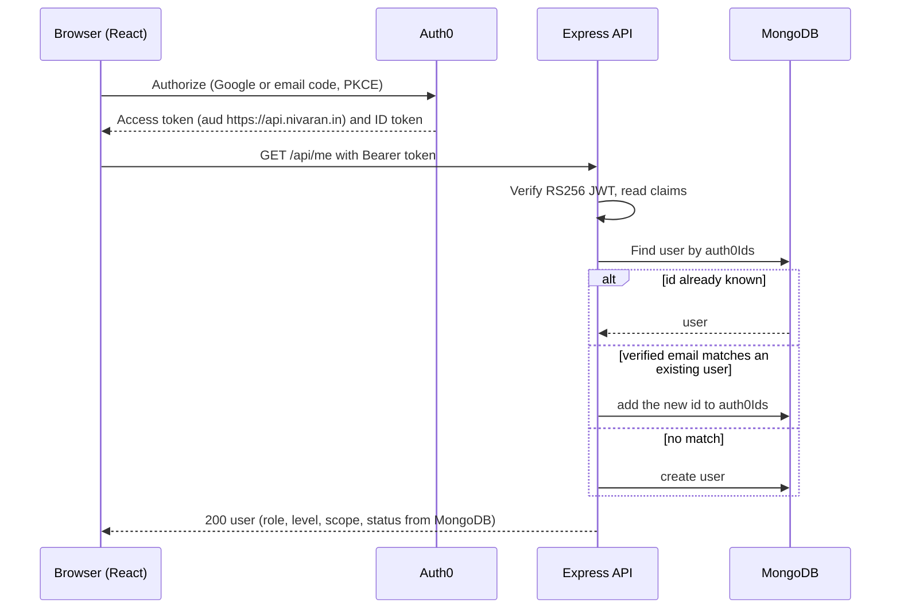
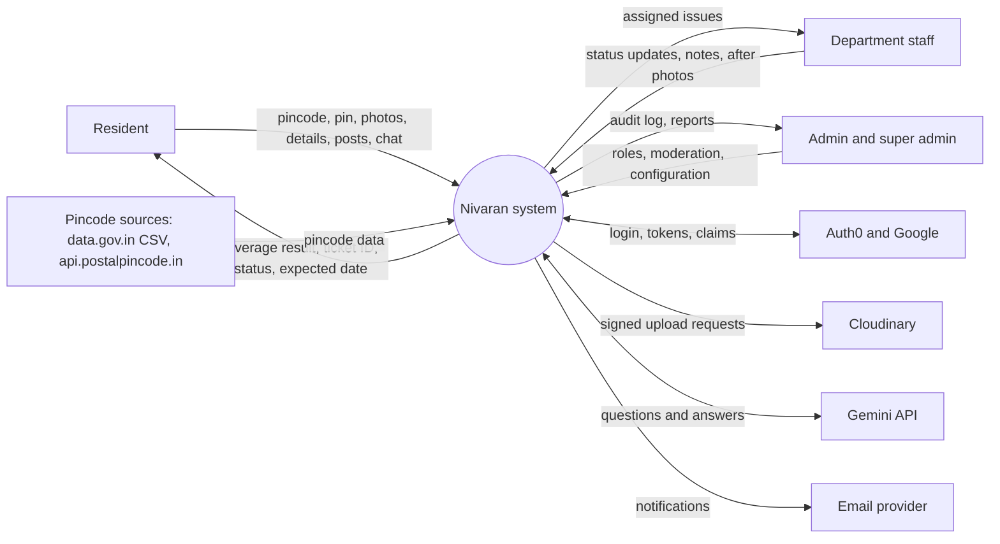
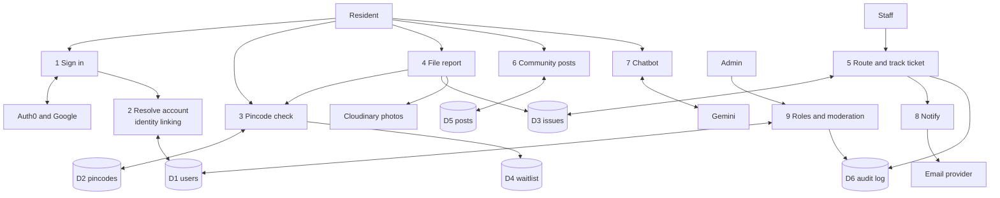

# Nivaran v2: Project Handoff

Written 2026-11-25 (Wed) at the end of a long working session, to start a new chat without losing context.
No secrets are in this file. Only environment key NAMES appear, never values.

How to read the status tags used below:
- [DONE] built and checked in the sessions this document comes from
- [IN PROGRESS] started, not finished
- [PLANNED] designed, not built
- [UNVERIFIED] known from earlier conversation only. Confirm it in the repo before relying on it.

---

## 1. What Nivaran is

Nivaran is a civic issue platform. A resident reports a local problem (pothole, garbage, streetlight and similar)
for their own 6-digit pincode, drops a pin on a map inside that area, adds a photo and details, and gets a ticket ID,
the department handling it, and an expected-by date. They track the ticket until it is fixed. A pincode community
lets neighbours post and discuss. A chatbot helps with questions.

Core rules of the product:
- Reporting is locked to a pincode. The pin must fall inside the pincode's area.
- Login is only Google or an emailed 6-digit code. No passwords, no verification links.
- One Nivaran user per verified email, however they sign in.
- Role, access level, scope and status come from MongoDB, never from the token.
- Residents are mostly on phones, often outdoors, sometimes on weak data. Mobile first.

Context: this is Sachin Kumar's college capstone (LPU, CSE). The earlier version was deployed as CivicPulse. The same
project feeds a DevOps course report (Terraform, Ansible, Nagios) and a planned group conference paper.
Nivaran v2 is the rebuild.

Repository: GitHub `sachinsharmaa07/NVN`. Local folder on the user's Mac: `~/Downloads/Daily/Projects/NVN`.

---

## 2. Tech stack

| Layer | Choice |
|---|---|
| Client | React + Vite (Vite 8), React Query hooks (`useMe`), Auth0 React SDK |
| Server | Node + Express 5, Mongoose, Zod validation, structured JSON logs |
| Database | MongoDB Atlas. Databases: `nivaran_dev` (development), `nivaran_test` (tests may wipe it) |
| Auth | Auth0: Google social login + Passwordless Email OTP, RS256 access tokens |
| Maps and geo | GeoJSON with 2dsphere indexes (planned). Map library: [UNVERIFIED] check the client |
| Photos | Cloudinary with server-signed uploads (decided, not built) |
| Chatbot | Gemini API (UI bubble exists, backend state [UNVERIFIED]) |
| Tooling | Claude Code CLI, Graphify (code graph), Ponytail (minimal-change review), Playwright MCP |
| Monorepo | npm workspaces (`server`, `client`), `concurrently` runs both from the repo root |

Ports: API on **5001**, client on **5173**. macOS AirPlay Receiver owns port 5000, so never use 5000 on a Mac.

---

## 3. System design

### 3.1 High-level architecture

```
 Browser (React SPA, :5173)
    |  1. Auth Code + PKCE
    v
 Auth0 (tenant nivarann.us.auth0.com)  <--- Google social login, Passwordless Email OTP
    |  2. access token (aud = https://api.nivaran.in) + ID token
    v
 Browser  --- Bearer token --->  Express API (:5001)
                                   route -> controller -> service -> model
                                   |            |            |
                                   |            |            +--> MongoDB Atlas (nivaran_dev)
                                   |            +--> Auth0 Management API (M2M, app_metadata only)
                                   +--> Cloudinary (signed uploads, planned)
                                   +--> Gemini API (chatbot, planned)
                                   +--> Email provider (notifications, planned)
```

### 3.2 Backend layering (a rule for all new code)

- route -> controller -> service -> model. No business logic in routes.
- Zod validates every input. Error body is always `{ "error": { "code", "message" } }`.
- Indexes live in models and are created by migration scripts (dry run by default, `--apply` to write).
- Writes are idempotent. Unique indexes protect them, and services catch duplicate-key errors (E11000) and re-read.
- Public routes are rate-limited. List endpoints are paginated with a capped page size.
- Logs never contain tokens, full emails or secrets.
- Tests use `nivaran_test` only.

### 3.3 Login and account resolution (sequence)



The first successful `GET /api/me` after login is what creates the user. If that call fails, no user is created.

### 3.4 Data flow diagram, level 0 (context)



### 3.5 Data flow diagram, level 1 (processes and data stores)



Status of each process: 1 and 2 [DONE]. 3 to 9 [PLANNED], except that a pincode input and chat bubble exist as UI only.

### 3.6 Report lifecycle (planned)

```
reported -> received -> in progress -> fixed        (side states: on hold, reopened)
                                         |
                                         +--> reporter asked "Is it fixed?" (one tap)
```

Each change appends to `statusHistory` (status, by whom, when) and writes an audit log entry. Staff may attach "after" photos.
Only on-hold pauses the SLA clock. A reopened issue gets a new deadline. A breach notifies the department head, then the city admin.

---

## 4. Authentication and access design

### 4.1 Final decisions
- Login methods: Google (`google-oauth2`) and passwordless email code (connection `email`, 6 digits, 300 seconds).
- No passwords and no verification link. Email codes are Identifier First.
- One Nivaran user per verified email. A user holds an array `auth0Ids`, so Google and email logins share one account.
- Access levels 0 to 7 with a permission matrix. Level 4 and above are admins and must pass MFA.
  The MFA flag is fail-closed (`app_metadata.mfa_required`, enabled by the Action).
- The super admin (level 7) is created by a script from `SUPER_ADMIN_EMAIL`.
- `requireVerifiedEmail` stays as a safety net.

### 4.2 Auth0 configuration (what exists)
- Tenant `nivarann.us.auth0.com` (Development).
- API "Nivaran", identifier `https://api.nivaran.in`, RS256, RBAC on, offline access allowed.
  Application Access tab: **Nivaran Web must have User-delegated Access authorized**.
  Without it the app shows "Client ... is not authorized to access resource server".
- Applications: Nivaran Web (Single Page App, PKCE, refresh-token rotation) and Nivaran Server (M2M).
- M2M scope: only `update:users_app_metadata` should be enabled for Nivaran Server.
  [IN PROGRESS] `update:users` still needs to be unticked, then restart the server.
- Connections: Google social (own Google Cloud OAuth client, secret kept in the Auth0 dashboard only) and Passwordless Email.
  Auth0's built-in email sender is for development only.
- Post-login Action "Nivaran claims": allows only `google-oauth2` and `email`. Adds claims under
  `https://nivaran.in`: email, email_verified (strictly true), name, picture, login_method, mfa.
  Enables MFA when `app_metadata.mfa_required` is set.
- Allowed Callback URLs, Logout URLs and Web Origins must include `http://localhost:5173`.
- Plan note: OTP as an MFA factor is labelled PRO, and the trial had about 22 days left on 2026-11-24.
  Check Settings, then Subscription, before it ends.

---

## 5. Data model

[DONE] `User` (confirm exact fields in the repo [UNVERIFIED]): `auth0Ids[]` (unique index), email, emailVerified
(partial unique index on verified email), name, picture, accessLevel (0 to 7), scope, status, preferredLanguage
(`en` or `hi`), createdAt, lastLoginAt.

[PLANNED] `Pincode`: pincode (unique 6-digit string), state, district, localities[], centroid (GeoJSON Point,
2dsphere), boundary (GeoJSON Polygon, loaded for the pilot city first) and `boundarySource` so better data can replace it.

[PLANNED] `Issue`: reporter, pincode, location (GeoJSON Point, 2dsphere), category, department, title, description,
photos[] (up to 3, Cloudinary), status, statusHistory[], ticketId (human-readable, unique, counter-based, for example
NVN-261125-00042), expectedBy (from a per-category SLA config), createdAt.

[PLANNED] `Waitlist`: pincode plus HMAC of the email (decision pending, see section 9), unique on both.

[PLANNED] `Post` (community, scoped to a pincode) and `AuditLog`.

[PLANNED] Department mapping: a national category list, plus a per-city mapping from each category to a department
(edited by the city admin, every change audited), a triage queue for "Other" or unmapped reports, and a per-category,
per-city SLA in calendar hours with a national default.

---

## 6. API surface

[DONE] `GET /api/health` (status and database up/down) and `GET /api/me` (creates or links the user).
The full route list [UNVERIFIED]: the audit Step 1 produced it inside the Claude Code session. Re-run it to refresh.

[PLANNED]
- `GET /api/pincodes/:pin`, `POST /api/pincodes/:pin/check-point`, `POST /api/waitlist`
- `POST /api/issues`, `GET /api/issues/mine`, `GET /api/issues/:ticketId`, `PATCH /api/issues/:ticketId/status`
- Upload signing endpoint for Cloudinary
- Community: posts, replies, report and hide, staff moderation queue
- Chatbot proxy to Gemini
- Admin: users and roles, audit log

---

## 7. Repository map

This tree is assembled from the sessions and is [UNVERIFIED]. Regenerate the real one with:

```bash
git ls-files | awk -F/ 'NF<=3' | sort | head -200
```

```
NVN/
  package.json                workspaces: server, client. "npm run dev" runs both with concurrently
  README.md                   setup notes (port 5000 -> 5001 doc fix pending commit)
  CLAUDE.md                   slimmed project rules for Claude Code
  .claude/
    settings.json             allow: npm run/test/ci, git status/diff/add, graphify. deny: reading .env, git push, rm -rf
    commands/step.md          /step <prompt-file> <step-number>  (re-created on 2026-11-25)
  docs/
    AUTH0_SETUP.md
    prompts/
      phase-1-cleanup.md
      phase-1-verify.md
      phase-1b-audit.md       read-only audit, 3 steps
      phase-1c-ui-redesign.md UI redesign, 7 steps
      phase-2-backend.md      pincodes then reports, 7 steps
    DECISIONS.md              [PLANNED] being written from the seven decisions
  data/
    pincodes.csv              [PLANNED] data.gov.in file, not downloaded yet
  client/
    .env.example, .env        (.env is git-ignored)
    src/
      AuthProvider.jsx        runs useMeQuery after login (line 77 at last check)
      hooks/useMe.js          calls GET /api/me
      ...pages: Home, Report (placeholder), My issues, Community, plus Profile and Admin [UNVERIFIED]
      sign-in sheet           Google and email buttons; header Sign in button
  server/
    .env.example, .env        (.env is git-ignored)
    src/
      server.js               starts the API, connects MongoDB
      services/identityLinkService.js
      ...routes, controllers, models [UNVERIFIED]
    scripts/
      migrateUsersV2.js       npm run migrate:users-v2 -w server  (dry run default, --apply to write)
      bootstrap super admin   npm run bootstrap:super-admin -w server
    tests/api/
      identityLink.test.js
      migrateUsersV2.test.js
  .playwright-mcp/            screenshots from the audit. Being added to .gitignore.
```

Git state: branch `phase-1-cleanup` pushed to GitHub. Commits include c7ca2f4 (remove email verification flow),
834988e (Google and email-code sign-in sheet), ab00b2c (format Claude settings), 7b543c9 (link multiple sign-in ids
per verified email). A branch `phase-2-backend` was suggested for the prompt files and decisions.
The Phase 1 pull request is not confirmed open. Open it at
`https://github.com/sachinsharmaa07/NVN/pull/new/phase-1-cleanup`. `gh` is not signed in on the Mac.

---

## 8. Environment

Key NAMES only. Values live in the git-ignored `.env` files.

`server/.env`: NODE_ENV, PORT (5001), CLIENT_URL (`http://localhost:5173`, no trailing slash), LOG_LEVEL, TRUST_PROXY,
MONGODB_URI (database name `nivaran_dev`), MONGODB_URI_TEST (`nivaran_test`), AUTH0_DOMAIN, AUTH0_AUDIENCE,
AUTH0_M2M_CLIENT_ID, AUTH0_M2M_CLIENT_SECRET, SUPER_ADMIN_EMAIL.
Planned: HMAC_SECRET (generate with `openssl rand -hex 32`), CLOUDINARY_CLOUD_NAME, CLOUDINARY_API_KEY, CLOUDINARY_API_SECRET.

`client/.env`: VITE_API_URL (`http://localhost:5001`), VITE_AUTH0_DOMAIN, VITE_AUTH0_CLIENT_ID, VITE_AUTH0_AUDIENCE.
The client reads only `client/.env`. `VITE_` keys placed in `server/.env` do nothing.
Vite reads env files only at startup, so restart after any change. A `client/.env.local` would override `.env`.

Check key presence without exposing values:

```bash
awk -F= '/^[A-Za-z_]+=/{print $1, ($2==""?"EMPTY":"set")}' client/.env
awk -F= '/^[A-Za-z_]+=/{print $1, ($2==""?"EMPTY":"set")}' server/.env
```

Run the app from the repo root with `npm run dev`. Running it inside `client/` starts Vite only, with no API.

---

## 9. Decisions log

| # | Topic | Decision |
|---|---|---|
| A | Login | Google plus passwordless email code only. No passwords, no verification link. |
| B | Accounts | One user per verified email, linked through `auth0Ids`. |
| C | Authorization | Role, level, scope and status from MongoDB, never from the token. |
| 1 | Pincode boundaries | One pilot city first. Boundaries come from open data or are drawn by hand, stored with a 2dsphere index and a `source` field so better data can replace them. **Pilot city: still open.** |
| 2 | Departments | One national category list. Each city admin maps every category to one of their departments. "Other" or unmapped reports go to a triage queue. Every mapping change is written to the audit log. |
| 3 | Expected-by date | Calendar hours from submission, set per category per city with a national default. Only on-hold pauses the clock. A reopened issue gets a new deadline. A breach notifies the department head, then the city admin. |
| 4 | Photos | Cloudinary, server-signed uploads. Up to 3 per report, 5 MB each, JPEG, PNG, WebP or HEIC, EXIF location data removed. Links are public but hard to guess. Only staff upload "after" photos. Two additions agreed earlier, to verify in `docs/DECISIONS.md`: read GPS in the browser before stripping, only to prefill the map pin, and compress in the browser to about 1600px. Secrets only in `server/.env`. |
| 5 | Languages | English and Hindi at launch. All UI text behind translation keys. Regional languages later, Punjabi first. |
| 6 | Notifications | In-app plus email at launch. No SMS for now (India DLT registration adds cost and paperwork). |
| 7 | Community | Signed-in users with a verified email post in their own pincode's community. Posts go live immediately. Moderation after publishing: report button, auto-hide after about 3 reports pending review, per-user rate limit, staff queue. |
| Open | Waitlist emails | HMAC lets us deduplicate but not email people later. Choose HMAC-only or encrypted emails before building. |
| Open | Pilot city | Decides which pincode boundaries are loaded first. A distance-from-centre fallback is only needed for pincodes that have no boundary yet. |

---

## 10. Progress

| Phase | What | Status |
|---|---|---|
| 0 | Foundation: monorepo, Express and React scaffolding, base tooling | [DONE] |
| 1 | Auth0 setup, Google and email-code login, claims Action, identity linking, v2 migration, admin MFA flag, verification flow removed, sign-in UI | [DONE] with pending confirmations below |
| 1b | Read-only audit of backend and frontend (3 steps, run in the CLI) | [DONE] The report lives in the CLI session. Re-run `/step phase-1b-audit.md 3` to regenerate. |
| 1c | UI redesign (7 steps, starting with a design plan you approve) | [PLANNED] next, can run in parallel with Phase 2 |
| 2 | Backend: pincodes, then reports (7 steps) | [PLANNED] next |
| 3 | Report flow end to end (UI plus API plus photos) | [PLANNED] |
| 4 | Ticket tracking and staff console | [PLANNED] |
| 5 | Community and moderation | [PLANNED] |
| 6 | Chatbot (Gemini) | [PLANNED] |
| 7 | Admin dashboard and real statistics (replace the fake "Sample numbers") | [PLANNED] |
| 8 | Notifications (in-app, email) | [PLANNED] |
| 9 | DevOps: Docker, GitHub Actions CI/CD, Terraform, Ansible, Nagios monitoring, AWS deployment | [PLANNED] |
| 10 | Hardening, load and accessibility checks, metrics for the research paper | [PLANNED] |

Evidence for Phase 1 at its end: 597 server tests and 196 client tests passing. Migration dry run found 0 users,
`--apply` created the indexes, the rerun changed nothing. The app now signs in and shows the signed-in avatar.

What the UI looks like today (screenshots reviewed): a dark theme with a teal accent. A Home page with a 6-box pincode
input, a "How it works" three-step section, and a fake "Reports at a glance" stats row. A sidebar with Report an issue,
Home, My issues and Community. A chat bubble. The Report page says "The report form isn't ready yet". This is expected
until Phase 2 exists.

---

## 11. What is left

### 11.1 Phase 1 confirmations (small, do first)
1. Rotate three secrets that were pasted into chat: the Auth0 M2M client secret, the Google OAuth client secret and the
   MongoDB password. Update both Mongo URIs after changing the password.
2. In Atlas, `nivaran_dev` then `users`: confirm one user with two `auth0Ids` (one `google-oauth2|`, one `email|`)
   after signing in with Google and then with the email code using the same Gmail.
3. Untick `update:users` for Nivaran Server on the Management API Application Access tab. Keep `update:users_app_metadata`.
4. Set `SUPER_ADMIN_EMAIL`, then run `npm run bootstrap:super-admin -w server`.
5. Commit the pending doc fix (port 5001 in `.env.example` and README files), commit the prompts and decisions on a new
   branch, and open the Phase 1 pull request.
6. Check the Auth0 plan before the trial ends.

### 11.2 Deferred review items
- A failed `lastLoginAt` write when a token's email changes to an address another user has verified.
- A cleanup migration for the old `auth0Id` field.
- A development-only banner when Auth0 env values are missing (included in the UI redesign prompt).

### 11.3 Build work
Phase 2 first (pincodes unlock the report flow), then 1c in parallel, then phases 3 to 10 as in section 10.
Before Phase 2 Step 2, download the data.gov.in "All India Pincode Directory" CSV to `data/pincodes.csv` and check its size
before committing it. Before Phase 2 Step 6, create a Cloudinary account.

---

## 12. The end goal

A polished, mobile-first civic platform that a real resident can use in under a minute: enter a pincode, drop a pin,
send a photo, get a ticket with a department and an expected-by date, and see honest status updates until it is fixed.
Behind it: a clean layered backend with strong access control, real statistics, a moderated pincode community, a
helpful chatbot, notifications, and a repeatable deployment pipeline with monitoring. Success also means an
explainable project: a DevOps report and a research paper backed by real measurements from the running system.

---

## 13. Working method (how the CLI is used)

- One Claude Code session per task. `/clear` between steps. `/model opusplan` for planning.
- Prompts live in `docs/prompts/`. Run one step at a time: `/step <file> <number>`.
- Graphify first (`graphify query ...`) before opening files, then `graphify update .` after changes.
- Ponytail: minimal change, reuse first, `/ponytail-review` at the end (high and medium findings only).
- Plan first if a step touches more than 3 files, and wait for approval.
- No commits, pushes or destructive commands without explicit approval. Keep auto mode off while debugging
  (`Shift+Tab` cycles it).
- Never read or paste `.env` contents. Use the key-presence check in section 8.
- Plugins in use: backend-design, frontend-design, engineering, design. Plugins turned off: aws-core, productivity,
  code-review-plugin (turn aws-core on at the DevOps phase).
- MCP servers: context7, playwright. Playwright MCP tools load only after restarting Claude Code.

---

## 14. Lessons and pitfalls from this project

| Symptom | Cause | Fix |
|---|---|---|
| `EADDRINUSE :::5000`, and `curl` shows `Server: AirTunes` with 403 | macOS AirPlay Receiver owns port 5000 | Use 5001 in `server/.env` and `client/.env`. Update `.env.example` and the README. |
| App says "Sign-in isn't set up yet" and shows no Sign in button | `VITE_AUTH0_*` blank in `client/.env` (they had been put in `server/.env`) | Put them in `client/.env` and restart Vite |
| "Client ... is not authorized to access resource server" | Nivaran Web lacks User-delegated Access on the API | Auth0 then APIs then Nivaran then Application Access then Edit Nivaran Web |
| Vite starts on 5174 | An old Vite process still holds 5173, which breaks Auth0 callbacks and CORS | `lsof -nP -iTCP:5173 -sTCP:LISTEN`, then `kill <PID>` |
| No users in Atlas after login | `GET /api/me` never succeeded | Check `curl -i http://localhost:5001/api/me` returns 401 with `UNAUTHENTICATED`, then check the Network tab |
| `/step` says "Unknown command" | `.claude/commands/step.md` missing, or the CLI started before it existed | Create the file and restart Claude Code from the repo root |
| `gh pr create` asks to log in | `gh` is not authenticated | `gh auth login`, or use the browser pull request link |
| `.claude/settings.json` fails prettier | Invalid JSON | Rewrite it as valid JSON and run `npx prettier --write` |
| Commits land on `main` | No branch created first | `git switch -c <branch>` before committing |
| `sed -i` fails on macOS | BSD sed needs an empty suffix | Use `sed -i '' 's/a/b/' file` |

---

## 15. Open questions to settle early in the next chat
- Which city is the pilot (decides which pincode boundaries load first, and how to get or draw them).
- Waitlist emails: HMAC only, or encrypted so people can be notified.
- Which map library the client uses, and whether pincode boundary polygons are available or only centroids.
- UI direction from the redesign Step 1 (light or dark default, type, the one memorable motion).

---

## 16. First message for the new chat

Paste this at the top of the new conversation, with this file attached:

```text
I am Sachin, building Nivaran v2 (MERN, Auth0, Atlas) in ~/Downloads/Daily/Projects/NVN. The attached file is the full
handoff: design, DFD, status, decisions and what is left. Phase 1 (auth and identity linking) is done except the
confirmations in section 11.1. I use the Claude Code CLI with /step and prompt files in docs/prompts, plus Graphify and
Ponytail to save tokens.
Please: (1) read the handoff, (2) tell me the three most valuable things to do next in order, (3) then help me with
the first one. Do not modify files, run destructive commands, push or deploy without my explicit approval, explain code
line by line when I ask, give hints before full solutions for practice problems, and show terminal commands with
expected outputs. I am on macOS. Never ask me to paste .env contents.
```
