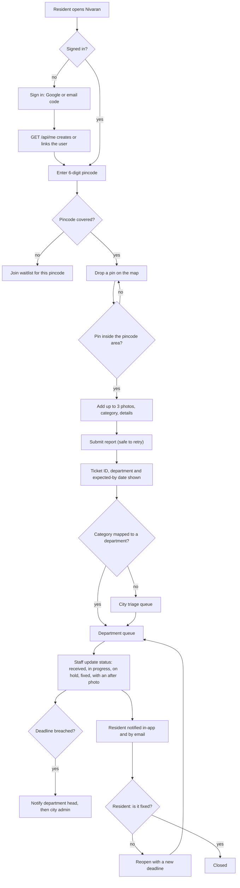
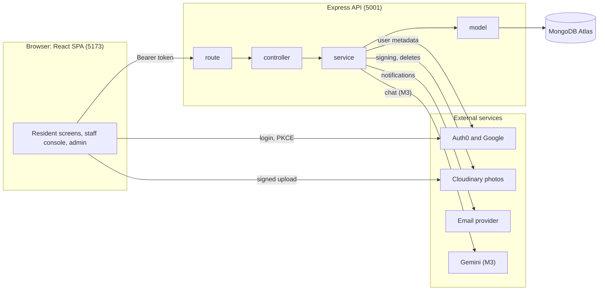
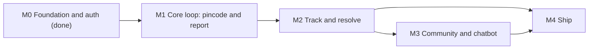

# Nivaran v2: Lean Replan

Written 2026-11-25. Status: M0, M1 and M2 are done; Docker (part of M4) is built. Next: M3 or the rest of M4.

## 1. Why replan

The project had 11 phases, 5 prompt files, many plugins and several workflows. That costs tokens and attention.
A capstone needs one working core loop, shown end to end, then the rest on top. This plan has 5 milestones.
Each one ends with something you can demo and tests that pass.

Principles:
1. One working loop first: sign in, pincode, report, ticket, resolve.
2. One pilot city. Pincode boundaries are loaded for that city only.
3. UI is built together with each feature, not as a separate phase. The design system is created once, at the
   start of M1.
4. A milestone is done only when its exit criteria pass. Nothing starts until the previous one is demoed.
5. Fewer files, fewer plugins, one prompt file per milestone.

## 2. Full flow

### 2.1 Product flow (resident, staff, admin)

### 2.2 System flow

### 2.3 Milestone order

M3 is optional. If time runs short, M4 can follow M2 directly.

## 3. Milestones and exit criteria

| # | Milestone | Contents | Done when |
|---|---|---|---|
| M0 | Foundation and auth | Monorepo, Auth0 login (Google and email code), identity linking, migration, admin MFA flag | DONE. Remaining: rotate secrets, one-user-two-ids check, open the PR |
| M1 | Core loop | Design system and app shell. Pincode model, import, lookup, boundary check for the pilot city. Report API and UI (stepper, map pin, up to 3 photos on Cloudinary at 5 MB each, EXIF removed). Ticket ID, department routing with a triage queue, expected-by date. Waitlist. English and Hindi keys from the start. | A resident signs in, enters a pilot pincode, pins inside the boundary, submits, and sees ticket ID, department and date. A pin outside the area is refused. Tests pass. `docs/API.md` has curl examples. |
| M2 | Track and resolve | My issues list and ticket timeline. Staff console: update status, on-hold, after photo. SLA clock rules and breach notifications (in-app and email). Reopen with a new deadline. Real statistics replace the fake Home numbers. | Staff change a status and the resident sees it. A breach notifies the department head, then the city admin. The Home numbers come from the database. |
| M3 | Community and chatbot (optional) | Pincode community posts with report, auto-hide and a staff queue. Gemini chatbot that answers about the platform and a user's own tickets, rate-limited. | Posts work and moderation hides reported posts. The chatbot never answers about tickets that are not the asker's. |
| M4 | Ship | Docker, GitHub Actions (lint, test, build), Terraform, Ansible, Nagios checks, AWS deployment, hardening, load and accessibility checks, metrics for the DevOps report and research paper. | `docker compose up` runs the stack. CI is green on a pull request. A deployed URL works. Monitoring raises an alert when the API is stopped. |

## 4. What was cut or merged

| Before | Now |
|---|---|
| Phase 1b audit, Phase 1 verify, Phase 1 cleanup | Done and archived in the handoff. Prompt files removed. |
| Phase 1c UI redesign | Merged into M1 (design system first), then each milestone ships its own screens |
| Phase 4 tracking and staff console, Phase 7 admin statistics, Phase 8 notifications | Merged into M2 |
| Phase 5 community, Phase 6 chatbot | M3, optional |
| Phase 9 DevOps, Phase 10 hardening | M4 |
| SMS notifications | Cut. Revisit only if DLT registration is done. |
| Regional languages | After M4. Translation keys exist from M1, so it is a content task. |
| Boundaries for every city | Pilot city only, with a `boundarySource` field so better data can replace it |

## 5. Keep, disable, remove

### Keep
- All source code and tests in `client/` and `server/`.
- `.claude/settings.json` and `.claude/commands/step.md`.
- A slim `CLAUDE.md`, `README.md`, `docs/AUTH0_SETUP.md`, `docs/DECISIONS.md`, `docs/API.md` (when it exists).
- `docs/PLAN.md` (this file).
- One prompt file per milestone: `docs/prompts/m1-core-loop.md` first. The others are written only when their turn comes.
- Migration scripts that were already applied (`migrateUsersV2.js`) stay while they are idempotent and tested.

### Disable (not uninstall; re-enable when needed)
- Plugins: keep `backend-design` and `frontend-design` on. Turn `engineering`, `design`, `aws-core`, `productivity`
  and `code-review-plugin` off. Re-enable `design` for review steps in M1 and M2, and `aws-core` in M4.
- MCP servers: keep `context7`. Keep `playwright` off except during UI checks.
- Any custom agents or coordinator-era workflows from the earlier setup.

### Remove (only after a dry-run list that you approve)
- Completed prompt files: `phase-1-cleanup.md`, `phase-1-verify.md`, `phase-1b-audit.md`, `phase-1c-ui-redesign.md`,
  `phase-2-backend.md`. Their content moves into `m1-core-loop.md`.
- Coordinator or subagent files from the abandoned workflow.
- Unreferenced source files, unused components, duplicate docs and unused dependencies that the dry run proves are
  dead (checked with Graphify and a text search, not guesses).
- Local-only folders such as `.playwright-mcp/` (already git-ignored).

### Safe removal rules
- Work on a branch named `chore/cleanup`.
- Tracked files go with `git rm`, so history can restore them. Untracked files move into a git-ignored `_to_delete/`
  folder. Never `rm -rf`.
- Tests and the client build must pass after the removal.
- You approve the exact list first.

## 6. Token habits (so work stays cheap)
- One milestone prompt file, one step at a time, `/clear` between steps.
- Graphify query before opening files. Ponytail review at the end of each step.
- Plan first when a step touches more than 3 files.
- Keep auto mode off while debugging or deleting.

## 7. Next actions, in order
1. Finish the "verify and complete" run and commit its results.
2. Run the cleanup dry run, approve the list, remove on `chore/cleanup`, merge or keep as a branch.
3. Rewrite the prompts into `docs/prompts/m1-core-loop.md` from this plan.
4. Rotate the three secrets, choose the pilot city, download `data/pincodes.csv`.
5. Start M1 step by step.

## 8. Open decisions
- Pilot city (decides boundaries and the first test data).
- Waitlist emails: HMAC only, or encrypted so people can be notified.
- Whether M3 (community and chatbot) is in scope for the capstone deadline.
- Light or dark default theme, decided in M1 design step.
