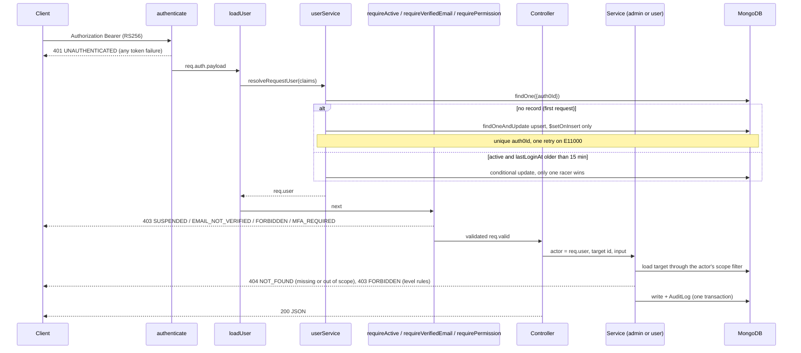

# Phase 1: authentication and authorization, design

Status: Approved and built (Phase 1).

> **Changed after Phase 1 (Nov 2026):** sign-in is Google or Auth0 email OTP only (no passwords, no
> verification link). The `POST /api/me/resend-verification` endpoint, the VerifyEmail page,
> `useResendVerification`/`useResendCooldown` and `ALREADY_VERIFIED` were removed. `EMAIL_NOT_VERIFIED`
> now shows a toast and opens the sign-in sheet. Sections below that mention them are historical.

Scope: Auth0 login, the request pipeline (`authenticate` → `loadUser` → `requireActive` → `requireVerifiedEmail` → `requirePermission` → scope check in the service), roles and scope, profile, admin user management, audit log, bootstrap of the first super admin, and the client screens that go with them.

## 1. Rules this design follows

1. MongoDB is the source of truth for role, scope (`cityId`, `departmentId`, `stateCode`) and `status`. The token proves identity and `email_verified` (and MFA, see 3.3). The user is loaded from the DB on every request.
2. Deny by default. Every protected route declares `requirePermission("<resource>:<action>")` and a scope check in the service. A test walks the router and fails on any route without both.
3. Nobody can grant a level equal to or above their own. Every role or status change writes an AuditLog in the same transaction.
4. A suspended user is blocked on their next request.
5. Tokens never go in `localStorage` (Auth0 in-memory cache plus refresh tokens). No passwords, no own JWT signing, no own OTP code.
6. Out-of-scope or missing targets return 404 `NOT_FOUND` with identical bodies. A missing permission returns 403.

Levels: 0 public, 1 citizen, 2 moderator (city), 3 staff (department), 4 dept_head (department, MFA), 5 city_admin (city, MFA), 6 state_officer (state, read-only oversight, MFA), 7 super_admin (platform, MFA).

## 2. Decisions the contributors disagreed on, and what this document chose

Five contributors designed parts in parallel. Where they disagreed, this is the call. Each one is also an open question for Sachin in section 13 (the number in brackets).

| Topic | Choice | Why |
|---|---|---|
| Order of Auth0 call and DB write on a role change [Q2] | Depends on direction. Promotion to level >= 4: set `mfa_required` in Auth0 first, then one Mongo transaction (user + AuditLog). Demotion below 4: transaction first, then clear the flag (best effort). | The only dangerous state is an admin without MFA. Extra MFA for someone who does not need it is harmless. (Schema contributor proposed "transaction, then API"; threat and test contributors proposed "API, then transaction". This takes the second for promotions.) |
| How MFA is enforced for level >= 4 [Q4] | The post-login Action adds a claim `https://nivaran.in/mfa` = `true` when the login used MFA. `requirePermission` fails closed with 403 `MFA_REQUIRED` when the DB role is level >= 4 and the claim is not `true`. Server design contributor proposed reading the standard `amr` claim instead; `amr` is not guaranteed in access tokens, so the custom claim wins. | Closes the gap where a user is promoted while holding a session that never did MFA. |
| Name and avatar source [Q1] | Add `name` and `picture` to the Action (`https://nivaran.in/name`, `https://nivaran.in/picture`). No `/userinfo` call. | One Action edit (needed anyway for the `mfa` claim), zero extra network calls, no extra failure path. `/userinfo` is the fallback if Sachin does not want to touch the Action. |
| Suspended user and `/api/me` [Q14] | `/api/me` stays blocked like every route: 403 `SUSPENDED` with `details.reason`. No exemption. | The brief says blocked on the next request. The client reads the reason from `details`. |
| Audit action names | `user.role_change`, `user.suspend`, `user.reactivate`, `user.bootstrap_super_admin`, `user.mfa_flag_sync_failed` | Schema contributor's list; one verb form. |
| Audit actor fields | `actorType` (`user`/`system`), `actorId`, `actorLabel`, `actorRole` | Bootstrap has no User. |
| Concurrency on a role or status change | Mongoose `optimisticConcurrency`; `VersionError` → 409 `CONFLICT` | Simpler than hand-written filters on `updatedAt`. |
| Scope-rule constant | One `SCOPE_RULES` in `utils/permissions.js`, used by Zod, the service and the Mongoose hook | One source for the same rule. |
| Citizen `cityId` | Forbidden in Phase 1 (citizens carry no scope). Phase 2 may allow a system-set home city. | Keeps the rule table simple. |
| Indexes on User | Schema contributor's set (section 6.2) | It supersedes the others. |
| Admin write rate limit | 10 per minute per user (reads 60) | Threat contributor's number; role changes are rare. |
| Default page size | API default 20, max 50. The client asks for 25. | Cursor API, "Load more" UI. |
| Test database [Q7] | Real MongoDB as a replica set (transactions need it). Recommend `mongodb-memory-server` (`MongoMemoryReplSet`) as a server devDependency. Needs approval. | Without it the JIT race and transaction tests never run in CI. |

## 3. What stays, what changes, what is new

The Phase 1 code already built is extended, not redone. Paths are under `server/` or `client/`.

| File | Stays | Changes (and why) | New |
|---|---|---|---|
| `server/src/config/env.js` | Zod parse, test-DB guard, `TRUST_PROXY` rule | Add `AUTH0_M2M_CLIENT_ID`, `AUTH0_M2M_CLIENT_SECRET`, `SUPER_ADMIN_EMAIL` (lowercased email). Optional in dev, M2M keys required in production. Explicit `clockTolerance` (5 s). | `.env.example` entries |
| `middleware/auth.js` | `createJwtCheck`, RS256 only, one generic 401, export name `authenticate` | JWKS fetch failure maps to 503 `AUTH_PROVIDER_UNAVAILABLE` (today 500). Log `auth.rejected` at info. | none |
| `middleware/access.js` | `requireVerifiedEmail`, shape of `requirePermission` | `loadUser` does the JIT upsert and the throttled refresh (today it 403s unknown users). `requireActive` is split out of `assertActive`. `requirePermission` also checks MFA. `requireScope` is removed (scope moves to the service). `req.user` gains `level`, `stateCode`, `status`, `mfa`. | `requireActive` |
| `middleware/userRateLimit.js` | whole file | none | none |
| `utils/access.js` | `levelOf`, `hasPermission`, `ROLES` | `inScope` rewritten (state_officer, `stateCode`); `canAssignRole` returns a reason and checks scope fields; new `scopeFilterFor(actor, permission)` | `utils/permissions.js` (matrix, `SCOPE_RULES`, MFA flags), `utils/cursor.js`, `utils/india.js` (`PINCODE_RE`, `INDIA_STATE_CODES`), `utils/clock.js` |
| `models/User.js` | `auth0Id` unique+immutable, `email`, `role`, `status` | `verified` → `emailVerified`; add `stateCode`, `avatarUrl`, `suspendedReason/At/By`, `preferredLanguage`, `defaultPincode`, `lastLoginAt`; scope validation hook; `optimisticConcurrency`; new indexes (6.2) | `models/AuditLog.js`, `models/City.js`, `models/Department.js` (placeholders) |
| `services/userService.js` | `CLAIM_NAMESPACE`, `readClaims`, `toPublicUser`, `findByAuth0Id` | `syncFromToken` split into JIT upsert (`$setOnInsert` only) and a conditional 15-minute refresh; claims add `mfa`, `name`, `picture`; `ACCOUNT_SUSPENDED` → `SUSPENDED`; `USER_NOT_REGISTERED` removed | `resolveRequestUser`, `updateOwnProfile` |
| `services/authProviderService.js` | the file as the Auth0 facade | the `RESEND_UNAVAILABLE` stub becomes a real Management API call; add `setMfaRequired` | `services/auth0ManagementClient.js` |
| `controllers/meController.js`, `routes/meRoutes.js` | `no-store`, resend rate limit | `GET /me` no longer syncs (middleware did); add `PATCH /me`; resend gets `requireActive` + permission | `adminUserController.js`, `adminUserRoutes.js`, geo routes; mount in `routes/index.js` |
| `tests/helpers/fakeAuth0.js` | RSA key, local JWKS, token signing | add `kid` override, `mfa` and `name` claims | `tests/helpers/testDb.js`, Management client mock helper |
| `tests/api/auth.test.js` | token-failure table | stop mocking `userService`; real DB | `me.test.js`, `adminUsers.test.js`, unit tests, route-inventory test |
| `client/src/app/AuthProvider.jsx` | Auth0Provider, memory cache, refresh tokens, `useAuth()` | status `suspended`, `error.kind`, `sessionExpired`; `can()`, `level`; `MFA_REQUIRED` → `login({prompt:"login"})`; `refresh()` uses `cacheMode:"off"` | none |
| `components/auth/{AccountMenu,RequireAuth}`, `pages/VerifyEmail.jsx` | structure, loading skeleton | see section 10.3 | see section 10.3 |
| `lib/safePath.js` | whole file | none | none |
| `src/app/cors` config | allow-list | `credentials` becomes `false` (bearer header needs none) [Q11] | none |
| `docs/AUTH0_SETUP.md`, `docs/DESIGN.md` | n/a | add M2M scopes, Action claims, "no automatic account linking"; DESIGN.md role enum (5 → 7 roles) and `verified` → `emailVerified` | none |

Conflicts between the brief and the code, and how each is resolved (brief wins):

| # | Conflict | Resolution |
|---|---|---|
| 1 | Code reads `…/email`, `…/name`, `…/email_verified`; the Action sets only email and email_verified | Action adds `name`, `picture`, `mfa` [Q1, Q4] |
| 2 | `ACCOUNT_SUSPENDED`, `USER_NOT_REGISTERED`, 403 for out-of-scope | `SUSPENDED`, removed, 404 |
| 3 | `loadUser` 403s unknown users, `/me` creates them | JIT upsert in `loadUser` |
| 4 | DB write on every `/me` | At most one per 15 minutes; `lastLoginAt` added |
| 5 | Scope check in route middleware | In the service layer |
| 6 | 8 permissions | 14 `resource:action` permissions (section 5) |
| 7 | Resend is a stub | Management API job, M2M keys [Q6] |
| 8 | Route tests mock `userService` | Real JWKS + real DB; only the Management client is mocked |
| 9 | No `stateCode`, no MFA modelling | Both added |

## 4. Request flow

`authenticate` is the existing export (the brief calls it `checkJwt`).



| # | Middleware | Reads | Sets | Failure |
|---|---|---|---|---|
| 1 | `authenticate` | header, JWKS | `req.auth.payload` | 401 `UNAUTHENTICATED` for any token problem (reason logged only). 503 `AUTH_NOT_CONFIGURED` if env unset. 503 `AUTH_PROVIDER_UNAVAILABLE` if JWKS is unreachable and uncached. |
| 2 | `loadUser` | `sub`, `…/email`, `…/email_verified`, `…/mfa`, `…/name`, `…/picture`, then the DB | `req.user = {id, auth0Id, email, name, role, level, cityId, departmentId, stateCode, status, emailVerified, mfa}` | 401 `TOKEN_CLAIMS_MISSING` (JIT needs an email and the token has none). DB error: 503. |
| 3 | `requireActive` | `req.user.status` | none | 403 `SUSPENDED` (`details.reason`) |
| 4 | `requireVerifiedEmail` | token claim `=== true` | none | 403 `EMAIL_NOT_VERIFIED` |
| 5 | `requirePermission(p)` | `req.user.role`, `mfa`, matrix | none | 403 `FORBIDDEN`; 403 `MFA_REQUIRED` when the permission is MFA-flagged, level >= 4 and `mfa` is not `true` |
| 6 | `validate` | params, query, body | `req.valid` | 400 `VALIDATION_ERROR` |
| 7 | service scope check | `req.user` + target loaded through a scope filter | none | 404 `NOT_FOUND`; 403 `FORBIDDEN` for level rules or self-change |

Rules:
- `validate` runs after `requirePermission`, so unauthorized callers never learn the body shape.
- `loadUser` writes only for active users; suspension is checked before any write (kept from today).
- Role, scope and status never come from the token.

**First request (JIT).** Filter `{auth0Id}` (unique index). Update is `$setOnInsert` only: `email`, `emailVerified`, `name`, `avatarUrl`, `role:"citizen"`, `status:"active"`, `preferredLanguage:"en"`, `lastLoginAt`. Options: `upsert`, `returnDocument:"after"`, `runValidators`. On E11000 retry once. Five concurrent first requests produce exactly one user (test A7).

**15-minute throttle.** One conditional write: `findOneAndUpdate({_id, status:"active", $or:[{lastLoginAt:null},{lastLoginAt:{$lt: now-15m}}]}, {$set:{email, avatarUrl, emailVerified, lastLoginAt: now}})`. Racing requests: one wins, the rest get `null` and use the document they loaded. `name` is written only on insert (the user owns it via `PATCH /me`). Exception: if the token says verified and the DB says not, write at once so "I've verified it" works. Consequence: avatar and email shown elsewhere can be up to 15 minutes stale [Q12].

**`emailVerified`.** The token claim decides on every request. The DB field mirrors it and is read only where there is no token (admin list, bootstrap, the resend 409 check).

**DB email differs from the token.** The token wins and overwrites the DB email (lowercased). Role, scope and status key on `auth0Id`, so they never move with email. For level >= 4 users log `auth.email_changed` at warn. Email is not unique: a Google login and a password login with the same address are two users and are never auto-merged (merging by email is an account-takeover path).

## 5. Permission matrix

Columns are levels 0 to 7 (public, citizen, moderator, staff, dept_head, city_admin, state_officer, super_admin). "Ver" = verified email required. "MFA" = needs `mfa` claim when the actor is level >= 4. Permissions for later phases (`issue:*`, `post:*`) are defined now so those phases only add routes.

| Permission | 0 | 1 | 2 | 3 | 4 | 5 | 6 | 7 | Scope rule | Ver | MFA |
|---|---|---|---|---|---|---|---|---|---|---|---|
| public:read | ✓ | ✓ | ✓ | ✓ | ✓ | ✓ | ✓ | ✓ | none | no | no |
| profile:read_own | | ✓ | ✓ | ✓ | ✓ | ✓ | ✓ | ✓ | own: id from `req.user`, never a param | no | no |
| profile:update_own | | ✓ | ✓ | ✓ | ✓ | ✓ | ✓ | ✓ | own | no | no |
| issue:create | | ✓ | ✓ | ✓ | ✓ | ✓ | | | own | yes | no |
| issue:read_own | | ✓ | ✓ | ✓ | ✓ | ✓ | | | `issue.ownerId === actor.id` | no | no |
| issue:read_scope | | | | ✓ | ✓ | ✓ | ✓ | ✓ | department (3,4), city (5), state (6), platform (7) | yes | yes |
| issue:assign | | | | | ✓ | ✓ | | | department (4), city (5) | yes | yes |
| issue:update_status | | | | ✓ | ✓ | ✓ | | | department (3,4), city (5); staff also need assignment | yes | yes (4+) |
| post:create | | ✓ | ✓ | ✓ | ✓ | ✓ | | | own | yes | no |
| post:moderate | | | ✓ | | | ✓ | | ✓ | city (2,5), platform (7) | yes | yes (5,7) |
| user:read_scope | | | | | | ✓ | ✓ | ✓ | city (5), state (6, read-only), platform (7) | yes | yes |
| user:promote | | | | | | ✓ | | ✓ | city (5): target and new scope inside the actor's city, plus level rules in 7.1 | yes | yes |
| user:suspend | | | | | | ✓ | | ✓ | city (5): target in city and level below actor; platform (7) | yes | yes |
| city:onboard | | | | | | | | ✓ | platform | yes | yes |
| audit:read | | | | | | ✓ | | ✓ | city (5), platform (7) | yes | yes |

Notes:
- Old 8 permissions map to the new ones: `issue:work` → `issue:update_status` + `issue:read_scope`; `post:write` → `post:create`; `platform:manage` → `city:onboard`; `oversight:read` → `issue:read_scope` + `user:read_scope`; `city:manage` has no Phase 1 route.
- `dept_head` has no admin endpoints in Phase 1.
- `state_officer` is read-only: no `*:create`, `*:assign`, `*:promote`.
- Unverified users get only `profile:*`, `issue:read_own`, `public:read`.
- Only the bootstrap script can create a super_admin. Level 7 is never strictly below any actor.
- A route-inventory test walks `app.router.stack` and fails if a non-public route lacks `requirePermission` or a service scope call. A unit test deep-equals the `PERMISSIONS` constant to a literal copy of this table.

## 6. Schemas

Invariants live in the schema first (MongoDB has no FK, CHECK or RLS, so each rule is Mongoose validation plus a service check; a DB-level `$jsonSchema` validator is a later step).

### 6.1 User

| Field | Type | Constraints | Default | Why |
|---|---|---|---|---|
| `_id` | ObjectId | | auto | All API `:id` params use it, never `auth0Id` |
| `auth0Id` | String | required, unique, immutable, trim, max 128 | none | The identity (token `sub`) |
| `email` | String | required, lowercase, trim, max 254, **not unique** | none | Contact only; never an identity |
| `emailVerified` | Boolean | required | false | Mirror of the claim |
| `name` | String | trim, max 100 | "" | User-editable via `PATCH /me` |
| `avatarUrl` | String | max 2048; "" or `^https://` | "" | Blocks `javascript:` / `data:` URLs |
| `role` | String | enum of 7, required | citizen | |
| `cityId` | ObjectId ref City | per `SCOPE_RULES` | absent | |
| `departmentId` | ObjectId ref Department | per `SCOPE_RULES` | absent | |
| `stateCode` | String | `INDIA_STATE_CODES`, per `SCOPE_RULES` | absent | |
| `status` | String | active \| suspended, required | active | Explicit state, not a flag |
| `suspendedReason` | String | trim, 3..500 | absent | Required iff suspended; shown to the user, so write it user-safe |
| `suspendedAt`, `suspendedBy` | Date, ObjectId ref User | | absent | Same lifecycle; full history in AuditLog |
| `preferredLanguage` | String | en \| hi | en | |
| `defaultPincode` | String | `PINCODE_RE` `^[1-9][0-9]{5}$` | absent | |
| `lastLoginAt` | Date | | absent | Accurate to about 15 minutes |
| `createdAt`, `updatedAt` | Date | `timestamps: true` | auto | |

Options: `optimisticConcurrency: true` (two admins changing one user: the loser gets `VersionError` → 409).

`SCOPE_RULES` (R required, F forbidden):

| Role | cityId | departmentId | stateCode | Note |
|---|---|---|---|---|
| citizen | F | F | F | Phase 2 may add a system-set home city |
| moderator | R | F | F | |
| staff, dept_head | R | R | F | department must belong to that city (checked in the service) |
| city_admin | R | F | F | |
| state_officer | F | F | R | |
| super_admin | F | F | F | |

```js
userSchema.pre("validate", function () {
  const rule = SCOPE_RULES[this.role];
  for (const f of ["cityId", "departmentId", "stateCode"]) {
    const set = this[f] != null;
    if (rule[f] === "R" && !set) this.invalidate(f, `required for ${this.role}`);
    if (rule[f] === "F" && set) this.invalidate(f, `forbidden for ${this.role}`);
  }
  const susp = this.status === "suspended";
  for (const f of ["suspendedReason", "suspendedAt", "suspendedBy"])
    if (susp !== (this[f] != null)) this.invalidate(f, susp ? "required when suspended" : "must be empty when active");
});
```

- `runValidators` on `findOneAndUpdate` cannot see the whole document, so role change, suspend and reactivate use load → mutate → `save()`.
- A `pre(["updateOne","findOneAndUpdate"])` hook throws if the update touches `role`, scope fields, `status` or `suspended*` unless called with `{ scopeWrite: true }`. This stops the JIT sync or `PATCH /me` from changing scope by accident. `$setOnInsert: { role: "citizen" }` stays allowed.
- Demotion `$unset`s every scope field the new role forbids.
- City and Department existence is checked in the service. Hard delete of a City or Department is blocked while Users reference it.

Status transitions: active → suspended (actor level > target level, not self; writes status, reason, at, by; AuditLog `user.suspend`); suspended → active (same rule; unsets the three fields; `user.reactivate`); same → same is a no-op 200 with no audit row. Role changes on a suspended user are allowed and keep the user suspended.

`verified` → `emailVerified`: no production data exists. Dev databases: `updateMany({}, {$rename:{verified:"emailVerified"}})` or wipe. No dual-read shim. Existing fixtures that use `verified`, or roles without scope, must be updated.

### 6.2 User indexes

| Index | Serves |
|---|---|
| `{auth0Id:1}` unique | every request, JIT race |
| `{email:1}` | email prefix search (anchored lowercase escaped regex), exact lookup (bootstrap, promotion candidates) |
| `{cityId:1, role:1, createdAt:-1, _id:-1}` | city-scoped list, role filter, cursor order (replaces `{cityId, role}`, which is its prefix) |
| `{departmentId:1, role:1, createdAt:-1, _id:-1}` | department-scoped list |
| `{role:1, createdAt:-1, _id:-1}` | super_admin role filter |
| `{createdAt:-1, _id:-1}` | super_admin unfiltered list (droppable if super_admin must always filter) |

Cursor: opaque base64url of `{createdAt, _id}`; query `$or:[{createdAt:{$lt:c}},{createdAt:c,_id:{$lt:id}}]`; fetch `limit+1`; max 50. State officer scope has no index of its own: the service resolves `City.find({stateCode})` and queries `{cityId:{$in}}`. Name search is not index-backed (case-insensitive regex): scoped searches filter a small set; a global super_admin name search is a scan, acceptable below about 100k users, minimum 3 characters. Upgrade path: a lowercase `nameSearch` field or Atlas Search. Run `syncIndexes()` once in dev (Mongoose does not drop the old `{cityId, role}`).

### 6.3 AuditLog

| Field | Type | Constraints |
|---|---|---|
| `actorType` | String | `user` \| `system`, required |
| `actorId` | ObjectId ref User | required iff user |
| `actorLabel` | String | max 64, required iff system (e.g. `script:bootstrap-super-admin`) |
| `actorRole` | String | enum, required iff user (role at that time) |
| `action` | String | enum, required, immutable: `user.role_change`, `user.suspend`, `user.reactivate`, `user.bootstrap_super_admin`, `user.mfa_flag_sync_failed` |
| `targetType` | String | enum `['user']` now |
| `targetId` | ObjectId | required; no ref (the log outlives its targets) |
| `cityId` | ObjectId | snapshot of the target's city (cannot be back-filled later) |
| `before`, `after` | Mixed | changed fields only, serialized <= 4 KB, keys allow-listed per action. role_change: `{role, cityId, departmentId, stateCode}`; suspend: `{status, suspendedReason}`. Never tokens, secrets or email |
| `reason` | String | 3..500, required for role_change, suspend, reactivate |
| `ip` | String | max 45, from `req.ip` (needs `TRUST_PROXY >= 1`) |
| `requestId` | String | max 64 |
| `at` | Date | required, immutable, default now; `timestamps:false`, `versionKey:false` |

Indexes: `{targetType:1, targetId:1, at:-1}` (history of one user), `{at:-1, _id:-1}` (global feed), `{actorId:1, at:-1}` (what an admin did).

Append-only: `auditService` exports only `record()` and read functions. Schema hooks throw on `updateOne, updateMany, findOneAndUpdate, findOneAndReplace, findOneAndDelete, replaceOne, deleteOne, deleteMany, bulkWrite` and on `save()` of an existing doc; a unit test asserts each. Honest limit: hooks stop mistakes, not a driver call or a stolen credential. Later: a separate Atlas DB user with insert+find only, and an archive to write-once storage. Not a capped collection (it evicts old rows). The User change and the audit insert share one Mongo transaction (needs a replica set; Atlas has one). `user.mfa_flag_sync_failed` stores the error code only, never the Management API body. Rows hold ids and role data, not email or name, so a user erasure request does not touch the trail. Retention: at least 2 years, no TTL index [Q8].

### 6.4 City and Department (placeholders; Phase 2 owns the full models)

| Model | Fields | Indexes |
|---|---|---|
| City | `name` (req, max 100), `code` (req, unique, `^[A-Z0-9]{2,10}$`), `stateCode` (req) | `{code:1}` unique, `{stateCode:1, name:1}` |
| Department | `cityId` (req, ref City), `name` (req, max 100), `code` (req, `^[A-Z0-9_]{2,20}$`) | `{cityId:1, code:1}` unique |

Department has no `stateCode` (it would drift from City). `INDIA_STATE_CODES` (ISO 3166-2:IN, 36 codes) lives in `utils/india.js` with `PINCODE_RE`: `AN AP AR AS BR CH CG DH DL GA GJ HR HP JK JH KA KL LA LD MP MH MN ML MZ NL OD PB PY RJ SK TN TS TR UP UK WB`. (The code list is to be checked against ISO when built.)

## 7. Endpoints

Every non-public route runs `authenticate, loadUser, requireActive` first; admin routes add `requireVerifiedEmail`. Every endpoint can also return 401, 403 `SUSPENDED` and 503 `AUTH_NOT_CONFIGURED`. All bodies are Zod `.strict()`.

| Method and path | Permission | Scope | Request | Success | Errors |
|---|---|---|---|---|---|
| GET `/api/me` | profile:read_own | own | none | 200 `{user}` incl. `level`, `permissions[]`, `status`; `no-store` | 400 |
| PATCH `/api/me` | profile:update_own | own | optional `name` (1-100), `preferredLanguage` (en/hi), `defaultPincode` (PINCODE_RE or null); at least one key; nothing else | 200 `{user}` | 400 |
| POST `/api/me/resend-verification` | profile:update_own | own | empty | 202 `{sent:true}` | 409 `ALREADY_VERIFIED`, 429 (3/hour/user), 503 `AUTH_PROVIDER_UNAVAILABLE` / `AUTH_NOT_CONFIGURED` |
| GET `/api/admin/users` | user:read_scope | filter built from the actor | `limit` (1-50, default 20), `cursor`, `q` (3-64), `role` (enum), `status` (enum) | 200 `{items:[adminUser], nextCursor\|null}` | 400 (bad cursor too), 403 `FORBIDDEN`/`MFA_REQUIRED`/`EMAIL_NOT_VERIFIED` |
| PATCH `/api/admin/users/:id/role` | user:promote | target in actor scope | `id` ObjectId; `role`, `reason` (5-500), `cityId`, `departmentId`, `stateCode` as the new role needs | 200 `{user: adminUser}` | 400, 403, 404, 409 `CONFLICT`, 503 `AUTH_PROVIDER_UNAVAILABLE` |
| PATCH `/api/admin/users/:id/status` | user:suspend | target in actor scope | `status` (active/suspended), `reason` (5-500) | 200 `{user: adminUser}` | 400, 403, 404, 409 |
| GET `/api/cities`, GET `/api/departments?cityId=` (new, from the client design, Q10) | user:promote | actor's own city (city_admin) or all (super_admin) | `cityId` ObjectId | 200 `{items:[{id,name,code}]}` | 400, 403 |

`adminUser` fields: id, email, name, avatarUrl, role, level, cityId, departmentId, stateCode, status, suspendedReason, emailVerified, lastLoginAt, createdAt, and `canManage` (server-computed so the client does not reimplement scope rules). Never `auth0Id`.

List scope: city_admin `{cityId: actor.cityId}`; state_officer `{$or:[{stateCode}, {cityId:{$in: cityIdsOf(state)}}]}` (read-only); super_admin `{}`. Citizens have no `cityId`, so a city_admin finds a citizen only by exact full email (`q` containing `@`): the "invite" path [Q3]. Search: anchored lowercased escaped email prefix; anchored case-insensitive name prefix inside the scoped set. Rate limits: admin reads 60/min, writes 10/min per user. Admin responses are `no-store`.

### 7.1 Role-change rules (exact)

1. `level(newRole) < level(actor)` and `level(target.currentRole) < level(actor)`; self is forbidden (403). city_admin sets roles 1-4; super_admin sets 1-6; a city_admin can never create state_officer or city_admin; super_admin is never created or changed through the API.
2. Required and forbidden scope fields follow `SCOPE_RULES`. Each required field comes from the body, else from the target's existing value; if neither exists, 400 with `details.fields`. A body field the new role forbids is a 400.
3. Fields the new role forbids are set to null in the same update (no leftover scope after demotion).
4. For a city_admin, `cityId` must equal the actor's city and the department must belong to it (403; it is a body value, so it leaks nothing). For super_admin an unknown city or department is 400.
5. Order of checks: `requirePermission` (403) → load target through the scope filter (404) → level rules (403). A city_admin of A asking about a user of B gets 404, byte-identical to a missing id. Citizens are in scope for promotion only; for status changes a citizen is out of scope for a city_admin.
6. Audit row: `user.role_change`, with actor, target, before and after (allow-listed fields), reason, `ip`, `requestId`.
7. Unchanged role and scope: 200, no audit, no write, but the Auth0 flag is still synced (this is what makes a retry safe).
8. `VersionError` → 409 `CONFLICT`.

Suspend and reactivate: both need a reason; target strictly below the actor and not self. Suspend sets status, reason, at, by. Reactivate unsets them (the audit row keeps the reason). Takes effect on the next request through `requireActive` with no Auth0 call. Same-state request: 200 no-op. User update and AuditLog are one transaction.

### 7.2 Auth0 call ordering on a role change

| Direction | Step 1 | Step 2 | Step 1 fails | Step 2 fails |
|---|---|---|---|---|
| New level >= 4 | Auth0: `app_metadata.mfa_required = true` | Mongo transaction: user + AuditLog | 503 `AUTH_PROVIDER_UNAVAILABLE`, nothing written | Flag stays true (harmless: forces MFA enrollment). Log `auth0.mfa_flag_orphan`, return 500. A retry completes the DB write |
| Old level >= 4, new < 4 | Mongo transaction | Auth0: flag false, one retry | 500, nothing written | 200, log `auth0.mfa_flag_clear_pending` at error; the sync script clears it later |
| Both < 4 | DB only | none | | |

`scripts/syncMfaFlags.js` sets the flag from the DB for every user (true for level >= 4, false below) and is safe to rerun. When the flag is set, the user's old non-MFA token gets `MFA_REQUIRED`; the client forces `prompt=login` and the Action challenges and enrolls them.

## 8. Auth0 integration

### 8.1 Management API client (`services/auth0ManagementClient.js`, facade `authProviderService.js`)

Node 22 `fetch`, no new package. `authProviderService` exposes `resendVerificationEmail(auth0Id)` and `setMfaRequired(auth0Id, bool)`. Tests mock only the client module.

| Concern | Design |
|---|---|
| M2M token | `POST https://{AUTH0_DOMAIN}/oauth/token`, `client_credentials`, audience `https://{AUTH0_DOMAIN}/api/v2/`. Cached in memory, expires at 90% of `expires_in` (60 s minimum margin). One in-flight promise is shared |
| Scopes on the M2M app [Q6] | `update:users` (verification-email job) and `update:users_app_metadata` (the `mfa_required` flag). Nothing else. |
| Timeouts | 3 s token, 5 s per call, 8 s total per operation |
| 401 | drop the cached token, refetch once, retry once |
| 429 | wait `Retry-After` (cap 2 s), at most 2 retries |
| 5xx, network, timeout | at most 2 retries (about 200 ms then 600 ms, jittered) for the idempotent `PATCH /users/{id}`; the email job retries only on 429, 502, 503 |
| Circuit breaker | in-process (one instance, ADR 0001); opens after 5 consecutive failures, fails fast 15 s, then one probe; 4xx does not count |
| Verification email | `POST /api/v2/jobs/verification-email` with `{user_id}` taken from the DB record, never the body; expect 201. A failed upstream resend does not use up the 3 per hour |
| Error mapping | network, timeout, 5xx, 429 exhausted, breaker open → 503 `AUTH_PROVIDER_UNAVAILABLE` with `Retry-After: 30`. Auth0 401/403 or unexpected 4xx also → 503 but logged at error as `auth0.mgmt.misconfigured`. Keys unset → 503 `AUTH_NOT_CONFIGURED` |
| Logs | operation, method, path template, upstream status, attempt, `durationMs`, breaker state, `userId`, `requestId`. Never the secret, the M2M token, `Authorization`, request or response bodies. pino redact for `authorization`, `client_secret`, `access_token` |

### 8.2 Post-login Action (changes Sachin makes in the tenant)

Claims added to the access token (names under `https://nivaran.in/`): `email`, `email_verified` (exist), `name`, `picture`, and `mfa` (`true` when `event.authentication.methods` contains `mfa`). The Action should challenge and enroll MFA whenever `app_metadata.mfa_required` is true (check how the Action built in `docs/AUTH0_SETUP.md` does this today). Manual checks: the Action runs on refresh-token exchange (so `email_verified` and `mfa` refresh without a new login); no automatic account linking; attack protection on.

### 8.3 Bootstrap script (`server/scripts/bootstrapSuperAdmin.js`, `npm run bootstrap:super-admin -w server`)

It calls `adminUserService.promoteToSuperAdmin(email)` (no direct model import) so one code path owns the order and the audit.

1. Load config. Require `SUPER_ADMIN_EMAIL` (lowercased), `MONGODB_URI`, M2M keys.
2. Find users with that email. Zero: exit 2 ("sign in once first"). More than one: exit 3, list their ids, do nothing.
3. `emailVerified !== true`: exit 4, refuse (an unverified sign-up must never win). `status` suspended: exit 6, refuse.
4. Already super_admin: still ensure the Auth0 flag, write no audit row, exit 0.
5. Otherwise: set the Auth0 flag first (failure: exit 5, nothing written), then one transaction sets `role: super_admin`, nulls scope fields, inserts the AuditLog (`actorType: system`, `actorLabel: script:bootstrap-super-admin`, `user.bootstrap_super_admin`, reason `bootstrap SUPER_ADMIN_EMAIL`, `ip: null`).
6. Prints a masked email, user id, `before -> after`, audit id, and "sign out and in, then enroll MFA". Never a secret or token. Idempotent and safe if two people run it (the update filter includes the role as read). Runs manually, never at start-up or on a route. Exit codes: 0, 1 unexpected, 2 to 6 above.

### 8.4 Error codes

Shape: `{ error: { code, message, details?, requestId? } }`.

| Code | Status | When |
|---|---|---|
| UNAUTHENTICATED | 401 | any token problem |
| TOKEN_CLAIMS_MISSING | 401 | first request and no email claim |
| EMAIL_NOT_VERIFIED | 403 | claim not `true` on a verified-only route |
| FORBIDDEN | 403 | permission missing, self-change, level or scope-body violation |
| SUSPENDED | 403 | status suspended (`details.reason`) |
| MFA_REQUIRED (new) | 403 | MFA-flagged permission, level >= 4, no `mfa` claim |
| NOT_FOUND | 404 | target missing or out of scope; unknown routes |
| VALIDATION_ERROR | 400 | Zod failure, missing scope fields, bad cursor |
| CONFLICT (new) | 409 | concurrent role or status change |
| ALREADY_VERIFIED | 409 | resend for a verified email |
| RATE_LIMITED | 429 | per-user or global limit (`Retry-After`) |
| AUTH_NOT_CONFIGURED | 503 | Auth0 domain, audience or M2M keys unset |
| AUTH_PROVIDER_UNAVAILABLE (new) | 503 | Management API or JWKS outage |

Renames: `ACCOUNT_SUSPENDED` → `SUSPENDED`; `RESEND_UNAVAILABLE` → `AUTH_PROVIDER_UNAVAILABLE`; `USER_NOT_REGISTERED` removed; out-of-scope `:id` 403 → 404.
## 9. Threat model

`requestId` is the pino-http id (`X-Request-Id`); every event below goes through `req.log`, so it carries the id. A "scoped 404" is `NOT_FOUND` 404 for both "missing" and "out of scope", with identical body.

| # | Threat | How it happens here | Control | Detection | Recovery |
|---|---|---|---|---|---|
| 1 | IDOR/BOLA on `/api/admin/users/:id` | A city_admin of city A asks for a user in city B, or walks ObjectIds | The service builds the query as `{ _id, ...scopeFilter(actor) }`, so the scope is applied inside the DB query. Out of scope and missing give the same 404. `:id` is a Zod ObjectId. A test asserts byte-identical bodies | `authz.out_of_scope` (warn); alert above 20 per actor in 10 min | Suspend the actor; review AuditLog by actor |
| 2 | Privilege escalation via role PATCH | Grant at or above own level, change yourself, promote across departments | `canAssignRole` in the service on the DB-loaded actor and target: new role < actor level, current target role < actor level, target is not the actor, target in scope. A dept_head can only set roles <= 3 inside their own `{cityId, departmentId}`. Scope fields on the target are derived from the actor, not trusted from the body; only a super_admin may set `stateCode` or create a state_officer | `admin.role_denied` (warn) | A higher actor reverts; the AuditLog `before` shows the old value |
| 3 | Mass assignment | `PATCH /api/me` with `{role}`, `{status}`, `{cityId}`, `{emailVerified}` | Zod `.strict()` on every body. `/me` allows only `name`, `preferredLanguage`, `defaultPincode`. Services pick fields explicitly, never `update(body)` | `validation.rejected` (info, paths only) | None needed |
| 4 | Token replay after suspension | A suspended user holds a valid access token for up to 1 hour | `loadUser` reads status from MongoDB on every request, so `SUSPENDED` 403 applies to all routes on the next call. Token lifetime stays 1 hour. Optional, best effort: set `blocked:true` in Auth0 on suspend | `auth.suspended_blocked` (warn) | Reactivate through the status PATCH |
| 5 | JIT race | Several first requests at once | One atomic `findOneAndUpdate` upsert with `$setOnInsert`, unique index on `auth0Id`, one retry on E11000. Role is `citizen` on insert only, never from claims | `auth.jit_created` once per user; `auth.jit_retry` on 11000 | If duplicates exist the unique index build fails; merge by hand, rebuild the index |
| 6 | Management API outage | Resend, the MFA flag sync, or the M2M token fetch times out, 5xx or 429 | 5 s timeout, no retry on writes. M2M token cached in memory until 60 s before expiry. Promotion order: (1) set `mfa_required` in Auth0 (idempotent), (2) one Mongo transaction for role + AuditLog. If step 1 fails nothing is written. Demotion: commit first, clear the flag best effort. Failure gives 503 `AUTH_PROVIDER_UNAVAILABLE`; a failed upstream resend does not use up the 3 per hour | `mgmt.api_error` (error); alert above 5 in 5 min | Retry the promotion; `scripts/reconcileMfaFlags.js` finds level >= 4 users whose flag is missing |
| 7 | M2M credential leak | Secret in logs, an error body or the bundle | Minimum scopes only (see Q6). Secret lives in server env, never `VITE_`, is redacted in pino, upstream bodies never reach responses. Token cached in memory only | CI grep test for `client_secret` in logs; Auth0 tenant logs | Rotate the secret, restart, review tenant logs |
| 8 | Clock skew | A host with a skewed clock rejects fresh tokens or accepts expired ones | Make `clockTolerance` explicit (5 s, never above 30 s). Hosts run NTP | `auth.rejected` with reason class right after a deploy | Fix NTP, restart |
| 9 | CORS | A reflected or wildcard origin | `CLIENT_URL` exact-match list, no `*`, `Vary: Origin`. Bearer tokens are sent in a header, so `credentials` is not needed (**change**: today `credentials: true`) | `cors.rejected` (warn) | Fix env, restart |
| 10 | Rate limits | Admin brute force, resend spam (costs Auth0 email quota), floods | Existing global per-IP limit. Per user: resend 3 per hour, admin reads 60 per minute, admin writes 10 per minute. Failed `authenticate` per IP 30 per 5 min. `TRUST_PROXY` must be right | `rate.limited` (warn) | Limits expire; restart clears the in-memory store |
| 11 | Email-verification bypass | Claim missing, the string `"true"`, a stale token, or an attacker pre-registering a victim's email on the password connection | `requireVerifiedEmail` uses `=== true`. We never link or merge accounts by email: identity is `auth0Id`. No role is granted by email match except the bootstrap (row 13). Auth0 setup: no automatic account linking | `auth.unverified_blocked` (info) | Unverified accounts hold no privilege; review duplicate emails across `auth0Id`s |
| 12 | MFA gap | A user is promoted to level >= 4 while holding a session that never did MFA; the Action only enforces MFA at login | The Action adds a claim `https://nivaran.in/mfa` = true when `event.authentication.methods` contains `mfa`. The server requires it for any DB role of level >= 4, **fail closed** (missing means not done) and returns 403 `MFA_REQUIRED`. The client answers with `loginWithRedirect({ authorizationParams: { prompt: "login" } })`. Check in the tenant that refresh-token exchanges keep the MFA method; if not, force a re-login | `auth.mfa_required_blocked` (warn) | The user signs in again |
| 13 | `SUPER_ADMIN_EMAIL` abuse | Someone registers that email first without verifying it | The script runs manually, never at start-up or on a route. It promotes only when the DB row has `emailVerified === true` and exactly one row matches. It is idempotent, refuses when a super_admin already exists unless `--force`, sets `mfa_required`, and writes an AuditLog | `admin.bootstrap` (warn) | Suspend and demote the wrong account in Mongo with an audit entry |
| 14 | Audit gaps or tampering | The role change commits but the audit write fails, or rows are edited | Decision: one Mongo transaction for role update + AuditLog insert; if the audit write fails the change fails (500). The audit service exports no update or delete, schema hooks block them, and ESLint forbids importing the model elsewhere. Production DB user should lack audit delete if Atlas roles allow | `admin.audit_write_failed` (error), alert on any | Retry; nothing is half written |
| 15 | Log and PII leakage | Tokens, the Authorization header or the M2M secret in logs | pino `redact` for `req.headers.authorization`, `req.headers.cookie`, `*.client_secret`, `*.access_token`, `*.password`. No request bodies in logs. Log our `userId`, not the email; the email appears only in the AuditLog and as a hash in `auth.jit_created` | CI test greps a log fixture for `Bearer ` and `eyJ` | Purge logs, rotate secrets |
| 16 | User enumeration | Search or error text shows who exists | Search needs `user:read_scope` and the scope filter; out of scope is 404; `USER_NOT_REGISTERED` disappears with JIT; auth errors stay generic | `admin.search` (info: actor, query length, result count) | Rate limits (row 10) |
| 17 | Regex injection / ReDoS in search | `?q=` goes into `$regex` | Never build a regex from raw input: escaped, anchored prefix match, 64 character cap in Zod | Slow-query log above 200 ms | Fix the index |
| 18 | NoSQL operator injection | `?role[$ne]=x` or `{"email":{"$gt":""}}` | Zod `.strict()` on `query` with `z.enum` for role and status; `sanitizeFilter` is already on globally (Phase 0) | `validation.rejected` | None needed |
| 19 | Cached personal data | A browser or proxy caches `/api/me` or admin lists | `Cache-Control: no-store` for `/api/me` (exists) and a router-level header for `/api/admin` | Header assertion in tests | Purge any cache |
| 20 | Open redirect after login | `?returnTo=//evil.com` | `lib/safePath.js` (exists, also blocks `/\host`); exact Auth0 callback and logout URLs, no wildcards | Auth0 tenant logs | Fix `safePath` and the URL list |
| 21 | DoS on the JWKS fetch | Random `kid` values force JWKS fetches, or Auth0 is unreachable | The library caches keys and limits refetches. The global IP limiter runs before `authenticate`. **Change**: map JWKS fetch failures to 503 `AUTH_PROVIDER_UNAVAILABLE` instead of the current 500 | `auth.jwks_error` (error); alert above 3 in 5 min | Auth0 recovers; cached keys keep working |

### 9.1 Fail closed or open, per dependency

| Dependency | Decision | Why |
|---|---|---|
| Auth0 JWKS | Fail closed. Use cached keys while valid; if unreachable and uncached, 503 (not 401, so clients keep their session) | Never accept an unverified token |
| Management API | Closed for role changes and resend. Open for clearing the flag on demotion and the optional Auth0 `blocked` flag | A promotion without the MFA flag is a hole; extra MFA after a demotion is harmless |
| MongoDB | Closed. `loadUser` failing gives 503, never a fallback to token data | The DB is the source of truth |
| Rate limiter (in memory) | Open if the limiter throws, except resend and admin writes, which fail closed | A limiter bug must not take the API down or unlock email spam |

### 9.2 What we log

All events are JSON through `req.log`. Never log tokens, `Authorization`, `Cookie`, the M2M secret, request bodies, raw email outside the AuditLog, or `suspendedReason` text.

| Event | Level | Fields |
|---|---|---|
| `auth.rejected` | info (today `debug`; raise so it shows in production) | reason class (`expired`, `audience`, `signature`, `missing`), ip |
| `auth.jit_created` | info | userId, auth0Id, emailHash |
| `auth.suspended_blocked`, `auth.mfa_required_blocked` | warn | userId, role, route |
| `auth.unverified_blocked` | info | userId, route |
| `authz.out_of_scope` | warn | actorId, targetId, route |
| `admin.role_changed`, `admin.status_changed` | warn | actorId, targetId, from, to, auditId |
| `admin.role_denied` | warn | actorId, targetId, from, to, rule |
| `admin.audit_write_failed` | error | actorId, targetId, action, err message |
| `admin.bootstrap` | warn | userId, force |
| `mgmt.api_error` | error | op, status, auth0ErrorCode, latencyMs |
| `mgmt.flag_clear_failed` | warn | userId, op |
| `rate.limited` | warn | keyType, route, userId or ip |
| `validation.rejected` | info | route, issue paths |
| `cors.rejected`, `auth.jwks_error` | warn, error | origin; err message |

### 9.3 Risks we accept for now

| Risk | Why accepted | Revisit when |
|---|---|---|
| Single instance | ADR 0001; the JIT race and rate limits are correct for one process | A second instance or overlapping deploys |
| In-memory rate limiter | Resets on restart | Second instance, or an abuse incident |
| Audit log in the same database | A DB admin can edit it | First real city onboarded or any compliance request: ship rows to append-only storage |
| Token claims up to 1 hour old | Role and status are read from the DB each request, so only `emailVerified` and `mfa` can be stale | A need for instant revocation of either |
| Transactions need a replica set | Atlas has one; a local `mongod` does not | A move off Atlas, or local dev without a replica set |
| Auth0 settings are not enforceable from code | No auto-linking, attack protection on | Add a checklist to `docs/AUTH0_SETUP.md` and check at every tenant setup |

## 10. Screens, states and copy (client)

Everything follows `docs/UI.md`: no new colour, font or token. Status colours are reserved for issue status, so they are not used for roles or "verified". Guards and the header menu are cosmetic; the server decides every access question.

### 10.1 Screen and state inventory

| Screen | Route | Who sees it | States |
|---|---|---|---|
| Header account slot (`AccountMenu`) | every page | everyone | **loading**: reserved 44px slot, circular skeleton after 200 ms (`useDelayedFlag`), never a button. **signed-out**: "Sign in" (opens the sheet). **signed-in**: 44px avatar (image, else initials) with a menu. **unverified**: same, plus first item "Verify your email". **suspended**: menu with Sign out only. **error** (`/api/me` failed): warning icon button with "Try again" and "Sign out". **unconfigured**: nothing |
| Account menu items | dropdown | signed-in | name and email, **Profile**, **Admin: Users** (only level >= 2 and `can('user:read_scope')`), separator, **Sign out** |
| Sign-in sheet (`SignInPrompt`) | overlay | signed-out | Bottom drawer (Vaul) below 1024px, dialog from 1024px. Opens from the header, from gated actions (Report, Me too, Post) and on session expiry (variant "session ended"). **Continue with Google** (primary) and **Use email and password**; both call `login(returnTo)` with `returnTo = pathname + search` through `safePath`. Direct visits to protected routes keep the inline `RequireAuth` block |
| VerifyEmail | `/verify-email` | signed-in, unverified | default; **resend cooldown** (60 s, "Resend in 0:42", `tabular-nums`, starts on success and on 429 using `Retry-After`); checking; still unverified; verified (redirect to `returnTo`); `ALREADY_VERIFIED` (silent refresh and redirect); `RATE_LIMITED` (minutes); `AUTH_PROVIDER_UNAVAILABLE` (retry enabled after 10 s); network |
| Profile | `/profile` | signed-in (unverified allowed, suspended not) | loading skeleton; default (Name, Preferred language en/hi, Default pincode optional, Email read-only with Verified badge or link, Role and Area as text rows); dirty; saving; success toast "Profile saved"; `VALIDATION_ERROR` mapped to fields with focus on the first invalid one; network/5xx inline error with edits kept; load error with retry. Cancel resets to server values |
| Suspended | `/suspended` | suspended only | Heading, reason (`details.reason` or a fallback line), who to contact, Sign out. Minimal frame (wordmark only). Every route redirects here while suspended; an active user is sent to `/` |
| 403 | in place on the denied route, plus `/forbidden` | signed-in without permission | EmptyState (`ShieldAlert`), hint, "Go to home". URL kept so Back works. Signed-out users get the sign-in block instead |
| Admin > Users | `/admin/users` | level >= 2 with `user:read_scope`; others get the 403 page | see 10.2 |

### 10.2 Admin > Users

| Part | Decision |
|---|---|
| Layout | From 1024px a `Table` with sticky header; below that, one card per user (UI.md §5) |
| Columns | Name (avatar, name, email under it), Role (outline badge), Area (city, department or state text; "All" for super_admin), Status (Active, or Suspended with the `CircleX` icon; never colour alone), Last signed in (IST), Actions |
| Search and filters | One input, debounced 300 ms, sent as `q` (3 characters minimum), resets the cursor. Role and Status selects. Filters live in the URL query string |
| Pagination | **"Load more"** (`useInfiniteQuery`, page 25): the API is cursor-based with no total, so prev/next cannot go back cheaply; it works the same on mobile and keeps scroll position. A live region announces "25 more users loaded" |
| Empty | "No users in your area yet", or with filters "No users match" plus Clear filters |
| Row actions | One 44px "Actions for {name}" menu: Change role, Suspend / Reactivate. Hidden when the row has `canManage: false` and on the actor's own row |
| Change role dialog | Dialog (desktop) or Drawer (mobile). Shows name, email, current role. Role select with only assignable roles. Scope block shows only what the chosen role needs (moderator and city_admin: City; staff and dept_head: City and Department; state_officer: State). A city_admin's City is fixed and read-only. Required Reason (10 to 300 characters, live count). For level >= 4 an info note: "{name} will be asked to set up two-step verification the next time they sign in." Confirm button "Change role to {role}", disabled until valid |
| Suspend / reactivate | Suspend: AlertDialog with a required reason; "Suspend account" (destructive) and "Keep account active" (cancel). Reactivate: the same dialog pattern, required reason |
| Update style | **Pessimistic** for both (they change access and write an AuditLog): the dialog stays open with the button loading; on success it closes, toasts, invalidates the list |
| Errors | In the dialog as `role="alert"`, not only a toast. 403: "You can't change this user's role." 404: closes, refreshes, toast "This user is no longer in your area." `VALIDATION_ERROR` to fields. `AUTH_PROVIDER_UNAVAILABLE` on a promotion: "Nothing was changed" with Try again |

### 10.3 The loading rule, component plan and changes

**Rule: until status is known, render nothing that depends on it** (no login button, no avatar, no protected content, no "signed out" empty state).

| Status | Header slot | Protected route | Public route |
|---|---|---|---|
| `loading` (Auth0 `isLoading`, or signed in and `/api/me` pending) | reserved slot; skeleton after 200 ms; sr-only "Checking your sign-in" in a polite `role="status"` | page-shaped skeleton, `aria-busy`, no children | renders normally |
| `signedOut` | Sign in | inline sign-in block | normal |
| `signedIn`, verified | avatar menu | children | normal |
| `signedIn`, unverified | avatar menu with "Verify your email" | `verified` routes redirect to `/verify-email` (router state `returnTo`) | normal |
| `suspended` | Sign out only | every route redirects to `/suspended` | redirect |
| signed in, no permission | avatar menu | 403 in place | normal |
| `error` | warning button | error block with "Try again" | normal (public pages never wait on `/api/me`) |
| `unconfigured` | nothing | "Sign-in isn't set up yet" | normal |

Failure paths: `/api/me` 401 → one silent refresh (`cacheMode:"off"`) and one retry, then "session ended" (status `signedOut` with `reason:"sessionExpired"`, sheet in the expired variant, form drafts kept). Network or 5xx → status `error`, no polling, one retry on window focus. 403 `TOKEN_CLAIMS_MISSING` → error with only Sign out. Any API call returning `SUSPENDED` → a global QueryCache/MutationCache `onError` writes `status: "suspended"` into `["me"]` and the guard redirects. Any `FORBIDDEN` → 403 state in place. `MFA_REQUIRED` → `login({authorizationParams:{prompt:"login"}})`.

**Reuse:** `components/ui` (button, badge, card, dialog, dropdown-menu, form, input, label, separator, sheet, skeleton, sonner, textarea, tooltip), `components/system` (EmptyState, PageHeader, FieldError), hooks `useDelayedFlag`, `useMediaQuery`, `useAuth`. **New shadcn components** (all inside the UI.md §6 allowed list; Vaul is already a dependency): `drawer`, `alert-dialog`, `select`, `table`, `avatar`. No package additions.

| New file | Purpose |
|---|---|
| `components/auth/SignInPrompt.jsx`, `SignInPromptProvider.jsx`, `hooks/useSignInPrompt.js` | One mounted sheet; `openSignIn({returnTo, variant})` (`default`, `expired`, `gated`) |
| `components/auth/AccountAvatar.jsx`, `RoleBadge.jsx` | Avatar or initials; role label from `common.role.*` |
| `layouts/SuspendedLayout.jsx` | Minimal frame |
| `pages/Profile.jsx`, `components/profile/ProfileForm.jsx` | react-hook-form + zod (matches the server `.strict()` schema) |
| `pages/Suspended.jsx`, `pages/Forbidden.jsx` | Static pages |
| `pages/admin/AdminUsers.jsx`, `components/admin/{UsersTable,UserCard,UserFilters,UserActionsMenu,RoleChangeDialog,ScopeFields,SuspendDialog,ReactivateDialog}.jsx` | Admin list and dialogs (each under about 200 lines) |
| `hooks/{useCan,useAdminUsers,useChangeRole,useSetUserStatus,useUpdateProfile,useResendVerification,useResendCooldown,useCities,useDepartments}.js` | Queries and mutations. `useCan` reads `user.permissions` (cosmetic only) |
| `lib/roles.js` | role order and levels, `assignableRoles(actorRole)`, `roleNeeds(role)`; display only, mirrors the server |

Queries: `["me"]` (existing, refetches on window focus so a demotion or suspension shows up without polling); `["admin","users","list",{q,role,status}]` infinite; `["geo","cities"]`, `["geo","departments",cityId]` (long `staleTime`). Mutations invalidate `["admin","users"]`; a profile save does `setQueryData(["me"], user)`.

Changes to existing files: `AuthProvider.jsx` (status `suspended`, `error.kind` network/claims/session, `reason:"sessionExpired"`, token-refresh failure → signedOut, `can()`, `level`, `isVerified`); `RequireAuth.jsx` (props `permission`, `minLevel`, suspended redirect, page-shaped skeleton, in-place 403, error split on `kind`); `AccountMenu.jsx` (all slot states; "Sign in" opens the sheet); `VerifyEmail.jsx` (cooldown, code-mapped copy, `aria-live`); `router.jsx` and `lazyPages.js` (routes `profile`, `suspended`, `forbidden`, `admin/users`); `lib/api.js` (map `error.code` to an `errors.*` key in one place so no screen shows raw server text). Departures: the generic guard text is replaced by code-mapped copy; the header "Sign in" opens a sheet instead of redirecting at once.

### 10.4 Copy

Flat `area.screen.key` keys in `i18n/en/auth.json`, plus new `profile.json`, `admin.json`, `errors.json`. No exclamation marks. `{contact}` is a config constant [Q9].

| Key | English |
|---|---|
| `errors.auth.unauthenticated` | Your session has ended. Sign in again to continue. |
| `errors.auth.emailNotVerified` | Verify your email to do this. Check your inbox for the link, or resend it. |
| `errors.auth.forbidden` | You don't have access to this. If you think you should, ask your city admin. |
| `errors.auth.suspended` | Your account is suspended. Contact {contact} to find out why and what to do next. |
| `errors.common.notFound` | We couldn't find that. It may have been removed or moved. |
| `errors.auth.rateLimited` / `rateLimitedGeneric` | You've asked for this too many times. Try again in {minutes} minutes. / Too many attempts. Wait a moment, then try again. |
| `errors.auth.providerUnavailable` / `providerUnavailableAdmin` | We couldn't reach the sign-in service. Wait a minute, then try again. / Nothing was changed. The sign-in service didn't respond. Try again in a minute. |
| `errors.auth.alreadyVerified` | Your email is already verified. Taking you back. |
| `errors.common.validation` | Check the fields marked below and try again. |
| `errors.auth.tokenClaimsMissing` | Your sign-in didn't include your email address. Sign out and sign in again. If it keeps happening, contact {contact}. |
| `errors.common.network` / `unknown` | Couldn't reach Nivaran. Check your connection and try again. / Something didn't work. Try again in a moment. |
| `auth.signIn.title` / `titleGated` / `titleExpired` | Sign in to Nivaran / Sign in to continue / Your session ended |
| `auth.signIn.body` / `bodyExpired` | You need an account to report an issue and follow it. / Sign in again to pick up where you left off. |
| `auth.signIn.google` / `email` / `close` | Continue with Google / Use email and password / Close |
| `auth.account.verifyItem`, `profile`, `adminUsers`, `loading`, `unavailable`, `retry` | Verify your email, Profile, Admin: Users, Checking your sign-in, Account unavailable, Try again |
| `auth.verify.resendIn` / `cooldownDone` / `resent` | Resend in {time} / You can resend the email now. / Email sent. It can take a minute to arrive. Check spam too. |
| `auth.verify.stillUnverified` / `verified` | Not verified yet. Open the link in the email, then choose I've verified it. / Email verified. Taking you back. |
| `profile.page.title` / `description` | Profile / Your details. Your role and area are set by your city admin. |
| `profile.form.*` | Name, Preferred language (English / हिन्दी), Default pincode ("6 digits, e.g. 144401. We'll start your reports here."), errors ("Enter 6 digits. The first digit can't be 0.", "Enter your name, up to 80 characters." (**server allows 100; align to 100 when building**)), Email ("Your email comes from your sign-in and can't be changed here."), Verified / Not verified, Role, Area, Save changes / Saving / Cancel |
| `profile.toast.saved` | Profile saved |
| `auth.suspended.title` / `reason` / `noReason` / `contact` / `signOut` | Your account is suspended / Reason: {reason} / No reason was recorded. / To ask about this, contact {contact}. / Sign out |
| `auth.forbidden.title` / `hint` | You don't have access to this page / This page is for staff and admins. If you think you should see it, ask your city admin. |
| `admin.users.*` | Users; "People in your area. Change a role or suspend an account."; Search users; Name or email; filters; column headers (Name, Role, Area, Status, Last signed in, Actions); Active / Suspended; Load more / Loading; "{count} more users loaded"; empty and no-match copy; "Couldn't load users. Try again."; "Actions for {name}"; Change role / Suspend / Reactivate; "This user is no longer in your area." |
| `admin.role.*` | "Change role for {name}", "Current role: {role}", New role, City / Department / State, Reason for this change, "Recorded in the audit log. 10 to 300 characters.", the MFA note, "Change role to {role}" / "Changing role" / "Keep current role", "Role changed to {role}", "Role changed. {name} will set up two-step verification at next sign-in.", "You can't assign any roles to this user." |
| `admin.suspend.*`, `admin.reactivate.*` | "Suspend {name}?", "{name} will lose access on their next request. You can reactivate the account later.", "Reason (shown to {name})", Suspend account / Keep account active, "{name} is suspended"; "Reactivate {name}?", "{name} will be able to sign in and use Nivaran again.", Reactivate account / Keep suspended, "{name} is active again" |
| `common.role.*` | Citizen, Moderator, Staff, Department head, City admin, State officer, Super admin |
| `common.retry`, `common.signOut` | Try again, Sign out |

Reason lengths: the server accepts 5 to 500 characters for role and status reasons (section 7); the client asks for 10 to 300 on role change, which is stricter and allowed. (Align during build: pick one range.)

### 10.5 Accessibility notes

| Screen | Notes |
|---|---|
| Header slot | 44x44 trigger, `aria-label` "Your account". Skeleton is `aria-hidden`; polite `role="status"` carries "Checking your sign-in". Radix menu keys; Escape returns focus |
| Sign-in sheet | Focus to the title, Tab reaches Google, email, close. Escape and overlay close and return focus to the opener. Drawer and Dialog share one content component. 44px buttons, 8px apart |
| VerifyEmail | One polite `role="status"` region for results. The countdown is not live per tick; announce only "You can resend the email now" and each result. Errors `role="alert"`. Focus stays on the button after a failed check |
| Profile | Visible labels, `aria-describedby` for hints and errors, `aria-invalid`, focus to the first invalid field. Read-only email is plain text (reachable), not a disabled input. `<html lang>` follows the language when Hindi ships |
| Suspended / 403 | One `h1`, focus on `main` on arrival; only Sign out or Go to home |
| Admin table | Real `<table>` with sr-only `<caption>`, `scope="col"`, name cell as `<th scope="row">`; status icon plus text; row action names include the user's name; cards below 1024px keep the same names |
| Role dialog | Opens with focus on Role; tab order Role, scope, Reason, Confirm, Cancel; Escape closes without saving; scope changes announced via `aria-live="polite"`; errors `role="alert"` and focus to the first invalid field. The suspend AlertDialog focuses Reason first, and the safe button is the Enter default. On close, focus returns to the row's action button |
| Load more | Focus stays on the button; new rows announced |
## 11. Test plan

### 11.1 Strategy

| Layer | Tool | Runs | Scope |
|---|---|---|---|
| Unit | Vitest | every `npm test`, no DB | `utils/access`, claim parsing, schema `validate()`, throttle helper |
| API | Vitest + Supertest | `npm test` (server) | `createApp()` → real `checkJwt` against a local JWKS → `loadUser` → real MongoDB. Only the Management API client is mocked |
| Client | Vitest + Testing Library | `npm test` (client) | A fake `AuthContext` value per state, as in `RequireAuth.test.jsx` |
| E2E | Playwright | `npm run test:e2e` before deploys | 3 flows, no hosted login |
| Manual | Sachin | before closing the phase | Hosted Auth0 flow |

**Test database (needs your decision, Q7).** Today API tests that need MongoDB are skipped without `MONGODB_URI_TEST`, and CI has no Atlas, so the brief's must-cases (real DB, the JIT race) would never run in CI.

| Option | For | Against |
|---|---|---|
| (a) Skip without `MONGODB_URI_TEST` (today) | No new package | Must-cases silently skip; a green CI proves nothing about auth |
| (b) `mongodb-memory-server` as a server devDependency | Runs everywhere with no secret; a real `mongod` with a real unique index for the race test | New package (needs your approval); first run downloads a `mongod` binary (about 100 MB, cacheable in CI); pin the version to match Atlas |
| (c) CI service container `mongo:7` | No npm package | Local runs without Docker still skip; needs a `ci.yml` change |

**Recommendation: (b), with (a) as the fallback when the package is absent.** Rules: if `MONGODB_URI_TEST` is set use it (name must end `_test`, a guard refuses anything else); otherwise start memory-server in a `globalSetup`; call `User.init()` before the tests so the unique index exists; run API files serially; the race test repeats 20 times.

**Key helper: keep the existing `node:crypto` helper, do not add `jose`.** It already produces `alg none`, HS256 and wrong-key forgeries and serves the JWKS. Extend it with a `kid` override and a claims builder that matches the Action (`email`, `email_verified`, `mfa`).

**Management API seam (the only mock).** `services/authProviderService.js` exports `sendVerificationEmail(auth0Id)`, `setMfaRequired(auth0Id, flag)` and optionally `blockUser`. It is the only importer of the M2M client. Tests use `vi.mock` on that module, assert exact arguments and call order, and reject with a typed `AuthProviderError` for outages. No HTTP-level fake.

**Clock seam.** Services read time through one `utils/clock.js`; tests fake only `Date` (`vi.useFakeTimers({ toFake: ["Date"] })`) so the JWKS fetch is not frozen. No sleeping.

### 11.2 Existing server tests

| Existing | Verdict |
|---|---|
| No token; the token-check table (audience, issuer, expired, wrong key, HS256, none, garbage); unknown query 400 | Keep as they are, minus the `userService` mock |
| `GET /api/me` tests, role-claim-ignored, unverified claim, TOKEN_CLAIMS_MISSING | Rewrite on the real DB (assert with a DB read) |
| Suspended `ACCOUNT_SUSPENDED` | Rewrite: the code becomes `SUSPENDED` |
| Resend tests | Rewrite: no `USER_NOT_REGISTERED`, no stub (200 plus the mock) |
| "protecting a route" block | Drop: it builds a throwaway app; replaced by cases A11 onwards on the real admin routes |
| `fakeAuth0.js`, `db.test.js` | Keep (extend the helper) |
| `access.test.js` | Rewrite against the new matrix |

### 11.3 Server API matrix (S = must, C = should)

| id | Route / setup | Expected | Proves | Mutation that must fail it |
|---|---|---|---|---|
| A1 S | `GET /api/me`, no header | 401 UNAUTHENTICATED | auth required | remove `authenticate` |
| A2 S | wrong `aud` | 401, no detail text | audience checked | drop the `audience` option |
| A3 S | expired | 401 | expiry enforced | huge `clockTolerance` |
| A4 S | wrong issuer, wrong key, HS256, `alg:none`, garbage | 401 each, no `audience/issuer/signature/alg` words | issuer, signature, algorithm | allow HS256 |
| A5 S | unknown `kid` | 401 | key lookup | accept any JWKS key |
| A6 S | first valid token, no row | 200, exactly 1 row, role citizen, email and `emailVerified` from the claims | JIT create | 403 for unknown users |
| A7 S | 5 concurrent first requests, same token | 5 × 200, 1 row, same id | JIT idempotent under races | drop the unique index or the 11000 retry |
| A8 S | token carries `role: super_admin` and `…/roles` | role from DB (citizen), row not elevated | DB is the source of truth | read role from token |
| A9 S | verified-only route, claim `email_verified:false` | 403 EMAIL_NOT_VERIFIED | `requireVerifiedEmail` | remove it |
| A10 S | row suspended, valid token | 403 SUSPENDED, `lastLoginAt` not written | block before write | check status after the sync |
| A11 S | `GET /api/admin/users` as citizen | 403 FORBIDDEN | permission | skip `requirePermission` |
| A12 S | city_admin of A reads or patches a user in city B | 404 NOT_FOUND, same body as a missing id | scope hides existence | return 403 or skip the scope filter |
| A13 S | city_admin grants city_admin | 403 FORBIDDEN; DB unchanged, 0 AuditLog, Management API not called | no equal-level grant | `>` instead of `>=` |
| A14 S | city_admin promotes citizen → moderator in scope | 200, role changed, 1 AuditLog with actor, target, before, after, reason, requestId, ip | happy path | skip the audit write |
| A15 S | promote to a level >= 4 | `setMfaRequired(auth0Id, true)` called once with exact args | MFA flag | wrong id or flag |
| A16 S | Management API rejects during promotion | 503 AUTH_PROVIDER_UNAVAILABLE; role unchanged, 0 AuditLog | no half promotion | swallow the error or write first |
| A17 S | suspend an in-scope user with a reason | 200, `status`, `suspendedReason`, 1 AuditLog | suspend | no audit |
| A18 S | the suspended user's old, still valid token | 403 SUSPENDED on the next call | immediate effect | cache the user |
| A19 C | reactivate | 200, reason cleared, AuditLog, next call 200 | reactivate | leave the reason |
| A20 S | role rules table: self; equal-level target; target above actor; role above actor; missing `cityId`; staff with `stateCode` | 403 or 400 per row; DB and AuditLog unchanged | `canAssignRole` + scope fields end to end | drop the self check |
| A21 S | demote the actor in the DB between calls, same token | next call 403 | roles read per request | cache |
| A22 S | every admin mutation, accepted and rejected | AuditLog +1 per success, +0 per rejection | audit exactness | audit before the guard |
| A23 S | AuditLog `updateOne`, `findOneAndUpdate`, `deleteOne`, `deleteMany`, `save()` on an existing doc | all rejected | append-only guard | remove the hook |
| A24 S | `PATCH /api/me` with `{role}`, `{cityId}`, `{email}` | 400, DB unchanged | strict body | `.passthrough()` |
| A25 S | `PATCH /api/me` valid; bad pincode `012345`, language not en/hi, long name | 200 only those 3 fields change; 400 otherwise | allowed set | allow a 4th field |
| A26 S | resend, unverified, mock ok | 200, mock called once; 4th in an hour 429; other user unaffected | per-user limit | key by IP |
| A27 S | resend, verified | 409 ALREADY_VERIFIED, mock not called | no pointless email | drop the check |
| A28 S | resend, mock rejects | 503 AUTH_PROVIDER_UNAVAILABLE, no stack | outage mapping | map to 500 |
| A29 S | `GET /api/me` at t0, t0+10 min, t0+16 min (frozen `Date`) | `lastLoginAt` written at t0 and t0+16 only | 15-minute throttle | write every call |
| A30 S | `GET /api/admin/users` as city_admin A, super_admin, moderator | only in-scope rows; no `auth0Id` in output | list scoping | forget the filter |
| A31 C | 55 rows; `limit=500`; page 2 by cursor | page size capped at 50; no gaps or duplicates | pagination | no cap |
| A32 C | `search=.*`, `a(b`, `$ne` | 200, literal match, no 500 | search escaping | raw `$regex` |
| A33 S | a table over 401, 403, 404, 400, 429, 503 and an unhandled throw | shape `{error:{code,message,requestId?}}`; no `stack`, `node_modules`, secret or Mongo URI in any body | no leakage | return `err.stack` |
| A34 S | bootstrap script run twice | 1st: super_admin + 1 AuditLog; 2nd: no change, no 2nd AuditLog; email absent: exit 1; unverified email: refuses; never creates a user | idempotent and safe | upsert, or always audit |
| A35 C | promote to level >= 4 with a session lacking the `mfa` claim | 403 MFA_REQUIRED; with the claim 200 | MFA gap | skip the check (conditional on Q4) |

### 11.4 Unit tests (no DB)

| Test | Style |
|---|---|
| Permission matrix vs this document | One test deep-equals the `PERMISSIONS` constant to a literal copy of the table in section 5; changing a permission means changing both on purpose |
| `hasPermission` | `it.each` over every role × permission, plus unknown role and permission denied |
| Levels, `canAssignRole`, scope predicates | Tables including self, equal, above, below, null city never matching null city, `stateCode` for state_officer, super_admin all |
| Schema `validate()` without a connection | Required, optional and forbidden scope fields per role; bad `stateCode`, pincode, language; lowercased email |
| Claim parsing | Non-string means missing; `"true"` is not `true`; extra claims ignored |
| Throttle helper | `shouldTouch` at 14:59, 15:00, 15:01 |

### 11.5 Client tests

A helper `renderWithAuth(state, ui)` builds the context for loading, signed-out, unverified, verified (citizen), admin (city_admin) and suspended.

| Component | Tests |
|---|---|
| AccountMenu | skeleton while loading (no Sign in flash); Sign in when signed out; name and role when signed in; Admin link only for admins; Sign out |
| RequireAuth | keep the 7 existing; add a permission guard (citizen sees the 403 page, admin sees the page); suspended goes to the Suspended page; loading never renders children |
| VerifyEmail | keep the existing 6; add the 60 s cooldown with fake timers; 429 and 409 map to their copy |
| Profile form | valid submit sends only the 3 fields; bad pincode blocks the call; server 400 shown |
| Suspended and 403 pages | copy, a sign-out or home link, no app navigation |
| Admin Users | rows from a mocked `fetch`; search, role filter, pagination; role dialog offers only roles below the actor's level; reason required for role change and suspend; server 403 and 404 shown |

Do not test the Auth0 SDK internals, the hosted login page, shadcn primitives or TanStack Query caching. Mock `fetch` at the global boundary.

### 11.6 End to end (Playwright, not installed: it needs your approval, Q7)

| Flow | How |
|---|---|
| Public pages | Home, a public page and the 404 route render with no console errors and no sign-in prompt |
| Protected redirect | Signed out, open `/report`: the prompt appears; Sign in navigates to `https://<AUTH0_DOMAIN>/authorize` (assert the URL and `code_challenge`); the request is fulfilled with a stub, the login is not completed |
| 403 page | Render the public `/forbidden` route directly. This avoids a test-only auth mode in the production bundle |

**Manual checklist for you (hosted Auth0):** (1) Google login creates a citizen. (2) Email sign-up sends the verification email; the link verifies; "I've verified" proceeds. (3) Resend works, shows the 60 s cooldown, and the 4th in an hour shows the rate-limit copy. (4) Promote a user to dept_head or above: next login asks for MFA. (5) Suspend while signed in: the next click shows the Suspended page; reactivate restores access. (6) Sign out, open `/report`: sign-in, then back to `/report`. (7) Sign in as `SUPER_ADMIN_EMAIL`, run the bootstrap script: the Admin menu appears. (8) DevTools shows no token in `localStorage` or `sessionStorage`.

### 11.7 Definition of done

`npm run check` passes (lint, both test suites, format check, build) with no `.skip` on S cases; the DB cases run in CI and the log shows how many ran; every S row has a test named by id (`it("A7 …")`); a mutation spot-check on 8 guards (A2, A7, A8, A12, A13, A18, A22, A24) fails the named tests; no existing test is deleted without a row in 11.2; the manual list is ticked.

Risks tests cannot catch: real Auth0 configuration (claim names, the MFA rule, M2M scopes, `email_verified` refresh), JWKS rotation timing and the issuer trailing slash, the MFA gap if A35 is not adopted, Atlas behaviour (replica-set write concerns, index builds), more than one instance, proxy and IP handling in the AuditLog `ip`, popup and third-party-cookie behaviour in real browsers, Management API rate limits, and a failure between a successful Management API call and the DB write.

## 12. Build plan (for the later build session)

Nothing here starts until Sachin approves the doc and answers the blocking questions in section 13. Each stream owns its files outright; no file appears in two streams. If a stream needs a change in another stream's file, it asks that stream's owner (or the next stream does it). Shared contracts are fixed by this document, so streams marked "parallel" can run at the same time.

| # | Stream | Depends on | Owns (create or edit) | Done when |
|---|---|---|---|---|
| 0 | Decisions and tenant | Sachin | Auth0 Action (claims `name`, `picture`, `mfa`), M2M app and scopes, `docs/AUTH0_SETUP.md`, `docs/DESIGN.md` role enum fix | Q1, Q2, Q4, Q6, Q7 answered; Action updated |
| 1 | Shared utils and env | 0 | `server/src/config/env.js`, `server/.env.example`, `utils/permissions.js`, `utils/access.js`, `utils/india.js`, `utils/cursor.js`, `utils/clock.js`, `tests/unit/{permissions,access,cursor,env}.test.js` | Matrix equals section 5; unit tests pass |
| 2 | Models | 1 | `models/{User,AuditLog,City,Department}.js`, `services/auditService.js`, `tests/unit/{userModel,auditLog}.test.js` | Scope rules and append-only hooks tested; `syncIndexes` run once in dev |
| 3 | Test infrastructure | 0 (Q7) | `tests/helpers/{fakeAuth0,testDb,mgmtMock}.js`, `tests/setup/*`, vitest config, `server/package.json` devDependency (only if approved) | A test can start a replica-set DB and sign tokens with `mfa`, `name`, `kid` override |
| 4 | Request pipeline and `/me` | 1, 2, 3 | `middleware/{auth,access}.js`, `services/userService.js`, `controllers/meController.js`, `routes/meRoutes.js`, `tests/api/{auth,me}.test.js` | A1 to A10, A24 to A29, A33 pass on the real DB |
| 5 | Auth0 Management client and scripts | 1, 3 | `services/{auth0ManagementClient,authProviderService}.js`, `scripts/{bootstrapSuperAdmin,syncMfaFlags}.js`, root and server `package.json` script entries, ESLint layering rule for `server/scripts/*`, `tests/unit/mgmtClient.test.js` | Retry, breaker, timeout and redaction tests pass; bootstrap exit codes tested |
| 6 | Admin services and routes | 2, 4, 5 | `services/adminUserService.js`, `controllers/adminUserController.js`, `routes/{adminUserRoutes,geoRoutes,index}.js`, `tests/api/adminUsers.test.js`, `tests/api/routeInventory.test.js` | A11 to A23, A30 to A32, A34, A35 pass |
| 7 | Client auth core (parallel with 4 to 6, against the contract in sections 7 and 10) | 0 | `app/AuthProvider.jsx`, `components/auth/{RequireAuth,authContext}`, `hooks/{useCan,useResendCooldown}.js`, `lib/{api,roles}.js`, `i18n/en/errors.json`, tests | Status table in 10.3 covered by tests |
| 8 | Client screens | 7 | `components/auth/{AccountMenu,SignInPrompt,SignInPromptProvider,AccountAvatar,RoleBadge}`, `hooks/{useSignInPrompt,useUpdateProfile,useResendVerification}.js`, `pages/{Profile,Suspended,Forbidden,VerifyEmail}.jsx`, `components/profile/*`, `layouts/SuspendedLayout.jsx`, `app/{router,lazyPages}`, `i18n/en/{auth,profile}.json`, new shadcn `drawer`, `alert-dialog`, `select`, `avatar` | Screens in 10.1 render every state; tests pass |
| 9 | Client admin users | 6, 8 | `pages/admin/AdminUsers.jsx`, `components/admin/*`, `hooks/{useAdminUsers,useChangeRole,useSetUserStatus,useCities,useDepartments}.js`, `i18n/en/admin.json`, shadcn `table` | 10.2 behaviours tested against mocked `fetch` |
| 10 | End to end and docs | 6, 9 | `e2e/*`, Playwright config (only if approved), `README.md`, `CLAUDE.md` auth line, `docs/AUTH0_SETUP.md` final | `npm run check` passes with no skipped S cases; manual checklist (11.6) given to Sachin |

Run order: 0 → (1, 3) → 2 → 4 → (5, 7 in parallel) → 6 → 8 → 9 → 10. Streams 4, 5, 6 can be reviewed by the security reviewer before 8 starts. After each stream: tests for that stream, lint, then a security review at the end of 6 and 9. Commits are made only when Sachin asks, as separate commits per stream. Nothing is pushed.

Needs approval before building (new packages not on the dependency list): `mongodb-memory-server` (server devDependency) and Playwright (root devDependency). Neither is added without a yes.

## 13. Open questions for Sachin

Each has a recommended default. "Blocking" means the build cannot start that stream without an answer.

| # | Question | Recommendation | Blocking |
|---|---|---|---|
| Q1 | Name and avatar are not in the token. Add `name` and `picture` claims to the Action, or call `/userinfo` once at first login? | Add them to the Action (same edit as `mfa`; no extra network call) | Stream 4 |
| Q2 | On a promotion, the Auth0 MFA flag is set first and the DB change second; if the second step fails the flag stays set (harmless). On a demotion the DB goes first. Agree? | Yes | Stream 6 |
| Q3 | Citizens have no `cityId`, so a city_admin finds a citizen to promote only by typing their exact full email (otherwise 404). Acceptable? The alternative is to give citizens a home city in Phase 2 | Yes, exact email only; revisit in Phase 2 | Stream 6 |
| Q4 | MFA for level >= 4: the Action adds a claim `https://nivaran.in/mfa`, and the server returns 403 `MFA_REQUIRED` without it (the client then forces a fresh login). Agree, and can you confirm refresh-token exchange keeps the MFA method? | Yes; test in the tenant | Stream 4 |
| Q5 | May `state_officer` list users (read-only) in Phase 1? | Yes, as in the matrix; say no and I remove the permission for level 6 | Stream 6 |
| Q6 | Create an Auth0 Machine-to-Machine app with only `update:users` and `update:users_app_metadata`, authorised for the Management API. Put its id and secret in `server/.env` as `AUTH0_M2M_CLIENT_ID` and `AUTH0_M2M_CLIENT_SECRET` (never in `client/.env`). OK? | Yes | Stream 5 |
| Q7 | Test database: add `mongodb-memory-server` (server devDependency, about 100 MB download cached in CI) so the JIT race and transaction tests run everywhere? And add Playwright for 3 browser flows? | Yes to memory-server (replica-set mode). Playwright later, not in Phase 1, if you prefer to save setup time | Stream 3 |
| Q8 | Audit retention and IP storage: keep rows at least 2 years, no TTL; store the full IP | Yes | No |
| Q9 | A support contact (email or phone) for the Suspended page and error copy, held as one config constant | Provide one | Stream 8 |
| Q10 | Two small read endpoints are added beyond the brief: `GET /api/cities` and `GET /api/departments?cityId=` (needed by the role dialog's scope pickers) | Yes | Stream 6, 9 |
| Q11 | CORS `credentials: true` is on today; bearer tokens do not need it. Turn it off? | Yes | No |
| Q12 | `lastLoginAt`, avatar and email refresh at most every 15 minutes, so those can lag by up to 15 minutes. `role`, `status` and scope never lag. OK? | Yes (the brief asks for it) | No |
| Q13 | Account linking: a person who signs in with Google and later with email and password becomes two accounts. Not solved in Phase 1. OK? | Yes, add an Auth0 setup note "no automatic linking" | No |
| Q14 | Suspended users get 403 `SUSPENDED` on `/api/me` too, with the reason in `details`, instead of an exemption for `/me`. Agree? | Yes | Stream 4 |
| Q15 | Reason length: the server accepts 5 to 500, the role dialog asks 10 to 300. Pick one range for both | 10 to 300 | No |

Risks the tests cannot catch (from 11.7) and the accepted risks (9.3) stay as written. Items to verify by hand in the tenant: claim names, the MFA rule, M2M scopes, `email_verified` refresh on refresh-token exchange, the Action running on refresh, no automatic account linking.
