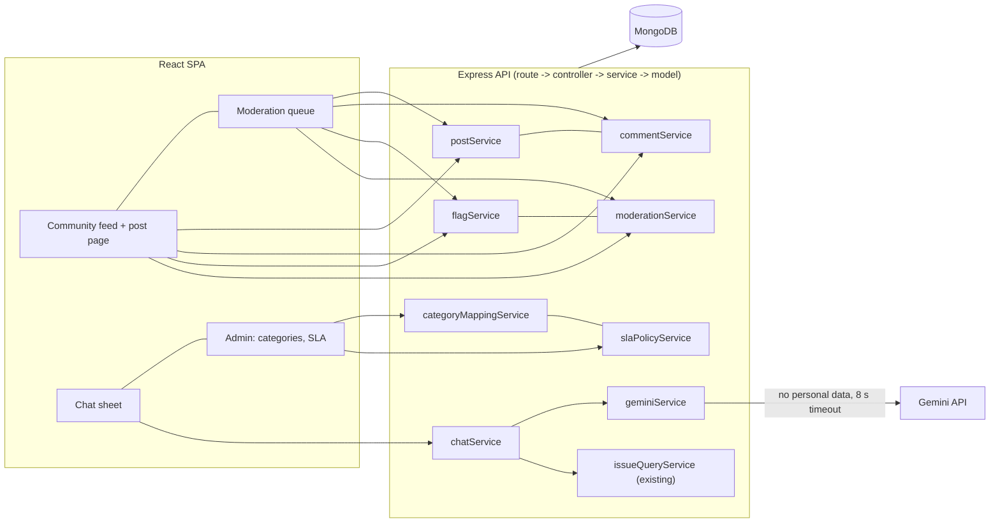

# M3: Community, chatbot and finishing the product

Goal: everything a resident, staff member and admin needs, minus infrastructure (M4). Branch:
`feat/m3-community-chat`. Common rules: `docs/prompts/m1-core-loop.md` ("Common rules"). Run with
`/step m3-community-chat.md <n>`, `/clear` between steps.

## 1. Where we are vs. where we need to be

| Area | Today (built) | Target | Gap |
|---|---|---|---|
| Report | Pincode, map pin, 3 photos, ticket, routing, waitlist | same | none |
| Track and resolve | Timeline, staff queue, state machine, hold, SLA job, in-app bell, public stats | same + email | email (decision 6) |
| Community | `Community.jsx` empty state; `post:create`, `post:moderate` permissions exist | Pincode feed, posts, 2-level comments, flags, auto-hide at 3, moderation queue | all of it |
| Chatbot | `ChatBubble` opens a "coming soon" sheet | Ticket answers from the DB, general help from Gemini, rate-limited | all of it |
| Admin | User list, role and status changes | + category to department map, SLA policy per city | 2 screens + APIs |
| Languages | English only (`i18n/en/*`) | English and Hindi (decision 5) | `hi/*.json` |
| Design and motion | UI.md tokens, motion variants, landing, wizard, queue | Same system applied to the new screens; feed and chat get the motion rules | new screens only |

Not in M3: SMS (cut), AI blog assist (DESIGN.md 6, later), regional languages, everything in M4.

## 2. HLD

Requirements and limits:
- Feed reads need sign-in (decision 7). Anyone signed in reads any pincode; posting only in your `defaultPincode`.
- Load: one district at a time, tens of posts a day. Cursor lists (max 50) on compound indexes; no cache needed.
- Chat: 20 messages per user per 10 minutes, input 1,000 chars, Gemini 8 s timeout, fallback text on any failure.
  Missing `GEMINI_API_KEY` = the general path answers with the fallback; ticket answers still work.
- Nothing from chat is stored (DESIGN.md 5 allows "don't store"). Simplest and nothing to leak.

Trade-offs taken:
- **Plain text posts, no Markdown.** React escapes text, so no `marked` + `sanitize-html`. Revisit if formatting is asked for.
- **Flags counted on the post** (`flagCount`, unique `Flag` rows per user) instead of a moderation event log;
  AuditLog already records moderator actions.
- **Ticket answers never go through Gemini.** The status text is a template from the DB, so it is always right.

## 3. LLD

### Models
- `Post`: `pincode`, `cityId` (from Pincode, for moderator scope), `authorId`, `title` 5-100, `body` 10-2000,
  `status` `published | hidden | deleted`, `flagCount`, `commentCount`, `hiddenReason`, timestamps.
  Indexes: `{pincode, status, createdAt:-1, _id:-1}` (feed), `{cityId, status, flagCount:-1, _id:-1}` (queue),
  `{authorId, createdAt:-1}` (rate limit).
- `Comment`: `postId`, `parentId` (null or a top-level comment: depth 2 max), `authorId`, `body` 1-1000,
  `status`, `flagCount`. Index `{postId, status, createdAt:1, _id:1}`.
- `Flag`: `targetType` `post | comment`, `targetId`, `userId`, `reason` enum. Unique `{targetType, targetId, userId}`.

### State machine (pure, `utils/postStateMachine.js`)
published -> hidden (3rd flag, or moderator), hidden -> published (moderator restore),
published | hidden -> deleted (author own, or moderator with reason). Deleted is final. Every moderator move
writes AuditLog in the same transaction.

### API (all Zod `.strict()`, errors in the house shape)
| Method | Path | Permission | Notes |
|---|---|---|---|
| GET | `/api/community/posts?pincode&cursor` | signed in | published only, author shown as display name |
| POST | `/api/community/posts` | `post:create` | pincode = user's `defaultPincode`, else `400 PINCODE_REQUIRED`; 5 per day |
| GET | `/api/community/posts/:id` | signed in | hidden/deleted = 404 unless moderator in scope |
| DELETE | `/api/community/posts/:id` | author | soft delete |
| GET/POST | `/api/community/posts/:id/comments` | signed in / `post:create` | depth check, `commentCount` `$inc`; 30 per hour |
| POST | `/api/community/flags` | `post:create` | idempotent per user; 3rd flag hides in one transaction |
| GET | `/api/moderation/queue?type&status` | `post:moderate` | city scope in the query |
| POST | `/api/moderation/:type/:id` `{action, reason}` | `post:moderate` | restore, hide, delete |
| POST | `/api/chat` `{message}` | signed in | `{reply, kind: "ticket" \| "list" \| "general" \| "fallback"}` |
| GET | `/api/admin/city-settings?cityId` | `user:promote` | own city (super_admin: any) |
| PUT | `/api/admin/city-settings/:category` | `user:promote` | department + hours, audited |

### Chat flow
`extractTicketIds` -> for each id, `issueQueryService` read with the asker's scope (reporter or staff in scope);
not allowed and not found answer the same. "my complaints/status" keywords -> last 5 of `GET mine`.
Else `geminiService.ask(text)` with the DESIGN.md 5 system prompt; personal data is never added.

## 4. Frontend and design

Follow `docs/UI.md` (tokens, §4 motion, §6 components, §7 patterns). Inspiration: FixMyStreet's local feed and
problem pages (ideas only), shadcn blocks for cards and threads.
- **Feed** (`/community`): pincode switcher (defaults to the user's), post cards with `fadeUp` + `stagger`,
  load more, composer in a `ResponsiveDialog`, optimistic comment count, empty state that teaches.
- **Post page** (`/community/:id`): body, threaded comments (indent one level), reply inline, flag menu.
- **Moderation** (`/moderation`): table on desktop, cards on mobile, restore / delete with reason (reuse `ReasonField`).
- **Chat**: the existing `ChatBubble` sheet becomes a conversation: message list (`aria-live`), typing dots
  (reduced-motion: static), ticket answers rendered as a mini `StatusTimeline` card with a link.
- **Admin**: category to department table with a `Select` per row; SLA hours per category.
- Every string in `en` and `hi`.

## 5. Steps

1. Backend community: models, state machine + tests, post and comment services, routes, flags, auto-hide.
2. Backend moderation queue and actions with AuditLog; API tests for scope 404s.
3. Backend chat: ticket extraction, scoped reads, Gemini service (mocked in tests), rate limit. Add `@google/genai`.
4. Backend admin: category mappings and SLA policies APIs.
5. Frontend community feed, post page, composer, flags.
6. Frontend moderation and admin screens.
7. Frontend chat conversation.
8. Hindi dictionaries; e2e: post, flag to hidden, restore, chat ticket answer.
9. Docs: API.md, DECISIONS.md (M3 rows), ARCHITECTURE BUILT tags.
Email notifications need a provider choice (decision 6); decide before M4.

Done when: `npm run check` passes, a resident posts and comments in their pincode, three flags hide a post, a
moderator restores it, and the chat answers a ticket the asker owns and refuses one they do not.
